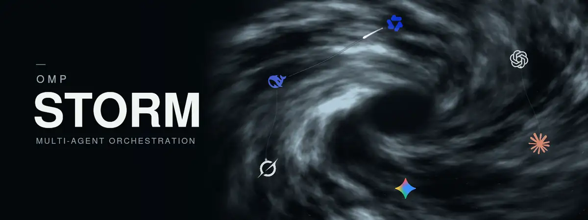
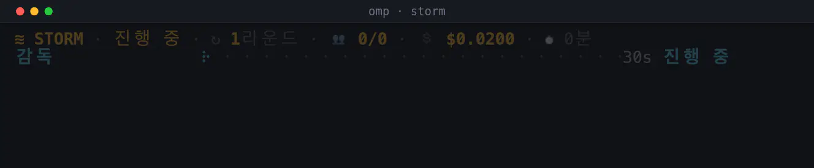

<div align="center">



<br>
<br>

**맡기면 승인한 팀이 나눠 일하고, 결과마다 근거를 보여 줍니다.**

[](https://github.com/dhkimxx/omp-storm/actions/workflows/ci.yml)
[](package.json)
[](https://github.com/can1357/oh-my-pi)
[](LICENSE)

**OMP Storm**은 [OMP](https://github.com/can1357/oh-my-pi)에서 여러 단계의 조사·실험·구현을 맡기는 플러그인입니다.<br>
승인한 팀이 일을 나눠 맡고, 요청한 결과가 어디까지 됐는지 근거와 함께 보여 줍니다.<br>
작업마다 모델이나 실행 모드를 고를 필요는 없습니다.

</div>

## 설치

OMP 19.2 이상이 필요합니다.

```sh
omp plugin install github:dhkimxx/omp-storm
```

19.0·19.1에서는 0.24.0을 쓰세요(`release/omp-19.0`). 0.25 이상을 더 오래된 OMP에 설치하면 `/storm`이 이 안내만 보여 줍니다.

## 이런 점이 다릅니다

- **팀은 한 번만 승인합니다.**<br>
  `/storm`의 추천 팀을 승인하면 끝입니다. 작업마다 모델이나 실행 모드를 고르지 않으며, 역할별 모델·effort는 승인 화면에서 바꿀 수 있고, 승인하지 않은 모델이나 더 높은 effort로는 워커가 돌지 않습니다(로그인이 끊겨 승인된 모델을 쓸 수 없으면 다른 모델로 대신 돌리지 않고 스폰하지 않습니다). 이것은 워커 자신의 요청에 대한 약속입니다. 도구가 omp의 보조 역할로 따로 부르는 모델(검색 판정, 편집 복구, 압축 등)은 사용자의 omp 설정이 고르고, Storm은 그 비용을 합계에 셉니다.

- **평소 요청이 자동으로 위임됩니다.**<br>
  자동 위임이 켜져 있으면 일반 대화는 메인이 답하고, 큰 수정이나 명령을 돌리는 작업은 팀에 넘깁니다. 메인은 읽고 검색하는 일을 직접 하고, 실행이 열린 뒤에는 한 줄 수정 같은 파일 편집도 직접 합니다(쓰는 워커와는 순서가 정해집니다). 끄고 싶으면 `/storm auto`를 씁니다.

- **결과마다 근거와 함께 추적합니다.**<br>
  계획을 내면 만들 결과를 먼저 알려 주고, 계획 없이 보낸 팀 작업은 계획 밖 활동으로 기록합니다. 결과별 상태와 근거는 `/storm status`에서 볼 수 있습니다. 실행이 끝난 것만으로 검증을 통과했다고 보지 않습니다. 격리한 구현자 여럿을 동시에 돌리면 결과는 부모 트리 밖에 보관 패치로 남고, 합치는 일은 아직 직접 합니다.

- **실행 중에 방향을 바꿉니다.**<br>
  입력창에 “UI는 빼고 API만 계속해”처럼 말하면 시작하지 않은 결과를 빼거나, 실패한 결과를 다시 시도합니다.

- **감독과 모든 레인이 실시간으로 보입니다.**<br>
  입력창 아래에 감독 줄기와 레인별 한 줄이 뜨고, 레인이 시작·제출·수용되는 모습이 움직임으로 나타납니다.

- **중단한 실행을 이어 갑니다.**<br>
  `Esc`로 멈춘 실행은 `/storm`에서 이어 갑니다. 현재 파일과 출처로 다시 확인된 결과는 유지하고, 달라진 결과와 거기에 기댄 작업만 다시 엽니다.

## 실행 화면

<div align="center">



</div>

레인 뷰를 읽는 법은 [사용 안내](docs/usage.md#실행-중-화면)에 있습니다. `/storm view`로 끄고 켭니다.

## 빠른 시작

1. OMP 터미널에서 `/storm`을 열고 추천 팀을 승인합니다.
2. `로그인 장애 원인을 조사하고 수정한 뒤 재발 여부를 확인해줘`처럼 평소대로 요청하세요. 자동 위임을 껐다면 `/storm <요청>`으로 맡깁니다.
3. 실행 중에는 레인 뷰와 `/storm status`에서 결과를 확인합니다. 끝나면 이행한 결과, 확인한 근거, 남은 일을 브리핑합니다.

팀과 자동 위임 선택은 이 **OMP 세션**에 저장됩니다. 새 세션·포크에는 물려주지 않고, 같은 세션에서 작업 트리를 바꾸면 새 대상에 대해 승인받습니다.

<details>
<summary><b>실행 중 방향 바꾸기</b></summary>

<br>

OMP 터미널의 실행 중 입력창에서 바로 요청할 수 있습니다.

- **“UI는 빼고 API만 계속해”** — 아직 시작하지 않은 독립 결과를 제외합니다. 제외 항목은 이행으로 세지 않습니다.
- **“실패한 API 검증만 다시 해”** — 끝났지만 미충족인 읽기 전용 결과의 재시도를 한 번 예약합니다. 완료된 독립 결과는 유지합니다.

대상이 모호하면 [결과 ID로 지정](docs/usage.md#결과-확인과-방향-수정)하세요. 실행 중인 워커를 강제 종료하거나 이미 반영된 변경을 되돌리지는 않습니다.

</details>

## 자주 쓰는 명령

| 명령 | 용도 |
|---|---|
| `/storm` | 팀 설정, 현황, 중단된 실행 이어 가기 |
| `/storm status` | 결과별 상태·근거와 실행 현황 보기 |
| `/storm auto` | 이 세션의 자동 위임 켜기·끄기 |
| `/storm view` | 이 세션의 실행 중 레인 뷰 켜기·끄기 |
| `/storm <요청>` | 자동 위임과 관계없이 명시적으로 요청 보내기 |

[자세한 사용법·문제 해결](docs/usage.md) · [설계·개발](docs/design.md) · [변경 기록](CHANGELOG.md)
