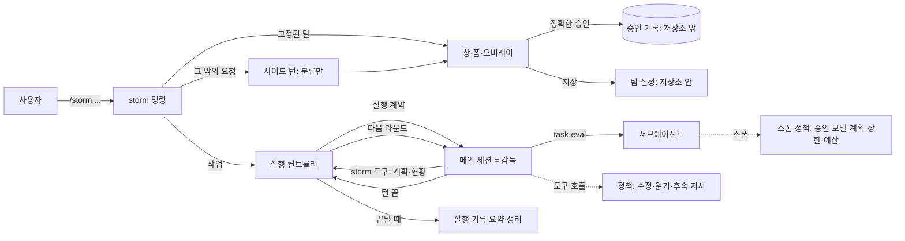

# OMP Storm 설계

- 무엇을 왜 그렇게 정했는지를 적는다. 값과 절차는 코드가 정하므로 위치만 가리킨다.
- 사용법은 [README](../README.md), 버전별 배경과 근거는 [history.md](history.md), omp 실측은 [spikes.md](spikes.md), 남은 일은 [next.md](next.md)에 있다.
- 원칙: **Storm은 후보를 조사하고 추천하지만, 팀과 그 변경은 사용자가 승인한 뒤에만 확정한다.**

## 1. 목표와 비목표

### 목표

- `/storm` 하나로 프로젝트의 멀티에이전트 팀을 고르고, 승인하고, 그 팀으로 일을 시키고, 바꾼다.
- 추천은 사용자의 omp 사용 기록과 omp 카탈로그로 계산한다. 근거가 없으면 비워 두고 추측하지 않는다.
- 승인된 팀은 실행 때 강제한다. 권고 문구가 아니라 스폰과 도구 호출을 막는 것으로 지킨다.
- 메인 세션에는 남아야 하는 것만 보낸다. 실행 계약, 라운드 메시지, 실행 결과가 전부다.

### 비목표

- 실행 엔진, 스케줄러, 병렬 실행기를 새로 만들지 않는다. 서브에이전트 실행은 omp의 `task`와 eval이 한다.
- omp Swarm Extension을 다시 만들거나 쓰지 않는다. upstream에서 삭제됐다.
- 에이전트 모니터링 화면을 다시 만들지 않는다. omp Agent Hub가 있다.
- 사용자의 omp 설정을 바꾸지 않는다. 맞지 않는 설정은 고치는 명령만 보여 준다.
- `omp gc`를 다시 만들지 않는다. Storm 실행이 만든 서브에이전트 기록만, 동의한 팀에서만 지운다.
- 승인 없는 팀 변경, 유료 측정 호출, 파괴적 명령을 하지 않는다.
- Provider의 남은 쿼터를 정확히 안다고 가정하지 않는다. 모르는 것을 무제한으로 읽지 않는다.
- 외부 런타임(Herdr, 원격 호스트, 다른 하네스)은 아직 다루지 않는다([next.md](next.md)).

## 2. 결정

"대체"가 채워진 줄은 지금은 쓰지 않는 결정이다. 버전별 배경은 [history.md](history.md)에 있다.

| 결정 | 이유 | 도입 | 대체 |
|---|---|---|---|
| 실행 엔진을 만들지 않는다. Storm은 추천, 승인, 강제, 관리만 한다 | 확장 API로는 기본 `task`를 직접 부를 수 없고, 병렬·격리·호출별 모델은 이미 `task`에 있다 | 0.1 | — |
| 팀 설정은 저장소 안에, 승인은 저장소 밖에 설정 해시별로 둔다 | 설정은 커밋해 나눌 수 있어야 하지만, 커밋된 설정이 이 사람과 이 머신의 승인은 아니다 | 0.1 | — |
| 정확한 "승인" 선택만 승인이다. 답이 없거나 취소면 미승인이다 | UI 유무로는 승인 가능 여부를 알 수 없다(P0 Q4). 답할 수 없는 환경은 저절로 미승인이 된다 | 0.1 | — |
| omp 설정을 바꾸지 않고, 승인된 팀을 스폰 훅으로 실행 때 적용한다 | 되돌리기가 단순하다. 훅은 에이전트 이름을 받고 시도 순서대로의 모델 목록을 돌려줄 수 있다(P0 Q2) | 0.1 | — |
| 역할은 플러그인의 에이전트 정의로 제공한다 | 확장 API로는 에이전트 정의를 동적으로 등록할 수 없다. 플러그인 `agents/`는 omp가 찾아 준다(P0 Q3) | 0.1 | — |
| 역할 정의를 가리는 프로젝트·사용자 파일은 승인 범위에 넣고, 승인 전에는 그 역할의 스폰을 막는다 | 프로젝트 정의가 플러그인 정의를 덮어쓰는데 스폰 훅은 정의의 출처를 모른다(P0 Q3) | 0.1 | — |
| 추천은 결정적으로 계산하고 모델에 숫자를 만들게 하지 않는다 | 이 사용자에게 가장 정확한 근거는 이 사용자의 실측이다. 카탈로그 점수는 비어 있거나 경로마다 다르다 | 0.1 | — |
| 같은 모델의 여러 경로는 계열 키로 묶고, 선호는 가격 계층별로 센다 | Provider별로 세면 많이 쓴 모델이 쪼개져 사라지고, 한 줄 순위에서는 싼 계층의 선호가 묻힌다 | 0.1 | — |
| 예산은 스폰 차단, 자체 누계 경고, omp 세션 상한 안내의 세 겹으로 지킨다 | 확장에는 비용 상한 API가 없다. 확실한 상한은 omp의 세션 상한뿐이다(P0 Q5) | 0.2 | — |
| 실행 중에는 Storm 역할이 아닌 에이전트도 승인된 모델로만 돈다. 승인 밖 요청은 맞는 역할이나 대체 역할의 모델로 바꾼다 | 막기만 하면 omp 기본 에이전트를 쓰는 흐름이 깨진다. 실행 밖 세션에는 관여하지 않는다 | 0.2 | — |
| 시험 사용으로 빠진 지표를 잰다. 예산은 시험으로 보낸 서브에이전트의 지출만 센다 | 지표가 없는 모델은 써 봐야 안다. 후보 모델의 모든 요청을 세면 시험이 몇 분 만에 예산으로 끝난다 | 0.2 | — |
| 실행 동안 메인 세션은 감독이다. 파일 수정 도구 호출을 막고 도구 목록은 바꾸지 않는다 | 메인이 직접 읽고 고치면 비용이 메인에 몰린다. 도구 목록을 바꾸면 큰 맥락의 프롬프트 캐시를 다시 쓴다 | 0.5 | — |
| 한 번 보는 화면은 오버레이, 고르는 창은 위 패널에 띄우고 대화 기록에는 실행 결과만 남긴다 | 현황과 승인 내용이 대화 기록과 모델 맥락을 채우지 않게 한다 | 0.6 | — |
| 쓰지 않는 역할은 스폰을 막고, 팀 설정에 아예 없는 역할은 가까운 역할의 모델을 빌린다 | 사용자가 일부러 뺀 역할을 다른 모델로 몰래 돌리지 않는다. 예전 설정은 그대로 돌아야 한다 | 0.7 | — |
| 팀 설정은 범위, 실행 계획은 값이다. 계획 없이는 스폰하지 않고, 범위 밖 계획은 승인을 거친다 | 권고는 무시됐다. 범위는 이미 승인했으므로 그 안의 값은 다시 묻지 않는다 | 0.8 | — |
| 감독 맥락이 상한을 넘으면 서브에이전트를 기다리는 동안 압축하고, 모든 압축에 Storm이 아는 실행 상태를 얹는다 | 맥락을 행동마다 끊지 않는다. 요약은 감독의 기억이 아니라 Storm이 아는 사실로 만든다 | 0.9 | — |
| 실행이 끝날 때 Storm 코드가 정리한다. omp 기록은 동의한 팀에서, 이 머신이 남긴 실행 목록에 있는 것만 지운다 | 지울 대상은 판단이 아니라 기록으로 정해진다. 저장소 안 기록은 누구나 커밋할 수 있어 지울 위치의 근거가 못 된다 | 0.9 | — |
| 초기화해도 Storm 실행 목록은 남긴다 | 그 목록이 없으면 지난 실행의 omp 기록이 Storm 것임을 증명할 수 없어 영영 정리하지 못한다 | 0.10 | — |
| 문서 규칙은 지킬 수 있는 역할에만 준다: 쓰는 역할에는 쓰기 규칙, 리뷰에는 검사, 읽기 전용 역할과 감독에는 한 줄 | 문서가 코드를 옮겨 적으면 커지고 낡는데, 감독은 실행마다 그 문서를 다시 읽는다 | 0.9 | — |
| 실행 계약에 omp 키워드를 쓰지 않는다 | 키워드 notice는 감독에게 직접 탐색하고 직접 고치라고 한다. Storm이 막는 일과 반대다 | 0.10 | — |
| 실행 방식은 셋(자유·목표·반복)이고, 방식은 실행이 끝나는 때만 정한다. 목표와 반복은 omp 모드로 들어간다 | 팀, 감독 규칙, 계획, 상한, 예산은 어느 방식에서나 같아야 한다 | 0.10 | 0.11: 실행 하나, 방식 없음 |
| omp vibe 모드에는 들어가지 않는다 | 감독의 도구가 바뀌어 `task`와 `storm` 도구가 사라지고, 워커 스폰은 스폰 훅을 거치지 않는다(M0). 팀과 계획을 강제할 길이 없다 | 0.10 | — |
| 팀 설정은 모델 없이 Storm의 창과 폼으로 한다 | Storm이 계산한 팀을 모델이 되묻는 데 메인 턴과 맥락을 썼고, 사용자는 추천을 그대로 받았다 | 0.10 | — |
| `/storm <요청>`은 사이드 턴 한 번으로 분류하고 Storm이 실행한다. 메인 세션에는 작업만 들어간다 | 조회와 변경이 메인 대화에 남을 이유가 없다. 분류 결과는 Storm이 검증하고, 작업 내용은 사용자의 글을 그대로 쓴다 | 0.10 | — |
| 메인 세션의 도구는 실행 예약, 계획, 현황, 서브에이전트 조회만 한다. 팀 변경은 사용자가 `/storm`으로 한다 | 도구 설명은 요청마다 실린다. 모델이 팀을 바꿀 길을 없애면 승인 우회 경로도 없어진다 | 0.10 | — |
| 지금 팀 설정이 승인된 상태에서만 변경을 받는다 | 변경 창은 차이만 보여 준다. 승인되지 않은 파일 위의 작은 변경을 승인하면 보지 못한 나머지까지 승인된다 | 0.10 | — |
| 승인 창은 해시가 덮는 것을 모두, 동의가 필요한 것부터 보여 준다. 잘린 창에서는 전체 내용을 연 뒤에만 승인할 수 있다 | 알 수 없는 필드, 역할의 에이전트 이름, 쓸 수 없는 모델도 승인 대상이다. 작은 터미널은 패널을 끝에서부터 자른다 | 0.10 | — |
| 팀 설정의 글자는 제어 문자를 보이게 바꿔 보여 주고, 그런 글자가 든 설정은 오류로 본다 | 승인되지 않은 파일의 글자가 승인 창에 그대로 나오면 줄을 지어내거나 가릴 수 있다 | 0.10 | — |
| 분류기는 셸 명령을 줄 수 없다. 쿼터 표시처럼 비싼 선택은 사용자가 한 번 확인한다 | 분류기는 대화 전체를 읽고, 거기에는 끼어든 글도 있다 | 0.10 | — |
| 상한은 둘이다. 후속 지시 상한은 팀과 역할의 상한만 보고, 감독 압축 상한은 창의 비율도 본다 | 창 비율은 싼 작은 창 모델만 묶었다. omp가 그런 에이전트를 스스로 압축하고, 이 상한은 비용 때문에 있다 | 0.10 | — |
| 감독의 읽기는 요청한 줄 수로 막는다. 서브에이전트가 읽은 파일을 넓은 범위로 읽을 때만 막는다 | 막힌 읽기도 감독 요청 하나의 값이다. 범위 없는 읽기는 omp가 한 쪽씩 끊어 주므로 넓지 않다 | 0.10 | — |
| 계열마다 품질 점수는 하나다. 경로마다 값이 다르면 근사로 표시하고 그만큼 넓게 같은 등급으로 본다 | 카탈로그 점수는 같은 모델의 경로 사이에서도 크게 다르다. 그 차이로 순위를 가르면 잡음이 결정한다 | 0.10 | — |
| 써서 검증된 계열과 경로를 먼저 둔다. 폴백도 다른 Provider의 검증된 경로에서 고른다 | 한 번도 안 쓴 경로가 수천 번 쓴 경로를 이겼다. 다만 검증은 카탈로그의 큰 차이까지 뒤집지는 않는다 | 0.10 | — |
| 쿼터 소진은 일시적이다. 소진된 Provider도 후보로 남기고 뒤로 보낸다 | 잠깐의 상태가 오래 쓸 팀에서 Provider 전체를 빼면 안 된다 | 0.10 | — |
| 읽는 곳이 없는 데이터는 쓰지 않는다. 승인 저장소에는 승인 기록, 승인한 설정 사본, 실행 목록만 둔다 | 근거 파일, 로그, 저장소 정보는 쓰기만 하고 읽지 않았고, 매번 git 호출까지 썼다 | 0.10 | — |
| 막을 때는 고정된 코드와 대신 할 일을 함께 준다. 스폰 판단이 실패하면 막는다 | 규칙은 막힌 이유로 가르친다. 판단 실패를 통과시키면 omp가 승인 밖 모델로 기록 없이 돌린다 | 0.10 | — |
| 예전 팀 설정과 승인 기록은 그대로 읽는다. Storm은 사용자의 파일을 고쳐 쓰지 않는다 | 승인된 파일을 바꾸면 해시가 달라져 다시 승인해야 한다. 안 쓰는 필드는 받고 무시한다 | 0.10 | — |
| 버전은 `package.json` 하나에서 읽는다 | 손으로 맞추는 사본이 어긋나면 새 버전 알림이 틀린다 | 0.10 | — |
| 실행은 하나이고 방식이 없다. `/storm <작업>`은 바로 시작한다 | 실행마다 방식을 고르는 것이 사용자의 병목이다. 모델이 대신 고르면 확인을 거쳐야 해 같은 병목이 된다 | 0.11 | — |
| 완료는 코드가 근거로 판정한다: 팀이 바꾼 파일과 마지막 쓴 사람의 변경 뒤의 `correct` 판정 | 모델의 완료 선언은 검증이 아니다. 파일 변경과 리뷰 판정은 Storm이 실행 중에 모은 서브에이전트 기록에서 읽을 수 있다 | 0.11 | — |
| Storm이 라운드를 직접 보낸다. omp의 목표·반복 모드에 들어가지 않는다 | 두 모드는 함께 켤 수 없고 TUI에서만 되며, 목표의 완료는 스스로 선언한 것이다. 판정과 한도를 Storm이 쥐어야 한다 | 0.11 | — |
| 실행별 조건(`--until`)을 두지 않는다 | 실행마다 조건을 고르는 것이 같은 병목이다. 검증은 리뷰어가 명령을 돌려 한다. 프로젝트 검사 명령이 필요해지면 승인된 팀 설정에 둔다 | 0.11 | — |
| 단순 작업 역할의 파일 변경은 리뷰 대상에서 뺀다 | 그 역할은 기계적 수정과 수집에 쓴다. 리뷰를 붙이면 그 일이 매번 되돌아와 역할을 나눈 뜻이 없어진다 | 0.11 | — |
| 리뷰는 이 실행에서 파일을 바꾸지 않은, 구현·단순 작업이 아닌 에이전트의 판정만 센다 | 쓴 에이전트가 자기 변경을 통과시키면 검증이 아니다 | 0.11 | — |
| 라운드 한도는 요청 문장, 없으면 팀 설정 `rounds`(기본 3)다 | 실행마다 옵션을 붙이는 대신 사용자가 이미 쓴 말에서 읽는다. 팀이 기본값을 정할 수 있다 | 0.11 | — |
| 완료는 리뷰가 통과했을 때만이고, 검증 없이 끝난 실행은 끝남, 일찍 끝난 실행은 중단으로 적는다 | 끝난 실행을 목표를 이룬 실행으로 보이게 하면 Storm이 모르는 것을 안다고 말하게 된다. 끝남은 실행이 끝났지만 검증이 없다는 뜻이다 | 0.12 | — |
| 작업 트리는 실행이 시작한 커밋과 비교한다. 실행 뒤에 생긴 새 파일은 커밋 여부와 상관없이 내용으로 비교한다. Storm은 저장소에 쓰지 않고 git의 색인 잠금도 잡지 않는다 | HEAD와 비교하면 팀이 실행 중에 커밋한 순간 변경이 사라져 검증 없이 완료된다. 새 파일을 이름으로만 보면 커밋이 변경처럼 보인다 | 0.12 | — |
| 리뷰가 통과한 뒤 파일이 바뀌었으면 그 뒤에 판정자 말고 다른 서브에이전트가 활동했는지 본다. 활동이 있었으면 항상 다시 리뷰하고, 그런 활동이 없었던 변경만 실행마다 한 번 더 리뷰한다 | 한 번의 면제가 이후 팀 변경까지 통과시켰다. 리뷰 뒤 팀이 움직였는지로 면제 여부를 가른다 | 0.12 | — |
| 진전은 팀이 한 일(파일 변경, 리뷰 판정, 서브에이전트 요청)로 판단한다 | 빌드 산출물이나 사용자의 수정이 라운드를 진전으로 보이게 했다. 팀이 아무것도 하지 않은 라운드는 멈춘다 | 0.12 | — |
| 이어 가기는 이 기기가 시작한 실행만 제안하고, 기록의 요청과 계획, 지금 작업 트리, 이전 한도와 덧붙인 말로 새 실행을 시작한다 | 저장소에 들어 있는 실행 기록은 누구나 만들 수 있어 요청과 끝난 이유를 믿을 수 없다. 이전 실행의 서브에이전트와 대화는 세션과 함께 사라진다 | 0.12 | — |
| 실행 중에는 상태줄 한 줄에 라운드, 서브에이전트, 지출, 시간을 보인다 | 사용자는 기다리는 동안 얼마나 왔고 얼마나 썼는지만 알면 된다. 모니터링 화면은 omp Agent Hub가 이미 있고, 다시 만들면 유지할 것이 늘어난다 | 0.12 | — |
| `/storm <자연어>`를 메인 세션 모델이 해석하고 도구로 변경을 제안한다 | 한 인터페이스에서 작업과 관리를 모두 받는다 | 0.2 | 0.10: 사이드 턴 분류 |
| 실행 계약을 `workflowz`·`orchestrate` 키워드로 시작한다 | omp의 다중 에이전트 안내를 그대로 쓴다 | 0.2 | 0.10: 키워드 없음 |
| 승인 창에 답이 없으면 변경 제안을 보류해 둔다 | UI가 없는 환경에서 받은 요청을 나중에 승인한다 | 0.2 | 0.10: 보류 없음. 답이 없으면 취소다 |
| 사용 기록을 일 단위로 따로 쌓아 둔다 | `omp gc`가 오래된 행을 지워도 분석을 잇는다 | 0.1 | 0.10: 없앰. 분석 창이 gc 보존 기간 안이라 쓰인 적이 없다 |
| 팀 설정 인터뷰를 세션 모델이 진행한다 | 질문을 상황에 맞게 한다 | 0.6 | 0.10: 모델 없는 설정 |
| 스킬로 Storm 사용법을 모델에 알린다 | 도구와 계약의 규칙을 한곳에 설명한다 | 0.1 | 0.10: 없앰. 규칙은 실행 계약과 막힌 이유가 전한다 |
| 실행을 시작할 때 감독 맥락이 크면 압축할지 묻는다 | 큰 맥락이 감독 요청마다 다시 실린다 | 0.8 | 0.10: 묻지 않고 먼저 압축 |
| 후속 지시 상한에 창의 비율을 함께 쓴다 | 작은 창 모델이 넘치지 않게 한다 | 0.8 | 0.10: 상한 둘 |
| 감독이 서브에이전트가 통째로 읽은 파일을 통째로 읽으면 막는다 | 감독의 중복 읽기를 줄인다 | 0.9 | 0.10: 크기로 판단 |
| 우선순위에 속도와 쿼터를 둔다 | 사용자 성향을 추천에 반영한다 | 0.1 | 0.10: 균형·품질·비용만. 실제 데이터에서 결과가 같았다 |

### 외부 리뷰에서 채택하지 않은 제안

| 제안 | 채택하지 않은 이유 | 근거 |
|---|---|---|
| 감독이 파일을 직접 고치게 한다 | 메인이 직접 고치면 비용이 메인에 몰리고 팀의 승인 모델과 리뷰를 거치지 않는다. 위임을 막는 규칙이 그 비용을 줄이려고 있다 | 0.5 실행: 2시간 20분 $54.09 가운데 메인이 89%($48.10). 0.8 실행: 34분 $6.78 가운데 메인이 62%($4.23) |
| 큰 재읽기를 막지 않고 경고만 한다 | 경고로 바꾸면 같은 파일을 다시 읽는 비용이 그대로 남는다 | 0.8 실행: 감독이 읽은 46.6만 자의 65%가 서브에이전트도 읽은 파일이었다 |
| 승인 없이 워커 상한을 늘린다 | 상한은 사용자가 승인한 범위다. 감독이 그 범위를 스스로 넘으면 예전 실행에서 본 컨텍스트와 비용 증가가 다시 온다 | 0.7 실행: 6시간 $83.60, 구현 1,126요청·평균 컨텍스트 약 23만($36.96), 리뷰 최대 849k($16.83). 감독이 새 에이전트 권장을 6번 무시했다 |
| 모델 능력 레지스트리를 둔다 | 손으로 채운 능력 값은 카탈로그의 빈틈을 메우지 못하고 낡는다. Storm은 사용 기록과 있는 지표만 쓴다 | 카탈로그 실측: 인증 모델 100개 중 지능 점수 19개, 속도 0개. 카탈로그 11,984행은 4,042개로 중복 |

## 3. 구조

- **스케줄링은 메인 세션이 한다.** Storm은 별도 스케줄러 없이, 승인 범위를 넘는 스폰과 호출만 막는다.
- **상태는 프로세스에서 공유한다.** 서브에이전트 세션도 같은 확장 모듈을 불러오므로, 계획과 살아 있는 에이전트 수를 같은 프로세스의 상태에서 본다.
- **스폰 판단은 저장소별로 차례로 한다.** 한꺼번에 띄워도 앞선 허용이 다음 판단에 잡힌다.

| 맡은 일 | 코드 |
|---|---|
| omp 이벤트 연결, `/storm` 명령 | `src/extension.ts` |
| 요청 분류와 팀 변경 | `src/request/` |
| 설정, 승인, 되돌리기, 초기화 흐름과 화면 | `src/flows.ts`, `src/setup/`, `src/view/`, `src/ui.ts` |
| 제안에서 승인·저장까지의 한 경로 | `src/proposals/decide.ts` |
| 승인 저장소, 저장소 식별, 가림 정의 | `src/approval/` |
| 팀 설정 형식, 검증, 해시 | `src/config/` |
| 스폰과 도구 호출 판단 | `src/policy/` |
| 실행 수명, 라운드 판정, 서브에이전트 상태, 실행 기록, 정리 | `src/runtime/` |
| 실행 계획 검증 | `src/plan/` |
| 사용 기록, 계열 키, 가격 계층, 추천 순위 | `src/history/`, `src/lineage/`, `src/analysis/`, `src/recommend/` |
| 메인 세션의 도구 | `src/tool/` |
| 역할과 그 기본값 | `src/roles.ts`, `agents/` |

### omp에 맡기는 것

| 영역 | omp 기능 | Storm이 하는 일 |
|---|---|---|
| 서브에이전트 실행, 병렬, 격리 | `task`, eval `agent()` | 쓰기만 한다 |
| 모니터링과 조종 | Agent Hub | 다시 만들지 않는다. 현황은 승인 범위 대비 요약만 |
| 목표와 반복 | 세션 모드(goal, loop) | 쓰지 않는다. 완료 판정과 다음 라운드는 Storm이 정한다 |
| 턴 도중 모델 폴백 | `retry.fallbackChains` | 바꾸지 않는다. 맞는 체인을 만드는 명령을 보여 준다 |
| 확실한 비용 상한 | 세션 비용 상한 | 쓰기를 권한다 |
| 쉬는 세션 전체의 보관과 정리 | `omp gc` | 다시 만들지 않는다 |
| 사용 통계 | `omp stats`와 그 DB | 읽기 전용으로 읽고, 늦었으면 `omp stats --summary`로 갱신한다 |

### omp 내부에 기대는 곳

공개 확장 API 밖의 것은 omp 업데이트로 조용히 깨질 수 있다. 기대는 곳은 다음뿐이고, 각각 깨졌을 때 안전한 쪽으로 넘어간다.

- **사용 통계 DB:** 읽기 전용으로 열고 필요한 열이 있는지 검사한다(`src/history/stats.ts`). 없으면 사용 기록 없이 추천한다.
- **세션 기록의 파일 배치:** 정리가 서브에이전트 기록을 찾는 데 쓴다(`src/runtime/janitor.ts`). 모양이 다르면 지우지 않는다.
- **읽기 도구의 쪽 크기:** 범위 없는 읽기를 omp의 한 쪽으로 센다(`src/policy/reads.ts`). 사용자가 쪽 크기를 올렸으면 실제보다 적게 세어 덜 막는다.
- **TUI 프레임 부품:** Storm 화면의 틀에 쓴다(`src/ui.ts`).

## 4. 추천

- **데이터:** 최근 사용 기록(부가 호출 제외, 메인과 서브에이전트 구분), omp 모델 레지스트리, `omp usage`의 쿼터, 사전값(`priors/priors.yml`).
- **사전값의 범위:** 이름 해석 어휘, 등급 순서, 가격 계층 경계, 출처 있는 alias와 품질 값만 둔다. 카탈로그 점수를 보정하지 않는다.
- **계열 키:** 같은 모델의 여러 경로를 `class/등급@revision`으로 묶는다. 애매하면 묶지 않는다. 규칙은 `src/lineage/key.ts`.
- **가격 계층:** 계열의 기준 요청 비용으로 나눈다. 역할마다 맞는 계층이 있고, 우선순위가 한 칸 옮긴다. 규칙은 `src/lineage/price.ts`.
- **품질:** 계열의 경로 값들의 중앙값 하나를 쓴다. 규칙은 `src/lineage/metrics.ts`의 머리 주석이 정한다.
- **순위:** 어느 기준을 어느 순서로 보는지는 `src/recommend/recommend.ts`의 `recommend` 주석이 정한다.
  - 가격 계층에서의 거리, 리뷰와 구현의 계열 분리, 품질 등급, 사용자의 검증, 그다음이 비용·사용 비중·쿼터·경로다.
  - 검증은 균형·비용 우선순위에서 카탈로그의 작은 우위보다 앞서고, 품질 우선순위에서는 동점만 가른다.
- **폴백:** 주 모델이 실패할 때 돌아야 하므로 다른 Provider의 다른 계열에서 고른다. 검증된 계열에서 실제 쓴 경로, 써 본 경로, 그 밖의 순서다.
- **이유를 남긴다:** 후보마다 고른 이유와, 위 후보에 밀린 이유를 붙인다. 모델 점검도 같은 순위에서 만든다.
- **결측:** 지표가 없으면 0점으로 치지 않고 비워 둔다. 사용자가 직접 고른 모델도 쓸 수 있는지 검사하고, 창이 작으면 경고한다.

## 5. 승인과 적용

- **승인 단위:** 엄격하게 읽은 팀 설정을 정규화(JCS)한 해시다. 서식만 바뀌면 같은 해시이고, 모델 순서가 바뀌면 다른 해시다(`src/config/canonical.ts`).
- **엄격한 읽기:** 중복 키 같은 모호한 입력은 설정 오류로 거부한다. 알 수 없는 필드는 경고하되 해시에 들어간다.
- **한 경로:** 설정, 변경, 계획의 범위 변경 모두 검증 → 창 → 정확한 승인 → 그 사이 바뀌지 않았는지 확인 → 승인 기록 → 설정 저장 순서를 탄다.
- **직접 고친 파일:** 그대로 승인한다. Storm은 그 파일을 고쳐 쓰지 않는다.
- **되돌리기:** 예전에 승인한 설정 사본을 다시 쓴다. 그 승인 기록이 남아 있으므로 새로 승인하지 않는다.
- **승인이 필요 없는 것:** 쿼터 소진 표시(승인된 모델의 순서만 바꾼다), 끝난 시험에서 "지금 모델 유지"(새 모델이 들어오지 않는다).
- **기본값 표시:** 설정에 없는 값은 승인 창에 기본값으로 보인다. `rounds`는 `기본(3)`이다.
- **적용:** 스폰 훅이 역할의 승인된 모델 목록을 돌려주고, 실행 계약이 팀과 규칙을 감독에게 알린다. omp 설정과 메인 세션 모델은 그대로다.
- **저장소 식별:** git 공통 디렉터리의 해시다. worktree는 승인을 공유하고, 별도 클론과 fork는 따로 승인한다(`src/approval/repo.ts`).
  - 저장소를 옮기면 다시 승인해야 한다.
  - remote URL은 자격 증명이 섞일 수 있어 쓰지 않는다.

## 6. 실행

- **시작:** 팀 확인 → omp 모드 전제 확인 → 큰 맥락 압축 → 실행 시점의 커밋을 정하고 그 커밋과의 작업 트리 기록 → 실행 계약 전송 순이다(`src/runtime/controller.ts`).
  - omp goal이 `active`이거나 loop가 `inactive`가 아니면 시작하지 않는다. omp vibe가 켜져 있으면 끄고 시작할지 묻는다.
  - 명령에서는 바로, 도구에서 예약한 실행은 그 턴이 끝난 뒤 시작한다. 도구 호출 중에는 메인 세션이 아직 응답 중이다.
  - omp의 이벤트 처리 시간 한도 안에서 압축을 기다리지 않도록, 예약된 시작은 처리기에서 떼어 낸다.
  - 이어 가는 실행은 작업 트리마다 남긴 이 기기의 표시가 맞는 실행만 시작하고, 실행 계약에 이전 실행의 id·끝난 이유·라운드·계획과 사용자가 덧붙인 말을 넣는다.
- **라운드:** 메인 세션이 한 번 일하고 멈출 때까지를 한 라운드로 센다. omp의 자동 이어 가기도 기다리는 비동기 작업도 없는 `agent_end`마다 끝나고, 기록의 턴 수가 라운드 수다.
- **판정:** 라운드가 끝날 때 Storm 코드가 정한다(`src/runtime/rounds.ts`).
  - 앞서 정한 끝(예산 중단)이 서 있다. Esc로 턴을 중단했거나 서브에이전트를 기다리다 멈췄으면 `interrupted`다.
  - 변경은 이 실행의 서브에이전트가 수정 도구로 바꾼 파일과, 실행이 시작한 커밋과 지금 작업 트리의 차이다. 팀이 실행 중에 커밋한 변경도 이 차이에 남고, 실행 뒤에 생긴 새 파일은 커밋 여부와 상관없이 내용으로 비교한다.
  - 팀이 바꾼 것이 없고 시작 커밋과 작업 트리가 같으면 `no-changes`, 단순 작업 역할만 바꿨고 이 실행에 구현 역할이나 역할 없는 에이전트가 없으면 `unreviewed`, 리뷰가 필요한 변경이 있는데 쓸 수 있는 리뷰 역할이 없으면 `no-reviewer`로 끝난다.
  - 이 실행에서 파일을 바꾸지 않은, 구현·단순 작업이 아닌 에이전트의 판정만 센다. 그 판정이 단순 작업 역할을 뺀 마지막 수정 도구 변경 뒤에 났고 `correct`면 통과(`verified`)다.
  - 리뷰가 통과한 뒤 파일이 바뀌었고 그 뒤에 판정자 말고 다른 서브에이전트가 활동했으면 팀이 바꿨을 수 있어 항상 다시 리뷰한다.
  - 판정자 말고 다른 서브에이전트가 활동하지 않았던 작업 트리 변경은 실행마다 한 번 더 리뷰한다. 그 뒤에 난 판정은 작업 트리가 또 바뀌어도 유지된다.
  - 단순 작업 역할을 뺀 수정 도구 변경은 그 뒤에 항상 리뷰가 필요하다.
  - 판정이 없거나, 쓴 사람이 있으면 그 마지막 변경과 같거나 그 전이거나, 판정 뒤에 판정자 말고 다른 서브에이전트가 활동했거나, 그런 활동 없이 작업 트리가 바뀌었고 아직 한 번 더 리뷰하지 않았거나, `incorrect`면 검증되지 않은 것이다.
  - 검증되지 않았으면 예산 초과(`budget`), 남은 라운드 없음(`round-limit`), 시간 한도(`time-limit`), 지난 라운드의 진전 없음(`no-progress`) 순으로 끝낼 이유를 보고, 없으면 다음 라운드를 보낸다.
- **진전:** Storm이 보낸 라운드의 표시는 파일 변경 수, 리뷰 판정 수, 서브에이전트 요청 수다. 셋 다 그대로면 그 라운드는 진전이 없다.
- **다음 라운드:** Storm이 라운드 메시지를 메인 세션에 보낸다. 왜 보내는지, 어떤 리뷰어가 확인해야 하는지, 마지막 라운드인지가 들어간다(`buildRoundMessage`).
  - 세션이 바쁘거나, 보낼 메시지가 밀려 있거나, plan 모드이거나, 사용자가 입력 중이면 기다린다. 기다리는 동안은 라운드가 아니다.
  - 보낼 수 없으면 진전 없음으로 끝낸다.
- **한도:** 라운드 상한은 요청 문장의 라운드 수, 없으면 `1 + 팀 설정 rounds`(기본 3)다. 시작할 때 고정한다. `rounds`가 0이거나 요청이 1라운드면 검증이 안 된 변경은 첫 라운드에서 `round-limit`으로 끝난다. 시간 한도는 요청 문장의 분이며 라운드 사이에서만 본다.
  - 예산을 넘었으면 다음 라운드를 보내도 새 스폰이 막히거나 실행이 멈춰 검증할 수 없으므로 끝낸다.
- **끝:** 판정이 끝내면 실행 기록을 쓰고 결과를 남긴다. 리뷰가 통과한 실행만 `done`이고, 검증 없이 끝난 세 이유는 `ended`, 나머지는 `stopped`다. 예산을 넘은 실행의 상태는 이유와 상관없이 `budget-exceeded`로 남는다. 대화가 바뀌면(`/new`, `/resume`, 포크) 세션 종료로 끝낸다. 실행 기록을 쓰지 못하거나 실행 계약을 보내지 못하면 시작 실패로 끝낸다.
- **상태줄:** 실행 중에는 라운드, 서브에이전트 수, 지출, 지난 시간을 한 줄로 보인다. 실행이 끝나면 평소 상태줄로 돌아가고, 이어 갈 실행이 있으면 그 사실을 붙인다.
- **알려진 한계:**
  - git 저장소가 아니거나 커밋이 없으면 셸로 바꾼 파일을 보지 못한다. 수정 도구로 바꾼 파일만 센다.
  - 작업 트리를 읽지 못하면 변경이 있을 수 있다고 본다. 아직 판정이 없으면 변경 없음으로 끝내지 않고, 리뷰가 필요한 팀에서는 리뷰를 한 번 요청한다.
  - 읽기만 하는 실행이 커버리지·로그 같은 새 파일을 만들거나 추적되는 파일을 다시 쓰면 리뷰가 필요한 팀에서는 리뷰 라운드가 한 번 붙는다.
  - 하위 모듈 안의 내용은 비교하지 않는다.
  - 격리 팀은 다른 작업 트리에서 일한다. 변경이 메인 작업 트리에 들어오기 전까지는 수정 도구로 바꾼 파일만 센다.
- **이어 가기:** 그 작업 트리의 마지막 실행이 이 기기가 시작했고, 상태가 중단이나 예산 초과이고, 끝난 이유가 없거나 중단 쪽이며 시작 실패가 아니고, 요청이 남아 있으면 제안한다. 프로세스가 죽은 실행은 다음 세션을 열 때 중단으로 바꾼 뒤 제안하고, 리뷰를 통과한 실행은 예산을 넘었어도 제안하지 않는다.
  - 작업 트리마다 남긴 이 기기의 표시와 요청 해시가 맞는 실행만 제안한다. 저장소에 들어 있는 실행 기록만으로는 제안하지 않는다.
  - 이어 가는 실행은 지금 작업 트리와 커밋된 변경, 이전 기록의 요청·계획, 이전 라운드·시간 한도로 시작한다. 사용자가 요청에 덧붙인 말과 20,000자에 닿으면 잘렸다는 안내도 인계에 넣는다.
- **실행 계약:** 작업, 팀, 강제하지 않는 규칙 몇 줄만 담는다. 강제하는 규칙은 막힌 이유가 가르치므로 계약에는 한 구절씩만 둔다(`buildHandoff`).
  - 리뷰 역할이 있으면 마지막 변경 뒤의 `correct` 판정이 필요하고 최대 몇 라운드인지 한 줄로 적는다.
  - 이어 가는 실행이면 작업과 규칙 사이에 이전 실행의 id, 끝난 이유, 라운드, 계획을 넣는다. 이전 계획이 이상하면 계획 부분만 뺀다.
- **강제의 순서:** 스폰은 `src/policy/spawn.ts`의 `decideSpawn`, 감독의 도구 호출은 `src/policy/toolcall.ts`의 `decideToolCall`이 정한다.
- **실행 계획:** 레인마다 역할이 정해지고, 워커 수를 안 적으면 레인 수를 승인된 범위 안으로 맞춘다(`src/plan/validate.ts`).
- **실행 기록:** 실행 중에도 고쳐 쓴다. 프로세스가 죽어도 그때까지의 비용과 스폰이 남고, 다음 세션 시작이나 다음 실행의 정리가 그것을 중단으로 표시한다. 기록은 요청 전문(20,000자까지), 라운드 한도, 이어 가는 실행이면 이전 실행의 id를 남긴다. 이 기기가 시작한 실행은 이어 가기 표시를 저장소 밖 승인 폴더에 남기고, 표시를 쓰지 못해도 실행은 계속된다.

## 7. 저장과 수명

무엇이 어디에 얼마나 남는지는 [README의 저장 데이터](../README.md#저장-데이터) 표에 있다. 원칙은 다음과 같다.

- **한도 없는 저장소를 만들지 않는다.** 모든 저장소는 개수나 기간 한도를 가진다.
- **읽는 곳이 없으면 쓰지 않는다.**
- **원문은 요청만 남긴다.** 이어 가기가 그 글로 시작하므로 실행 기록은 요청을 20,000자까지 보관한다. 그 밖의 원문은 omp 세션에 이미 있으므로 위치와 수치만 남긴다.
- **이어 가기의 근거는 그 작업 트리의 마지막 실행 기록과 이 기기의 표시다.** 표시는 저장소 밖 승인 폴더의 `resume-<작업 트리 해시>.json`에 두고 실행 id와 요청 해시를 담는다. 표시가 없거나 요청 해시가 다르면 제안하지 않고, 0.11까지의 기록에는 요청 전문이 없다.
- **초기화는 그 작업 트리의 이어 가기 표시를 지운다.** 실행 기록이 저장소에 남아 있어도 이 작업 트리에서는 다시 제안하지 않는다.
- **원본은 짧게, 요약은 오래.** 실행이 끝나면 비교에 쓸 요약을 색인에 남기고, 원본 실행 기록은 한도에 따라 지운다.
- **정리는 실행 단위로 한다.** 실행이 끝나는 때가 그 실행의 데이터가 더는 쓰이지 않는 첫 시점이다. 직전 실행 몇 개는 남긴다.
- **소유와 동의로 지운다.** Storm이 만든 데이터는 Storm이 한도로 줄인다. omp 기록은 팀이 정리를 승인했을 때만 지운다.
- **지울 위치는 이 머신이 남긴 목록에서만 고른다.** 그 경로도 omp 세션 폴더 아래이고 세션 기록이 옆에 있을 때만 받는다.
- **살아 있는 것은 지우지 않는다.** 메모리에 있는 서브에이전트의 기록을 지우면 그 뒤 기록이 사라진다(B0). 보관된 것만 지우고 결과는 남긴다.
- **저장소 안에는** 커밋할 수 있는 팀 설정과 커밋하지 않는 상태만 둔다. `.omp/storm/` 밖의 `.omp/`에는 쓰지 않는다. omp는 `.omp/storm/`을 읽지 않는다(P0 Q7).
- **승인은 omp 프로필별로** 따로 관리된다.

## 8. 보안과 안전

1. 팀 설정의 변경은 사용자가 창에서 확정한다. 모델은 승인할 수 없고, 메인 세션의 도구에는 팀을 바꾸는 동작이 없다.
2. 실행 계획이 승인 범위를 넘을 때만 도구가 변경 창을 띄운다. 저장소 내용에 숨은 지시가 할 수 있는 최대는 그 창을 띄우는 것이다.
3. 승인 기록은 저장소 밖에 둔다. 저장소의 팀 설정은 승인 해시와 맞을 때만 쓰인다.
4. Storm 역할 에이전트는 실행 안팎에서 승인된 팀으로만 스폰된다. 다른 에이전트는 실행 중에만 승인된 모델로 제한한다.
5. 역할 정의를 가리는 파일은 승인 범위에 들어가고, 승인 전에는 그 역할을 막는다.
6. 요청 분류의 답은 Storm이 검증한다. 형식이 틀리면 통째로 버리고 사용자에게 묻는다. 셸 조건은 받지 않고, 요청 문장의 한도는 범위를 검사하며, 쿼터 표시는 확인을 거친다.
7. 탐지는 파일을 바꾸지 않는다. 단, 사용 기록이 늦었으면 `omp stats --summary`를 돌려 omp의 통계 DB를 갱신한다.
8. 사용 기록은 집계값만 읽는다. 프롬프트와 응답 원문은 읽지 않고 모델에 보내지도 않는다.
9. 비밀키, 토큰, 계정 식별자는 파일과 프롬프트에 남기지 않는다.
10. 정리는 이 머신이 기록한 실행의 것만, omp 세션 폴더 안에서만 지운다. 심볼릭 링크는 따라가지 않는다.
11. 창에 답할 수 없는 환경에서는 아무것도 승인되거나 지워지지 않는다.
12. 감독의 수정 차단은 수정 도구만 본다. `bash`로 고친 파일은 막지 않는다. 라운드의 검증은 수정 도구 결과와 시작 커밋과의 작업 트리 차이를 함께 보고, 하위 모듈 안의 내용은 보지 않는다.
13. 모델이 도구로 보는 현황에는 omp 설정을 고치는 명령과 파일 경로를 넣지 않는다. 실행의 한도는 사용자의 요청 문장이나 승인된 팀 설정에서만 온다. 메인 세션의 도구는 한도를 정하지 못한다.

omp는 프로젝트의 확장과 설정을 신뢰 확인 없이 불러온다. 믿을 수 없는 저장소에서 omp를 여는 위험은 Storm이 막을 수 없다.

## 9. 선행 사례

- **omp용:** `@yuechou/omp-agent`, `@nledford/omp-coord`, `gsd-for-omp`, `@sencha930511/pi-model-sync`
- **Pi용:** `pi-subagents`, `pi-herdr-agents`, `pi-orchestrator-config`
- **검토한 것:** oh-my-hermes의 작업 카테고리와 완료 전 증거, OmO의 자문·계획 역할, omp의 Swarm Extension(삭제됨)
- **Storm이 다른 점:** 사용 기록으로 추천하고, 승인한 범위를 실행 때 강제한다. 실행 엔진으로는 경쟁하지 않는다.

## 10. 참고

- OMP: https://github.com/can1357/oh-my-pi
- Extensions: https://github.com/can1357/oh-my-pi/blob/main/docs/extensions.md
- Task: https://github.com/can1357/oh-my-pi/blob/main/docs/tools/task.md
- Task agent discovery: https://github.com/can1357/oh-my-pi/blob/main/docs/task-agent-discovery.md
- Eval: https://github.com/can1357/oh-my-pi/blob/main/docs/tools/eval.md
- Agent Hub: https://github.com/can1357/oh-my-pi/blob/main/docs/agent-hub.md
- Settings: https://github.com/can1357/oh-my-pi/blob/main/docs/settings.md
- Swarm Extension 삭제 커밋: https://github.com/can1357/oh-my-pi/commit/b0a94a8fc
