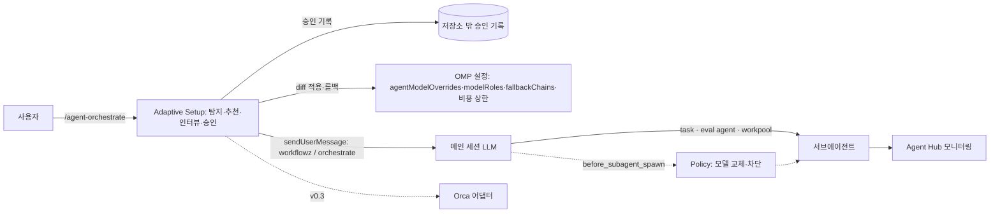

# adaptive-omp-orchestrator 개발 계획서

- 상태: 초안
- 작성일: 2026-11-20
- 검증 기준: omp 19.0.1(CLI), `@oh-my-pi/pi-coding-agent` 19.0.0 소스, Orca CLI 1.4.261
- 제품 형태: OMP Skill + TypeScript Extension (외부 런타임 어댑터는 이후 단계)
- 원칙: **AI는 후보를 조사·평가·추천하지만, 설정과 중요한 변경은 사용자의 명시적 선택과 승인 이후에만 확정한다.**

## 1. 목표와 비목표

### 목표

프로젝트에서 `/agent-orchestrate setup`을 호출하면 다음을 수행한다.

1. 현재 머신의 OMP 설정, Provider, 인증·쿼터 상태, 가용 모델과 effort를 읽기 전용으로 탐지한다.
2. 프로젝트와 사용자 목표를 바탕으로 역할별 모델·effort, 병렬도, 격리, 예산, 폴백 구성을 **추천**한다.
3. 추천을 근거와 함께 보여 주고, 사용자가 항목별로 수락·수정·승인한다.
4. 승인된 구성을 OMP 자체 설정에 기록하고(적용 전 diff, 적용 후 롤백 가능), 승인 밖의 서브에이전트 모델 사용을 막는다.
5. (v0.2) 승인된 계획을 OMP의 `workflowz`·`orchestrate` 실행으로 인계하고 결과와 비용을 기록한다.
6. (v0.3 이후) 외부 런타임(Orca, Herdr)을 어댑터로 추가한다.

### 비목표

- 새 DAG 실행 엔진, 스케줄러, 병렬 실행기 구현 (OMP 기본 기능 사용)
- Swarm Extension 재구현 또는 의존
- 에이전트 모니터링 UI 재구현 (Agent Hub 사용)
- v0.1에서 외부 벤치마크 실시간 수집, 원격 호스트 실행, 외부 하네스(Claude Code, Codex) 실행
- 승인 없는 모델·런타임·글로벌 설정 변경, 유료 측정 호출, 파괴적 명령
- 모든 Provider의 잔여 쿼터를 정확히 조회할 수 있다는 가정, 조회 불가를 무제한으로 해석하는 것

## 2. 설계 결정

| 결정 | 근거 |
|---|---|
| 실행 엔진을 만들지 않는다. 실행은 OMP 기본 기능(`task`, eval, `workflowz`·`orchestrate`)에 맡기고, 확장은 탐지·추천·승인·설정 기록·스폰 강제만 맡는다. | 확장 API에는 기본 `task`를 직접 호출할 수단이 없다. `ctx.invokeTool`은 같은 이름으로 재등록한 도구에서만 그 기본 도구로 위임한다. 병렬, 격리, 호출별 모델은 이미 `task`에 있다. |
| OMP Swarm Extension을 런타임 후보에서 제외한다. | upstream에서 2026-08-05 커밋 `b0a94a8fc`로 삭제됐다. npm 최신 13.17.0은 `@oh-my-pi/pi-coding-agent ^13`을 요구한다. |
| 승인 기록은 저장소 밖에 두고, 저장소에는 제안만 둔다. | 커밋된 승인 파일은 다른 사람이나 다른 머신의 승인일 수 있다. |
| 추천은 omp 내장 데이터와 편집 가능한 역할별 사전값으로 시작한다. | 공개 벤치마크는 커버리지가 좁고, 하네스가 달라 대부분 동일 조건 비교가 불가능하다. |
| v0.1은 로컬 탐지 → 추천 → 검토·승인 → OMP 설정 적용 → 스폰 강제로 한정한다. | 실행 인계, 외부 런타임, 원격 호스트, 벤치마크 수집은 v0.1로 가치를 확인한 뒤 붙인다. |

## 3. 재사용할 OMP 기존 기능 (재구현 금지)

| 영역 | OMP 기존 기능 | 이 프로젝트의 역할 |
|---|---|---|
| 서브에이전트 실행·병렬·격리 | `task`: 배치 `tasks[]`, `isolated`, 호출별 `model`, `effort`(`task.enableEffort` 시), 비동기 잡, `task.maxConcurrency` | 사용만 |
| 결정적 다중 에이전트 워크플로 | `workflowz` 키워드 + eval `agent()`·`workpool()`·`wait()` (`eval`과 `task`가 모두 활성일 때만) | 실행 인계 대상 |
| 자동 분해·병렬 위임 | `orchestrate` 키워드 (`task` 활성 필요) | 실행 인계 대상 |
| 모니터링·조종 | Agent Hub(Alt+A): 역할·모델·비용·토큰·요청 수, 조종, 모델·thinking 변경, 종료·부활 | 재구현하지 않음. `status`는 승인 범위 대비 요약만 |
| 에이전트 정의·모델 오버라이드 | `/agents` 허브, `task.agentModelOverrides` | 승인 결과를 기록 |
| 역할 모델·프리셋 | `modelRoles`, `modelPresets` | 승인 결과를 기록 |
| 폴백 | `retry.fallbackChains`, `retry.usageAwareFallback` | 승인 결과를 기록 |
| 비용 상한 | 세션 비용 경고·상한 설정(`--warn-cost`·`--max-cost`와 같은 값) | 승인된 예산을 기록 |
| 스폰 정책 | `before_subagent_spawn` 훅: task, eval `agent()`, workpool 워커의 자식마다 한 번 호출, `model` 지정·`block` 가능 | 승인 밖 모델 교체·차단 |
| 측정·조회 | `omp models --kind all --json`, `omp usage --json`, `omp stats --json`, `omp bench --json` | 탐지 입력 |

### Swarm Extension 판단

- **기능:** YAML로 파이프라인·병렬·순차·DAG를 정의한다(`waits_for`, `reports_to`로 의존성을 만들고 topological wave로 실행). 에이전트별 `model`, `.swarm_<name>/` 상태·로그, `pipeline` 모드의 `target_count` 반복, `/swarm run|status|help`, 독립 실행기 `omp-swarm`을 제공했다. effort 필드는 없다.
- **상태:** upstream `packages/swarm-extension`은 2026-08-05 커밋 `b0a94a8fc`(chore: cleanup)에서 파일 14개가 삭제됐다. npm 최신은 13.17.0(2026-03-30)이고, `peerDependencies`는 `@oh-my-pi/pi-coding-agent ^13`이며, 내부 모듈(`config/model-registry`, `config/settings`)을 직접 import한다.
- **실측:** omp 19.0.1에서 확장 로드 오류는 없다(로드 실패 대조군은 오류를 출력함). `/swarm run` 실행은 검증하지 않았다.
- **결정:** 런타임 후보에서 제외한다. YAML DAG 표현(`waits_for`, wave, 반복)은 계획 파일 형식 설계에 참고만 한다. 사용자가 이미 설치해 둔 경우에도 "유지보수 중단"으로 표시한다.

## 4. 아키텍처



- **Adaptive Setup** (Skill + `/agent-orchestrate` 명령): 탐지, 추천, 인터뷰, 승인
- **Policy & Enforcement** (확장): 승인 기록, OMP 설정 기록·롤백, `before_subagent_spawn` 강제, 쿼터·예산 감시, 텔레메트리
- **Execution** (OMP 기본): 메인 세션 LLM이 `workflowz`·`orchestrate` 계약에 따라 `task`·eval로 실행
- **External Runtime Adapters** (v0.3 이후): Orca(`orca orchestration`), Herdr

스케줄링 소유권은 실행 주체가 가진다. OMP로 실행하면 메인 세션(task·eval)이, Orca로 실행하면 Orca(run·task·gate)가 소유한다. 확장은 별도 스케줄러를 만들지 않고, 승인된 범위를 넘는 스폰만 막는다.

### 확장 API 제약 (설계 전제)

- 기본 `task`를 확장이 직접 호출할 수 없다. `ctx.invokeTool`은 같은 이름으로 재등록한 기본 도구에만 위임한다.
- 실행 인계는 `pi.sendUserMessage`를 쓴다. 소스상 세션이 유휴일 때 `synthetic` 없이 `prompt()`를 호출하므로 `workflowz`·`orchestrate` 키워드 계약이 주입된다. 스트리밍 중 큐잉 경로의 동작은 P0에서 확인한다.
- 대안 경로(`pi.pi.createAgentSession` SDK, `pi.exec("omp", ...)`)는 결정적이지만, Agent Hub·비동기 잡 연동이 확인되지 않아 보류한다.
- UI: `select`·`confirm`·`input`은 항상 있다. `askDialog`·`formDialog`·`approve`는 선택 멤버라 없을 수 있다. `ctx.hasUI === false`(print, `--no-ui` RPC)면 승인할 수 없다.

## 5. 환경 탐지 (읽기 전용)

### 5.1 OMP

| 명령 | 얻는 정보 | 주의 |
|---|---|---|
| `omp models --kind all --json` | `provider, kind, id, selector, name, contextWindow, maxTokens, reasoning, thinking, input, cost, pricingStatus` | 도구 호출 지원·인증 가능 여부 필드가 없어 별도 판정 |
| `omp usage --json` | Provider별 사용량·리셋 시각 | 조회 불가 Provider는 `unknown` |
| `omp usage accounts --json` | `provider, identityKey, orgName` | 계정 식별자이므로 저장·프롬프트 전달 금지 |
| `omp config list --json` (`--scope global\|project`) | 활성 설정, 모델 역할 | |
| `omp stats --json` | `overall, byModel, byFolder, byAgentType, …` 비용·이력 | |
| `omp bench --json` | TTFT, tok/s, 병렬 처리량 | 비용 발생, 별도 동의 필요 |

- 확장 안에서 `pi.exec`로 CLI JSON을 호출한다. omp 내부 API(`authStorage.usage.reports()` 등)는 자동 업데이트로 조용히 깨질 수 있어 쓰지 않는다.
- 사용자 경로는 omp가 해석한 에이전트 디렉터리를 쓴다. `OMP_PROFILE`을 쓰면 `~/.omp/profiles/<이름>` 아래로 바뀐다.
- `pi.getActiveTools()`로 `task`·`eval` 활성 여부를 확인하고, 매직 키워드 설정이 켜져 있는지 확인해 `workflowz`·`orchestrate` 사용 가능성을 판정한다.

### 5.2 외부 런타임 (v0.3 이후)

- **Orca:** `orca status --json`과 `orca agent-context`(기계 판독용 명령 스키마)로 capability를 판정한다. 명령 이름을 하드코딩하지 않는다. `coordinator-start/stop`처럼 이미 Retired된 명령이 있다.
- **Herdr:** 실행 파일·세션을 확인한다. 현재 테스트 환경이 없다.
- localhost와 원격 호스트는 서로 다른 실행 환경으로 기록한다. 원격은 v0.1에서 제외한다.

### 5.3 가용량 상태

`available / limited / exhausted / unknown / unavailable`과 신뢰도, 관측 시각, 리셋 시각을 저장한다. 구독형과 종량제를 구분하고, 조회 불가를 무제한으로 해석하지 않는다.

## 6. 추천 엔진

### 데이터 (v0.1)

1. omp 카탈로그: 가격, 컨텍스트, 최대 출력, reasoning·thinking effort
2. `omp stats`: 모델별 실제 비용·이력, 에이전트 유형별 사용
3. `omp usage`: 쿼터 상태
4. `omp bench`: 사용자가 동의한 경우만
5. 역할별 사전값 파일(`priors.yml`): 버전 관리, 사용자가 편집 가능, 출처와 날짜 포함

### 이후

- 오케스트레이터 역할: WorkflowArena(arXiv 2611.12856), ClawArena-Team(arXiv 2606.31174)을 사전값 근거로 쓴다. 보도 기준 각각 25개 구성과 12개 모델만 평가해 커버리지가 좁다는 점을 함께 표시한다.
- 코딩·리서치 역할: SWE-bench 계열, Terminal-Bench, BrowseComp 등. 하네스가 다르면 '동일 조건 비교 불가'로 표시한다.

### 규칙

- 모든 지표에 `source, observed_at, benchmark_version, methodology, confidence, missing_reason`을 둔다. 결측은 0점 처리하지 않는다.
- 점수는 결정적으로 계산한다. LLM은 설명 문장에만 쓰고, 쓸 경우 비용을 표시한다.
- 1차 제약 필터(인증, 쿼터, effort 지원, 컨텍스트, 비용 상한) → 2차 역할별 Pareto 후보 → 사용자 우선순위로 1~3개를 앞에 둔다.
- 추천마다 `why_recommended, why_not_alternatives, expected_cost_range, quota_impact, evidence_confidence`를 제공한다.
- 사용자가 직접 고른 조합도 제약 검사를 하고, 실행 불가능하면 이유와 함께 거절한다.

## 7. 인터뷰 UX

### 원칙

- 최초 호출에서 AI 판단만으로 확정하지 않는다. 추천은 기본 강조값일 뿐이다.
- 런타임이나 Provider가 하나만 감지돼도 설명하고 승인을 받는다.
- 취소, 미응답, UI 부재는 `not approved`다.
- 이전 선택은 '기존안'으로 보여 주되 새 승인으로 간주하지 않는다.

### 흐름

1. 탐지 요약
2. 목표와 최적화 우선순위(품질 / 비용 / 속도 / 쿼터 / 균형)
3. **추천 구성 검토 화면**: 역할별 모델·effort, 병렬도, 격리, 예산 상한, 폴백 목록을 한 화면에 표시
4. `전체 수락` 또는 항목 선택 → 그 항목만 후보 2~5개 비교·선택(직접 입력, 근거 보기, 뒤로)
5. 최종 diff(OMP 설정에 쓸 변경) → `승인 후 적용` / `dry-run` / `취소`

런타임·호스트·하네스 선택 단계는 외부 런타임 어댑터가 생긴 뒤(v0.3) 감지된 후보가 둘 이상일 때만 노출한다.

### 화면 예시 (가상의 값)

```
[검토] 추천 구성 — 최적화: 균형

역할         모델 / effort                근거 요약
메인         (현재 유지)                   변경 비용 없음
구현 워커     provider-x/model-a / medium   stats: 최근 성공 이력, 작업당 비용 낮음
리뷰 워커     provider-y/model-b / high     구현 워커와 다른 계열(독립 검증)
병렬도        4 (task.maxConcurrency)
격리          isolated
예산 상한      세션 $N
폴백          model-a → model-c (승인된 Provider만)

[전체 수락] [항목 수정] [근거 보기] [dry-run(diff)] [취소]
```

## 8. 승인과 적용

- **승인 기록 위치:** `<omp 에이전트 디렉터리>/adaptive-orchestrator/<repo-id>/`(저장소 밖). `decisions.json`, `approved-plan.json`(승인 ID, 계획 해시, 권한 범위, 승인된 Provider·폴백·예산), `rollback/` 스냅샷을 둔다.
- **저장소 안:** `<repo>/.omp/adaptive-orchestrator/proposal.json`만 선택적으로 둔다(팀 공유용 제안). 실행할 때 승인으로 취급하지 않는다. `run-state`와 `metrics`는 저장소 밖에 두거나 `.gitignore`에 넣는다.
- **적용 대상:** 프로젝트 범위 OMP 설정(`task.agentModelOverrides`, `modelRoles`, `retry.fallbackChains`, 비용 상한 등). 적용 전 diff를 보이고 적용 후 롤백할 수 있게 한다. 쓰기 방법(`.omp/config.yml` 직접 편집인지 CLI인지)은 P0에서 확정한다.
- **메인 세션:** 모델·thinking 변경은 `pi.setModel`·`pi.setThinkingLevel`로 세션 범위에 한정한다.
- **강제:** `before_subagent_spawn`에서 승인된 역할→모델 매핑 밖이면 승인된 모델로 교체하거나 `block`과 사유를 반환한다. 승인 밖 Provider로의 폴백도 막는다.
- **민감 정보:** 비밀키, 원시 토큰, 계정 식별자(`identityKey`, 이메일, `orgName`)는 파일과 프롬프트에 남기지 않는다.

## 9. 실행 인계 (v0.2)

- `/agent-orchestrate plan`: 프로젝트 분석 → 역할·작업·의존성 제안(DAG 표현은 Swarm의 `waits_for`·wave 개념 참고) → 승인
- `/agent-orchestrate run`: 승인된 계획을 `pi.sendUserMessage("workflowz …")`(결정적 워크플로) 또는 `orchestrate …`(자율 분해)로 메인 세션에 인계한다. 어느 쪽을 쓸지는 인터뷰 항목이다.
- **실행 중:** 모니터링은 Agent Hub, 예산은 OMP 비용 상한, 모델 준수는 스폰 훅이 맡는다.
- **재계획:** 429와 실패는 승인된 폴백 범위 안에서 OMP가 처리한다. 승인 범위 밖 변경(새 Provider, 예산 초과, 범위 확대)은 인터뷰를 재개한다.
- **텔레메트리:** `turn_end`, `agent_end`, `tool_execution_end`, `retry_fallback_applied`, `retry_fallback_succeeded` 이벤트와 `omp stats`로 역할별 비용·소요 시간·재시도를 기록하고 사전값을 보정한다.

## 10. 외부 런타임 어댑터 (v0.3 이후)

```ts
interface OrchestrationRuntimeAdapter {
  id: string;
  detect(host: HostContext): Promise<RuntimeDiscovery>;
  capabilities(host: HostContext): Promise<RuntimeCapabilities>;
  createRun(plan: ApprovedPlan, idempotencyKey: string): Promise<RuntimeRunHandle>;
  spawnTask(run: RuntimeRunHandle, task: ApprovedTask, idempotencyKey: string): Promise<TaskHandle>;
  reattach(runId: string): Promise<RuntimeRunHandle | undefined>;
  getStatus(handle: TaskHandle): Promise<TaskStatus>;
  send?(handle: TaskHandle, text: string): Promise<void>;
  cancel(handle: TaskHandle): Promise<void>;
  collect(handle: TaskHandle): Promise<TaskArtifacts>;
  cleanup(run: RuntimeRunHandle): Promise<void>;
}
```

- 크래시 후 재연결(`reattach`)과 중복 실행 방지(멱등 키)를 계약에 포함한다.
- 어댑터가 지원하지 않는 기능은 capability로 `false`를 반환하고, 필요한 경우 다른 런타임을 추천한다.
- **Orca:** `orca orchestration`의 `run-create`, `task-create`, `worker-start`, `dispatch`, `gate-create`, `request-show`(변경 요청이 이미 반영됐는지 확인)를 쓴다. Orca로 실행할 때 스케줄링은 Orca가 소유한다.
- **Herdr:** 테스트 환경을 확보한 뒤 진행한다. 선행 사례 `pi-herdr-agents`(Pi용)를 참고한다.

## 11. 보안 및 안전

1. 탐지는 읽기 전용이다. 비용이 발생하는 측정은 별도 동의를 받는다.
2. 승인 기록은 저장소 밖에 둔다. 저장소 파일은 제안으로만 취급한다.
3. 승인 전 커밋, 병합, 배포, 원격 실행을 하지 않는다.
4. 스폰 훅으로 승인된 모델·Provider 밖의 실행을 막는다.
5. 폴백은 승인된 목록 안에서만 한다.
6. 계정 식별자와 토큰은 파일과 프롬프트에 남기지 않는다.
7. 비용 추정이 불확실하면 범위와 근거 부족을 표시하고 사용자에게 결정을 요청한다.

참고: omp는 프로젝트 로컬 입력(`.omp/extensions`, `.omp/config.yml`)을 신뢰 확인 없이 로드한다. 신뢰할 수 없는 저장소에서 omp를 여는 위험은 이 도구가 막을 수 없다.

## 12. 구현 단계

| 단계 | 범위 | 완료 조건 |
|---|---|---|
| P0 스파이크 | 아래 질문 5개 | 질문마다 실측 결과와 결정 기록 |
| v0.1 Setup | 로컬 탐지 → 추천 → 검토·승인 → OMP 설정 적용 → 스폰 강제 | 승인 없이 적용 0건, 취소 시 설정 무변경, 승인 밖 모델 스폰 차단, 롤백 가능 |
| v0.2 Plan·Run 인계 | 계획 제안 → `workflowz`·`orchestrate` 인계 → 텔레메트리 | 승인된 모델만 사용, 예산 상한 준수, 결과와 선정 근거 역추적 가능 |
| v0.3 Orca 어댑터 | capability 탐지, run·task·worker·gate 매핑 | 계약 테스트 통과, 이중 스케줄러 없음 |
| 이후 | Herdr, 원격 호스트, 외부 하네스, 벤치마크 수집 | 어댑터 추가만으로 발견·인터뷰·실행 확장 |

### P0 질문

1. `pi.sendUserMessage("workflowz …")`가 유휴 상태와 스트리밍 상태에서 각각 키워드 계약을 주입하고 실행되는가?
2. `before_subagent_spawn`으로 task, eval `agent()`, workpool 자식의 모델 교체·차단이 의도대로 되는가?
3. 프로젝트 범위 OMP 설정을 어떻게 쓰고 되돌리는가? (`.omp/config.yml` 직접 편집 vs CLI)
4. 검토 화면이 TUI와 ACP(Orca 채팅 포함)에서 어떻게 보이는가? `select` 상태 머신으로 충분한가?
5. 승인 기록의 위치, 형식, 저장소 식별자(경로 vs git remote)를 무엇으로 할 것인가?

### 필수 E2E 시나리오 (v0.1~v0.2)

- 승인 전에는 어떤 설정 변경, 유료 호출, 워커 생성도 없다.
- 인터뷰 취소·뒤로·재개·항목 변경 후 결과가 사용자 선택과 일치한다.
- 목록에는 있지만 인증·쿼터가 없는 모델은 제외되거나 경고된다.
- 지원하지 않는 effort는 적용되지 않는다.
- 승인 밖 모델로의 스폰이 차단되고 사유가 남는다.
- 커밋된 `proposal.json`만 있는 새 머신에서는 다시 승인을 요구한다.
- 롤백 후 OMP 설정이 적용 전과 같다.

## 13. 선행 사례와 차별점

- **omp용:** `@yuechou/omp-agent`(다중 에이전트 관리), `@nledford/omp-coord`(세션 간 서브에이전트 한도·큐), `gsd-for-omp`(오케스트레이션 시스템 호스트), `@sencha930511/pi-model-sync`(서브에이전트 모델 라우팅)
- **Pi용:** `pi-subagents`, `pi-herdr-agents`(Herdr + worktree), `pi-orchestrator-config`
- **OMP 자체:** Swarm Extension(삭제됨), `workflowz`·`orchestrate` 키워드, Agent Hub
- **이 프로젝트의 차별점:** (1) 근거 기반 역할별 모델·effort 추천과 승인 기록, (2) 승인 범위의 강제(스폰 훅), (3) 외부 런타임 선택. 실행 엔진 자체로는 경쟁하지 않는다.

## 14. 사용자 명령 (제작할 기능)

```text
/agent-orchestrate setup      # 탐지 → 추천 → 검토·승인 → OMP 설정 적용
/agent-orchestrate rescan     # Provider·모델·쿼터 재탐지
/agent-orchestrate review     # 현재 승인 구성 확인·변경(재승인)
/agent-orchestrate rollback   # 마지막 적용 이전 설정으로 복원
/agent-orchestrate plan       # (v0.2) 작업 계획 제안·승인
/agent-orchestrate run        # (v0.2) 승인된 계획을 workflowz·orchestrate로 인계
/agent-orchestrate status     # 승인 범위 대비 비용·쿼터 요약 (모니터링은 Agent Hub)
```

후보 비교와 근거는 검토 화면의 `근거 보기`, dry-run은 적용 전 diff, 재평가는 `rescan` 뒤 재추천으로 제공한다.

## 15. 참고

- OMP: https://github.com/can1357/oh-my-pi
- Extensions(`before_subagent_spawn`, `ctx.invokeTool`, UI 컨텍스트): https://github.com/can1357/oh-my-pi/blob/main/docs/extensions.md
- Magic keywords(`orchestrate`, `workflowz`): https://github.com/can1357/oh-my-pi/blob/main/docs/magic-keywords.md
- Task: https://github.com/can1357/oh-my-pi/blob/main/docs/tools/task.md
- Eval(`agent()`, `workpool()`): https://github.com/can1357/oh-my-pi/blob/main/docs/tools/eval.md
- Agent Hub: https://github.com/can1357/oh-my-pi/blob/main/docs/agent-hub.md
- Settings: https://github.com/can1357/oh-my-pi/blob/main/docs/settings.md
- Swarm Extension 삭제 커밋: https://github.com/can1357/oh-my-pi/commit/b0a94a8fc
- Orca Orchestration: https://orca.dev/docs/cli/orchestration
- Herdr: https://github.com/herdrdev/herdr, https://herdr.dev/tui/docs/cli-reference/
- WorkflowArena: https://arxiv.org/abs/2611.12856
- ClawArena-Team: https://arxiv.org/abs/2606.31174

명령과 API는 버전마다 바뀔 수 있으므로 P0에서 설치된 버전의 도움말과 응답 스키마를 다시 확인한다.
