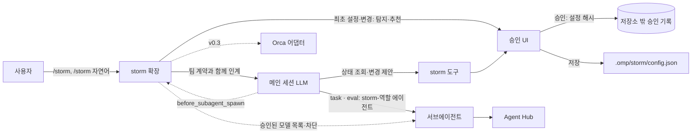

# OMP Storm 개발 계획서

> **OMP STORM** — Adaptive Multi-Agent Orchestration
> One command. Intelligent agents. Any runtime.

- 상태: 초안. P0 스파이크 완료(2026-11-20, [p0-results.md](p0-results.md))
- 작성일: 2026-11-20
- 검증 기준: omp 19.0.1(CLI), `@oh-my-pi/pi-coding-agent` 19.0.0 소스, Orca CLI 1.4.261
- 제품 형태: omp 플러그인(Extension + Skill + 역할 에이전트 정의). 외부 런타임 어댑터는 이후 단계
- 원칙: **AI는 후보를 조사·평가·추천하지만, 설정과 중요한 변경은 사용자의 명시적 선택과 승인 이후에만 확정한다.**

## 1. 공식 네이밍

| 항목 | 이름 |
|---|---|
| 프로젝트명 | **OMP Storm** |
| GitHub 저장소 | `omp-storm` |
| npm 패키지 | `omp-storm` (omp는 플러그인을 이 패키지 이름으로 식별) |
| 실행 명령 | `/storm` |
| 확장 내부 ID | `storm` (상태 표시 키, 커스텀 엔트리·이벤트 접두사, 승인 저장 디렉터리 이름) |
| Skill | `storm` |
| 역할 에이전트 | `storm-<역할>` (예: `storm-implementer`, `storm-reviewer`) |
| 프로젝트 설정 | `.omp/storm/config.json` |
| 런타임 상태 | `.omp/storm/state/` |
| 승인 기록 | `<omp 에이전트 디렉터리>/storm/approvals/<repo-id>/` (저장소 밖) |

2026-11-20 확인: GitHub `dhkimxx/omp-storm`과 npm `omp-storm`은 비어 있었고, `/storm`은 omp 기본 슬래시 명령·CLI 명령과 겹치지 않는다.

## 2. 목표와 비목표

### 목표: `/storm` 하나로 프로젝트의 멀티에이전트 팀 전체를 관리한다

1. **최초 `/storm`:** 환경 탐지 → 역할별 후보 추천 → 인터뷰 → 승인 → `.omp/storm/config.json` 저장
2. **`/storm <자연어>`:** 작업 실행, 상태 확인, 설정 변경(우선순위, 워커 추가, 모델 재선정), 쿼터 대응을 한 인터페이스에서 처리
3. **실행:** 사용자가 고른 런타임(기본 OMP, 이후 Orca·Herdr)에서 승인된 모델·effort·병렬화 정책으로 수행
4. **강제:** 승인 밖의 모델·Provider 사용은 스폰 단계에서 막는다
5. **모델 점검:** 사용 기록으로 역할별 선호 모델과 실측 속도를 파악하고, 더 새롭거나 더 좋거나 더 가성비 좋은 모델을 근거와 함께 찾는다(9장)

### 사용 예시

```text
/storm                                  # 최초: 탐지 → 추천 → 인터뷰 → 승인. 이후: 팀 현황
/storm 로그인 기능 구현해줘                 # 작업 실행
/storm 현재 프로젝트 아키텍처 분석해줘        # 작업 실행(분석)
/storm 이번엔 비용보다 성능을 우선해줘         # 설정 변경 제안 → 승인
/storm 리뷰 워커 하나 추가해줘                # 팀 구성 변경 제안 → 승인
/storm 지금 쿼터 상황 어때?                  # 상태 확인
/storm 지금 모델보다 싸고 좋은 거 있어?        # 모델 점검(사용 기록 + 카탈로그)
```

### 비목표

- 새 DAG 실행 엔진, 스케줄러, 병렬 실행기 구현 (OMP 기본 기능 사용)
- Swarm Extension 재구현 또는 의존
- 에이전트 모니터링 UI 재구현 (Agent Hub 사용)
- 사용자의 omp 설정 파일(`.omp/config.yml`, 전역 설정) 자동 수정
- v0.1에서 외부 벤치마크 실시간 수집, 원격 호스트 실행, 외부 하네스(Claude Code, Codex) 실행
- 승인 없는 모델·런타임·설정 변경, 유료 측정 호출, 파괴적 명령
- 모든 Provider의 잔여 쿼터를 정확히 조회할 수 있다는 가정, 조회 불가를 무제한으로 해석하는 것

## 3. 설계 결정

| 결정 | 근거 |
|---|---|
| 실행 엔진을 만들지 않는다. 실행은 OMP 기본 기능(`task`, eval, `workflowz`·`orchestrate`)에 맡기고, Storm은 탐지·추천·승인·강제·관리만 맡는다. | 확장 API에는 기본 `task`를 직접 호출할 수단이 없다(`ctx.invokeTool`은 같은 이름으로 재등록한 도구에서만 그 기본 도구로 위임). 병렬, 격리, 호출별 모델은 이미 `task`에 있다. |
| `/storm <자연어>`는 메인 세션 LLM이 해석한다. 설정 변경은 `storm` 도구가 **제안만** 하고, 확정은 승인 UI에서 사용자가 한다. | LLM이 스스로 승인할 수 없어야 한다. 저장소 내용 등에 숨은 지시가 있어도 승인 창을 띄우는 데서 멈춘다. |
| 프로젝트 설정은 `.omp/storm/config.json`에 두고, 승인은 저장소 밖에 설정 해시로 기록한다. 해시가 다르면 다시 승인을 받는다. | 설정 파일은 팀이 커밋해 공유할 수 있지만, 커밋된 설정이 곧 이 사용자·이 머신의 승인은 아니다. |
| omp 설정 파일은 바꾸지 않는다. 승인된 구성은 런타임에 강제한다(역할 에이전트 + 스폰 훅). | 사용자의 omp 설정이 그대로라 롤백이 단순하다. 스폰 훅은 에이전트 이름을 받고 시도 순서대로의 모델 목록을 돌려줄 수 있다. |
| 역할은 플러그인에 포함된 에이전트 정의(`agents/storm-<역할>.md`)로 제공한다. | 확장 API로는 에이전트 정의를 동적으로 등록할 수 없다(`resources_discover`는 스킬·프롬프트·테마 경로만 받고 현재 호출되지 않음). 플러그인의 `agents/` 디렉터리는 omp가 자동 탐색한다. |
| OMP Swarm Extension을 런타임 후보에서 제외한다. | upstream에서 2026-08-05 커밋 `b0a94a8fc`로 삭제됐다. npm 최신 13.17.0은 `@oh-my-pi/pi-coding-agent ^13`을 요구한다. |
| 모델 분석과 추천은 사용자의 omp 사용 기록(선호 모델, 실측 속도·비용)과 omp 카탈로그로 결정적으로 계산한다. LLM은 설명과 인터뷰 질문에만 쓰고, 근거가 없으면 '비교 불가'로 표시한 뒤 시험 사용을 제안한다. | 이 사용자에게 가장 정확한 근거는 이 사용자의 실측이다. 카탈로그 지능 점수는 인증된 모델 100개 중 19개, 속도 추정치는 0개에만 있었다(9.4). 공개 벤치마크는 커버리지가 좁고 하네스가 다르다. |
| v0.1은 최초 `/storm`(탐지 → 추천 → 인터뷰 → 승인 → 저장), 스폰 강제, 팀 현황까지로 한정한다. | 자연어 관리, 작업 실행 인계, 외부 런타임은 v0.1로 가치를 확인한 뒤 붙인다. |

## 4. 재사용할 OMP 기존 기능 (재구현 금지)

| 영역 | OMP 기존 기능 | Storm의 역할 |
|---|---|---|
| 서브에이전트 실행·병렬·격리 | `task`: 배치 `tasks[]`, `isolated`, 호출별 `model`, `effort`(`task.enableEffort` 시), 비동기 잡, `task.maxConcurrency` | 사용만 |
| 결정적 다중 에이전트 워크플로 | `workflowz` 키워드 + eval `agent()`·`workpool()`·`wait()` (`eval`과 `task`가 모두 활성일 때만) | 작업 실행 계약 |
| 자동 분해·병렬 위임 | `orchestrate` 키워드 (`task` 활성 필요) | 작업 실행 계약 |
| 모니터링·조종 | Agent Hub(Alt+A): 역할·모델·비용·토큰·요청 수, 조종, 모델·thinking 변경, 종료·부활 | 재구현하지 않음. `/storm` 현황은 승인 범위 대비 요약만 |
| 에이전트 정의 | `.omp/agents/`, 사용자 `agents/`, 플러그인 `agents/` 자동 탐색, `/agents` 허브 | 역할을 `storm-<역할>` 에이전트로 제공 |
| 모델 오버라이드·역할·프리셋 | `task.agentModelOverrides`, `modelRoles`, `modelPresets` | 바꾸지 않음. 서브에이전트 모델은 스폰 훅이 최종 결정 |
| 폴백 | `retry.fallbackChains`, `retry.usageAwareFallback` | 메인 세션은 omp 설정을 그대로 사용. 서브에이전트 폴백은 스폰 훅의 모델 목록 순서로 표현 |
| 비용 상한 | 세션 비용 경고·상한(`--warn-cost`·`--max-cost`와 같은 값) | 연동 방식은 P0에서 결정 |
| 스폰 정책 | `before_subagent_spawn` 훅 | 승인된 모델 목록 강제, 승인 밖 스폰 차단 |
| 측정·조회 | `omp models --kind all --json`, `omp usage --json`, `omp stats --json`, `omp bench --json` | 탐지 입력 |
| 사용 통계 | `omp stats`(대시보드·JSON): 모델별 요청·토큰·비용·tok/s·TTFT·오류율, main/subagent·부가 호출 구분, 모델별 사용자 불만(frustration) 비율 | 모델 분석 입력(9장). 대시보드는 재구현하지 않음 |

### Swarm Extension 판단

- **기능:** YAML로 파이프라인·병렬·순차·DAG를 정의한다(`waits_for`, `reports_to`로 의존성을 만들고 topological wave로 실행). 에이전트별 `model`, `.swarm_<name>/` 상태·로그, `pipeline` 모드의 `target_count` 반복, `/swarm run|status|help`, 독립 실행기 `omp-swarm`을 제공했다. effort 필드는 없다.
- **상태:** upstream `packages/swarm-extension`은 2026-08-05 커밋 `b0a94a8fc`(chore: cleanup)에서 파일 14개가 삭제됐다. npm 최신은 13.17.0(2026-03-30)이고, `peerDependencies`는 `@oh-my-pi/pi-coding-agent ^13`이며, 내부 모듈(`config/model-registry`, `config/settings`)을 직접 import한다.
- **실측:** omp 19.0.1에서 확장 로드 오류는 없다(로드 실패 대조군은 오류를 출력함). `/swarm run` 실행은 검증하지 않았다.
- **결정:** 런타임 후보에서 제외한다. YAML DAG 표현(`waits_for`, wave, 반복)은 작업 계획 형식 설계에 참고만 한다. 사용자가 이미 설치해 둔 경우에도 "유지보수 중단"으로 표시한다.

## 5. 아키텍처



- **`/storm` 명령:** 입력을 나눈다. 인자가 없으면 최초 설정 또는 팀 현황, 정확히 일치하는 짧은 키워드는 LLM 없이 처리, 그 외 자연어는 팀 계약과 함께 메인 세션에 인계한다.
- **`storm` 도구:** LLM이 호출하는 관리 연산이다. 조회는 바로 답하고, 변경은 제안(diff)을 만들어 승인 UI를 띄운다.
- **정책·강제:** 스폰 훅, 예산·쿼터 감시, 텔레메트리
- **실행(OMP 기본):** 메인 세션 LLM이 `workflowz`·`orchestrate` 계약에 따라 `storm-<역할>` 에이전트를 `task`·eval로 실행
- **외부 런타임 어댑터(v0.3 이후):** Orca(`orca orchestration`), Herdr

스케줄링 소유권은 실행 주체가 가진다. OMP로 실행하면 메인 세션(task·eval)이, Orca로 실행하면 Orca(run·task·gate)가 소유한다. Storm은 별도 스케줄러를 만들지 않고, 승인 범위를 넘는 스폰만 막는다.

### 확장 API 사실 (P0 실측, omp 19.0.1, [p0-results.md](p0-results.md))

- 기본 `task`를 확장이 직접 호출할 수 없다. `ctx.invokeTool`은 같은 이름으로 재등록한 기본 도구에만 위임한다.
- **실행 인계:** `pi.sendUserMessage(text)`를 `deliverAs` 없이 호출할 때만 `workflowz`·`orchestrate` 키워드 notice가 붙는다. 유휴 상태, 스트리밍 중(steer로 큐), `agent_end` 뒤 모두 실측했다. `deliverAs: "followUp"`·`"steer"`는 메시지는 전달하지만 notice를 붙이지 않는다.
- **스폰 훅:** task·eval 경로 모두에서 호출된다.
  - `model`을 돌려주면 `task.agentModelOverrides`보다 우선한다. 훅 입력 `patterns`에는 override 값이 담겨 온다.
  - `block`을 돌려주면 자식 요청이 나가지 않고 사유가 호출한 쪽에 전달된다. async task는 작업 실패 알림으로, eval은 `wait()` 결과의 오류로 받는다.
  - 기본 에이전트(`task`, `scout` 등)도 훅을 거친다. 서브에이전트 세션에도 확장이 로드되므로 중첩 스폰에도 같은 정책이 걸린다.
- **역할 에이전트:** 에이전트 정의는 동적으로 등록할 수 없다. `-e` 패키지 루트나 설치·link한 플러그인의 `agents/`는 탐색되어 task 도구 목록에 나오고 이름으로 스폰된다. 프로젝트·사용자 `agents/`에 같은 이름의 정의가 있으면 플러그인 정의를 덮어쓴다(실측). 우선순위는 프로젝트 > 사용자 > 확장 패키지 > 플러그인 > 기본 탑재 순이다.
- **승인 UI:** 도구 `execute` 안의 `ctx.ui.select`·`confirm`은 TUI, RPC, ACP(클라이언트가 `elicitation.form`을 알릴 때)에서 동작한다.
  - print 모드, `--no-ui`, 폼을 지원하지 않는 ACP에서는 `select`가 `undefined`, `confirm`이 `false`다.
  - 폼을 지원하지 않는 ACP도 `hasUI`가 `true`라서, `hasUI`로 승인 가능 여부를 판단할 수 없다. ACP 세션의 `ctx.mode`는 `rpc`다.
- **비용:** omp 세션 상한(`session.maxCost`, `--max-cost`)은 서브에이전트 요청까지 막는다(실측). 확장이 이 상한을 설정하거나 누계를 읽는 공개 API는 없다.
- **경로:** 승인 기록 위치는 `pi.pi.getAgentDir()`로, stats DB 경로는 `getStatsDbPath()`(`@oh-my-pi/pi-utils`, 호스트 번들)로 얻는다. 두 값 모두 프로필 설정을 따른다.
- 대안 경로(`pi.pi.createAgentSession` SDK, `pi.exec("omp", ...)`)는 결정적이지만, Agent Hub·비동기 잡 연동이 확인되지 않아 보류한다.

## 6. `/storm` 인터페이스

### 입력 처리

| 입력 | 처리 |
|---|---|
| `/storm` (승인된 설정 없음) | 최초 설정 인터뷰 |
| `/storm` (승인된 설정 있음) | 팀 현황(역할·모델·쿼터·비용·진행 중 작업)과 다음 행동 선택 |
| `/storm status`, `setup`, `review`, `rollback` | 정확히 일치하면 LLM 호출 없이 처리. `rollback`도 승인 UI를 거친다 |
| `/storm <그 외 자연어>` | 팀 계약과 함께 메인 세션에 인계. LLM이 작업 실행인지 관리 요청인지 판단 |

### 자연어 관리 연산 (`storm` 도구)

| 연산 | 예 | 승인 |
|---|---|---|
| 상태 조회 | "쿼터 상황 어때?" | 불필요 |
| 우선순위 변경 | "비용보다 성능 우선해줘" | 필요. 영향받는 역할의 모델 재추천 diff를 보여 줌 |
| 워커 추가·제거 | "리뷰 워커 하나 추가해줘" | 필요 |
| 모델 재선정 | "구현 워커 모델 다시 골라줘" | 필요 |
| 모델 점검 | "지금 모델보다 싸고 좋은 거 있어?", "더 최신 모델 나왔어?" | 불필요(조회). 교체는 모델 재선정과 같음 |
| 시험 사용 | "리뷰 워커에 새 모델 일주일만 써 보자" (v0.2) | 필요. 비율·기간·예산 상한 포함 |
| 쿼터 대응 | "Anthropic 쿼터 다 썼어" | 승인된 폴백 범위 안이면 정책대로, 밖이면 필요 |
| 런타임 변경 | "Orca로 돌려줘" (v0.3) | 필요 |

- 도구는 설정을 직접 쓰지 않는다. 제안(diff)을 만들고 승인 UI를 띄운다. 사용자가 승인해야 `.omp/storm/config.json`과 승인 기록이 바뀐다.
- 승인 UI가 응답하지 않는 환경(print, `--no-ui`, 폼 미지원 ACP)에서는 제안만 남기고 적용하지 않는다. `hasUI`로는 판단하지 않는다.

### 작업 실행

- **인계:** 작업 요청이면 `storm` 도구가 실행 요청을 기록해 두고, 현재 실행이 끝난 뒤(`agent_end`, 이때 `isIdle()`이 `true`) `workflowz`(결정적 워크플로) 또는 `orchestrate`(자율 분해) 키워드를 붙인 메시지를 `sendUserMessage(text)`로 보낸다. `/storm <작업>`처럼 명령에서 바로 시작할 때는 `waitForIdle()` 뒤에 보낸다. 관리 요청에는 키워드를 붙이지 않는다. 어느 계약을 쓸지는 설정 항목이다.
- **스폰 정책:** Storm 실행은 인계 시점부터 세션이 settle될 때까지다.
  - `storm-<역할>`: 승인된 모델 목록(시도 순서)으로 교체한다.
  - Storm 역할이 아닌 에이전트(`task`, `scout` 등): 요청 모델이 승인 목록 안이면 허용하고, 밖이면 config가 지정한 대체 역할의 모델로 바꾼다. 대체 역할이 없으면 차단한다.
  - Storm 실행 밖의 일반 세션 스폰에는 관여하지 않는다.
- **역할 정의 가림:** 프로젝트·사용자 `agents/`에 `storm-*` 정의가 있으면 승인 화면에 보여 주고 그 내용 해시를 승인 범위에 넣는다. 승인되지 않은 가림 정의가 있으면 그 역할의 스폰을 차단한다.

## 7. 저장 구조

```text
<worktree 최상위>/.omp/storm/
├── config.json      # 팀 구성: 역할, 모델·effort, 병렬도, 격리, 예산, 폴백, 런타임, 우선순위 (커밋 가능)
├── .gitignore       # "/state/" 한 줄 (Storm이 생성)
└── state/           # 런타임 상태: 진행 중 작업, 실행 기록, 텔레메트리 (커밋하지 않음)

<pi.pi.getAgentDir()>/storm/
├── approvals/<repo-id>/
│   ├── repo.json               # 식별 근거: git common dir, 정규화한 remote·root commit 힌트
│   ├── approved/<hash>.json    # 설정 해시별 승인 기록 (유효한 승인의 집합)
│   ├── snapshots/<hash>.json   # 승인된 정규화 config (rollback·diff용)
│   └── log.jsonl               # approved / revoked / rolled_back / inherited
├── usage/                      # 일 단위 사용 집계 (omp gc 대비, 9.1)
└── priors.yml                  # (선택) 사용자 사전값 덮어쓰기
```

- **repo-id:** `realpath(git rev-parse --path-format=absolute --git-common-dir)`의 SHA-256 앞 24자에 사람이 읽을 이름을 붙인다.
  - 같은 저장소의 worktree는 승인을 공유하고, fork·별도 클론은 따로 승인한다.
  - 저장소를 옮기면 승인이 없는 상태가 된다. root commit과 remote가 같은 이전 기록이 있으면 이어받기를 제안하고, 이것도 승인 UI를 거친다.
  - git 저장소가 아니면 프로젝트 루트 실경로를 쓴다.
  - remote URL은 자격 증명이 섞일 수 있어 키로 쓰지 않는다.
- **설정 해시:** BOM 제거 → 엄격한 JSON 파싱(중복 키·NaN 등은 설정 오류로 거부) → JCS(RFC 8785) 정규화 → SHA-256 순서로 계산한다.
  - 서식만 바뀐 경우는 재승인하지 않는다.
  - 해시가 승인 집합에 없으면(직접 편집, 팀원의 커밋 등) 실행·적용 전에 다시 승인을 받는다.
  - 브랜치마다 config가 다른 worktree끼리 재승인을 주고받지 않도록 승인을 해시별로 보관한다.
- `config.json`에는 비밀키, 토큰, 계정 식별자를 넣지 않는다.
- 프로젝트 루트 `.gitignore`는 건드리지 않는다. `.omp/storm/.gitignore`만으로 `state/`가 git에서 빠지는 것을 실측했다.
- omp는 `.omp/storm/`을 읽지 않는다(P0 Q7). Storm은 `.omp/storm/` 밖의 `.omp/` 경로에 쓰지 않는다.
- 승인은 omp 프로필별로 따로 관리된다.

## 8. 환경 탐지 (읽기 전용)

### 8.1 OMP

| 경로 | 얻는 정보 | 주의 |
|---|---|---|
| `omp models --kind all --json` | `provider, kind, id, selector, name, contextWindow, maxTokens, reasoning, thinking, input, cost, pricingStatus` | 사용 가능한 모델만 나온다. `int`·`tps`·`identity`와 도구 호출 지원 여부는 없다 |
| `omp usage --json` | Provider별 사용량·리셋 시각 | 조회 불가 Provider는 `unknown` |
| `omp usage accounts --json` | `provider, identityKey, orgName` | 계정 식별자이므로 저장·프롬프트 전달 금지 |
| `omp config list --json` (`--scope global\|project`) | 활성 설정, 모델 역할 | |
| `omp stats --json` | `overall`, `byModel`(요청·토큰·비용·`avgTokensPerSecond`·`avgTtft`·오류율), `byAgentType`, `modelPerformanceSeries`, … | 최근 24시간만 반환한다(기간 플래그 없음) |
| `omp bench --json` | TTFT, tok/s, 병렬 처리량 | 비용 발생, 별도 동의 필요 |
| 확장 API `ctx.models.list()`, `ctx.modelRegistry.getAll()`·`getAvailable()` | 카탈로그 행: `cost`, `identity`(class·family·revision), `int`(지능 점수), `tps`(속도 추정), `isNew`·`isRecommended` | `getAll()`은 소스상 로그인하지 않은 Provider까지 포함한다. `int`·`tps`는 omp 카탈로그(`catalog.stencil.so`)가 주는 값이고 산출 방법은 확인하지 못했다. 커버리지가 낮다(9.4) |
| `stats.db` (확장 안에서 `bun:sqlite` 읽기 전용, 경로는 `getStatsDbPath()`) | 요청 단위 30~90일 이력: provider, model, `agent_type`, `purpose`, `duration`, `ttft`, 토큰, 비용, `stop_reason`, 폴더 | P0에서 채택. 필수 컬럼을 검사하고 없으면 분석을 끈다. 쓰지 않는다. 대시보드 HTTP API와 `--range` 기여안은 집계값만 줘서 탈락했다 |

- CLI 결과는 `pi.exec`로, 카탈로그는 공개 확장 API(`ctx.models`, `ctx.modelRegistry`)로 읽는다. 그 밖의 omp 내부 API(`authStorage.usage.reports()` 등)와 내부 DB는 자동 업데이트로 조용히 깨질 수 있어 쓰지 않는다. 예외는 `stats.db` 읽기 전용 조회 하나이며, 스키마 검사로 보호한다(9.1).
- `pi.getActiveTools()`로 `task`·`eval` 활성 여부를 확인하고, 매직 키워드 설정이 켜져 있는지 확인해 `workflowz`·`orchestrate` 사용 가능성을 판정한다.

### 8.2 외부 런타임 (v0.3 이후)

- **Orca:** `orca status --json`과 `orca agent-context`(기계 판독용 명령 스키마)로 capability를 판정한다. 명령 이름을 하드코딩하지 않는다. `coordinator-start/stop`처럼 이미 Retired된 명령이 있다.
- **Herdr:** 실행 파일·세션을 확인한다. 현재 테스트 환경이 없다.
- localhost와 원격 호스트는 서로 다른 실행 환경으로 기록한다. 원격은 v0.1에서 제외한다.

### 8.3 가용량 상태

`available / limited / exhausted / unknown / unavailable`과 신뢰도, 관측 시각, 리셋 시각을 저장한다. 구독형과 종량제를 구분하고, 조회 불가를 무제한으로 해석하지 않는다.

## 9. 모델 분석과 추천

Storm은 사용자의 omp 사용 기록과 omp 카탈로그로 아래 네 가지를 파악하고 추천의 근거로 쓴다. 계산은 결정적으로 하고, LLM은 결과 설명과 인터뷰 질문에만 쓴다.

| 질문 | 방법 | 주 데이터 |
|---|---|---|
| 선호 모델은? | 명시적 설정, 모델 계열 단위(여러 Provider 합산)·가격 계층별 사용 비중(30일 전체와 최근 가중), 전환·중단 감지 | `omp config`, 사용 이력 |
| 얼마나 빠른가? | 모델·역할별 실측 tok/s(omp 정의, 생성 구간)와 TTFT | 사용 이력, (동의 시) `omp bench` |
| 더 최신 모델이 있는가? | 같은 계열·등급에서 `revision`이 더 높은 모델 | 카탈로그 `identity`, 모델 이름 |
| 더 좋거나 가성비 좋은 모델이 있는가? | 사용자 토큰 구성으로 다시 계산한 비용과 품질 지표의 역할별 Pareto 비교 | 카탈로그 `cost`·`int`, 사용 이력, `omp usage` |

### 9.1 데이터

1. **사용 이력:** `stats.db`의 `messages` 원본 행(8.1).
   - 요청 단위 provider, model, `agent_type`(main·subagent), `purpose`, 시각, `duration`, `ttft`, 토큰(입력·출력·캐시 읽기·쓰기), 비용, `stop_reason`, 폴더를 읽는다.
   - 7·30·90일 창을 쓰고 `purpose`가 있는 부가 호출은 뺀다. 오류는 omp와 같이 `stop_reason='error'`로 센다. 분위수는 윈도우 함수로 구한다.
   - **신선도:** stats DB는 `omp stats`·`/usage`가 돌 때만 갱신된다. 그래서 분석 결과에 데이터 기준 시각을 표시하고, 많이 늦었으면 요청을 받았을 때 `omp stats --summary`를 하위 프로세스로 돌려 갱신한다.
   - **보존:** `omp gc --apply`가 30일 넘은 세션의 행을 지운다. 그래서 Storm이 일 단위 집계를 `usage/`에 쌓고, 90일 창은 둘을 합쳐 계산한다.
2. **카탈로그:** `ctx.models.list()`(인증된 모델), `ctx.modelRegistry.getAll()`(로그인하지 않은 Provider 포함). `cost`, `identity`(class·family·revision), `int`(지능 점수), `tps`(속도 추정), `isNew`·`isRecommended`. `omp models --json`에는 `int`·`tps`·`identity`가 없다.
3. **명시적 설정:** `omp config list --json`의 기본 모델, `modelRoles`, `task.agentModelOverrides`
4. **쿼터:** `omp usage --json`. 구독형 Provider는 달러가 아니라 쿼터 창 소모로 비용을 본다.
5. **사용자 불만 신호(선택):** omp stats의 모델별 불만(frustration) 비율. 정규식 신호는 무료이고, LLM 판정은 토큰을 쓰므로 동의가 필요하다.
6. **측정(선택):** `omp bench`, 승인된 시험 사용(9.3)
7. **사전값:** `priors.yml`에 다음만 둔다.
   - 이름 해석 어휘(경로·벤더·브랜드어)
   - 같은 class 안의 등급 순서
   - 가격 계층 경계와 기준 토큰 구성
   - 출처와 만료일이 있는 alias
   - (선택) 출처가 있는 외부 품질 값

   카탈로그 `int`는 보정하지 않고, tps 사전값은 두지 않는다. 플러그인에 포함하고 날짜를 붙이며 사용자가 덮어쓸 수 있다. 90일이 지나면 '사전값 오래됨'을 표시한다.
8. **외부 벤치마크(이후):** 오케스트레이터 역할은 WorkflowArena(arXiv 2611.12856)와 ClawArena-Team(arXiv 2606.31174)을 근거로 쓴다. 보도 기준 각각 25개 구성과 12개 모델만 평가해 커버리지가 좁다는 점을 함께 표시한다. 코딩·리서치 역할은 SWE-bench 계열, Terminal-Bench, BrowseComp 등을 쓰고, 하네스가 다르면 '동일 조건 비교 불가'로 표시한다.

### 9.2 분석 방법

**선호 모델**

- 설정에 적힌 선호와 실제 사용을 나눠 보여 준다.
- **모델 계열 키 `class/등급@revision`:** 같은 모델을 여러 Provider로 쓴 사용량은 이 키로 합친다.
  - class와 revision은 카탈로그 `identity`에서 가져온다. 등급은 모델 이름에서 브랜드어·버전 숫자·경로 변형어를 지우고 남은 토큰이다. revision이 없으면 이름에서 만든다.
  - `-fast`·`-ultrafast`·`-highspeed`·`-preview`·날짜 스냅숏·`:thinking`은 같은 키 안의 경로 변형으로 따로 기록한다.
  - `identity.family`·`logicalId`와 `ctx.models.family()`(class와 같은 값)는 쓰지 않는다.
  - 애매하면 합치지 않는다. Provider(경로)는 속도·가격·가용성을 비교하는 별도 축으로 남긴다.
- **가격 계층:** 선호를 한 줄 순위로 보여 주지 않고, 가격 계층(고성능, 범용, 빠르고 싼 모델)별로 나눠 보여 준다. 한 줄 순위에서는 요청 수가 많은 고성능 모델에 가벼운 계층의 선호가 묻힌다.
  - 계층은 기준 요청 비용으로 나눈다: 카탈로그 단가 4종 × 기준 토큰 구성(입력 4k, 출력 1k, 캐시 읽기 160k, 캐시 쓰기 1k).
  - 경계: 빠르고 싼 < $0.01, 범용 $0.01~$0.06, 고성능 ≥ $0.06.
  - 계열에서 변형 경로를 뺀, 가장 싼 사용 가능 경로를 기준으로 한다.
  - 요청당 실제 비용(p50·p90)은 옆에 표시만 한다.
- 부가 호출(`purpose`가 있는 요청)은 빼고, main과 subagent, 프로젝트(폴더)별로 본다. 30일 전체 비중과 최근 가중 비중(기본 반감기 7일)을 함께 보여 준다. 최근 가중만 쓰면 오래 써 온 선호가 지워진다.
- 최근 비중이 이전 기간과 크게 다르면 선호가 바뀐 것으로 본다. 쓰다가 멈춘 모델은 이유를 확인한다: 경로가 지금 사용 불가(로그인 해제, Provider 제거), 쿼터 소진, 오류 증가. 지금 쓸 수 있는 다른 경로가 있으면 함께 보여 준다. 확인할 수 없는 이유는 인터뷰에서 묻고 추측해 확정하지 않는다.

**속도**

- omp 정의 tok/s(요청마다 `output_tokens × 1000 / duration`을 구해 평균, TTFT 포함), 생성 tok/s(`output_tokens / (duration − ttft)`), TTFT p50·p90를 함께 보여 준다. 두 tok/s는 2배 넘게 차이 날 수 있다.
- 표본 수와 관측 기간을 붙이고, 표본이 적으면 신뢰도를 낮춘다. 최근 구간이 평소보다 크게 느리면 경고한다.
- 써 본 적 없는(실측 30건 미만) 경로는 다음 순서로 속도를 정한다.
  1. 그 경로의 카탈로그 `tps`
  2. 같은 계열 다른 경로의 값. 신뢰도를 낮춰 표시하고, fast 계열 경로와 기본 경로끼리는 빌리지 않는다.
  3. 모두 없으면 '미측정'으로 두고 `omp bench`나 시험 사용을 제안한다.

**더 최신 모델**

- 카탈로그에 출시일이 없다. 같은 `class/등급`에서 revision이 더 높은 키를 새 버전으로 본다.
- revision을 이름에서 만들었거나 의심스러우면(`@?`, 두 자리 압축 표기) '확인 필요'로 둔다. preview·alias 경로는 새 버전 판정에 쓰지 않는다.
- 범위는 세 단계다.
  1. 인증된 모델: 바로 후보가 된다.
  2. 카탈로그에는 있지만 로그인하지 않은 Provider의 모델: 참고로만 보여 주고, Provider 추가는 승인을 받는다.
  3. 카탈로그에 아직 없는 모델: 사용자가 요청할 때만 메인 세션 LLM이 웹에서 조사하고, 출처와 낮은 신뢰도를 함께 표시한다.

**더 좋거나 가성비 좋은 모델**

- 비용: 그 역할의 실제 토큰 구성(입력·출력·캐시)을 후보 모델 요금으로 다시 계산한다. 모델마다 토큰 수가 달라지므로 '추정'으로 표시한다. 구독형 Provider는 쿼터 창 소모로 따로 본다.
- 품질: 카탈로그 `int`. `int`는 계열이 아니라 경로별 값이라, 같은 계열에도 값이 여럿일 수 있다.
  - 쓰는 순서: 그 경로의 값 → 같은 계열 다른 경로의 최빈값(서로 다른 Provider 수 기준, 동률이면 낮은 값, 값이 갈리면 conflict 표시) → 출처 있는 사전값 → '비교 불가'.
  - 다른 revision·등급의 값은 빌리지 않는다.
  - 오류율과 불만 비율은 작업 구성에 따라 달라지므로 점수에 섞지 않고 경고로만 쓴다.
- 역할별로 (품질, 비용, 속도) Pareto 후보를 만든다. 현재 모델보다 비용이 같거나 낮으면서 품질이 높은 모델, 또는 품질이 같으면서 더 싸거나 빠른 모델을 교체 후보로 제시한다.
- 비용대가 크게 다른 모델은 '더 좋은 모델'로 추천하지 않고, 비용 배수와 함께 상위 선택지로만 보여 준다.
- 지표가 없으면 '비교 불가'로 표시하고 추측하지 않는다.
- 사용자가 많이 쓰고 오류율이 낮았던 모델은 `int`가 없어도 '사용자 검증' 후보로 넣는다. 이 사용자에게는 카탈로그 점수보다 자신의 실제 결과가 더 직접적인 근거다.
- 같은 계열이라도 경로마다 가격·속도·`int`가 다를 수 있다. 경로별 값은 따로 보여 주고 평균 내지 않는다.

### 9.3 시험 사용 (v0.2)

빠진 지표는 측정으로 채운다. 사용자가 승인하면 스폰 훅이 한 역할의 스폰 일부(비율이나 횟수, 기간 상한)를 후보 모델로 보낸다. 끝나면 실측 tok/s, TTFT, 오류율, 비용, 불만 신호를 현재 모델과 나란히 보여 주고 교체 여부를 묻는다. 승인된 비율·기간·예산을 넘지 않는다.

### 9.4 실측으로 확인한 한계 (2026-11-20, 이 Mac, omp 19.0.1)

- `omp stats --json`은 최근 24시간만 반환했다(기간 플래그 없음). stats DB에는 한 달 치 요청 약 4만 건이 있었다.
- 카탈로그 캐시의 모델 11,984개 중 `identity`는 전부, `int`는 15%, `tps`는 3.6%에만 있었다. `isNew`가 있는 행은 없었고 출시일 필드는 없다.
- 인증된 모델 100개 중 `int`는 19개, `tps`는 0개였다. 가장 많이 쓴 subagent 모델과, 새로 나온 같은 등급 모델에도 `int`가 없었다.
- 기간에 따라 선호 모델이 달랐다. 한 달 가중으로는 GPT 계열, 최근 24시간은 Claude 계열이었다.
- `int`만으로 고르면 저가 모델의 대안으로 비용이 19~29배인 모델이 나왔다. 비용대를 고려한 Pareto 비교가 필요하다.
- 정가가 같은데 `int`가 더 낮고 실측 속도가 약 4분의 1인 모델을 찾을 수 있었다. 다만 구독형이면 실제 비용은 쿼터로 따져야 한다.
- Provider·모델 단위로 세자, 30일 요청의 12.6%로 세 번째로 많이 쓴 모델 계열(DeepSeek V4.1 Flash)이 Provider 세 곳으로 쪼개져 선호 목록에서 빠졌다. 마지막 사용이 9일 전이라 7일 반감기 가중도 비중을 더 낮췄다.
- 빠르고 싼 계층(DeepSeek Flash, GPT-6 Luna, MiniMax Flash, GLM Flash, Haiku 등)이 30일 요청의 31%였지만 한 줄 순위에는 드러나지 않았다. DeepSeek V4.1 Flash의 요청당 비용(정가 기준)은 Sonnet의 약 25분의 1, Opus의 약 45분의 1이었다.
- 같은 계열을 여러 경로로 옮겨 쓰다 멈춘 경우가 있었다. 앞의 두 경로는 지금 사용 불가였고, 남은 경로는 표본이 적어 속도 기록이 없었으며 출력 단가가 이전 경로의 약 2배였다.
- 같은 모델이라도 경로에 따라 생성 속도(137 대 190 tok/s)와 출력 단가(유료 경로 사이 최대 4배)가 달랐고, 카탈로그 `int`도 32.6과 39.5 두 값이 붙어 있었다.
- 카탈로그 캐시 11,984행은 버전별 캐시가 중복된 것으로, (provider, id) 기준으로는 4,042개(Provider 40곳)였다. Storm은 `ctx.modelRegistry`가 병합한 값을 쓰므로 직접 다루지 않는다.
- `int`가 있는 계열 키 181개 중 63개가 경로마다 다른 값을 가졌다. DeepSeek V4.1 Flash의 39.5는 번들 카탈로그가 날짜 없는 id에 붙인 값이다. models.dev 현재값은 `-1017` 스냅숏에만 붙은 32.6이다.
- 계열 키로 30일 이력의 (provider, model) 19쌍이 13개 계열로 묶였다. `identity`만으로 묶으면 출력 단가가 최대 100배 다른 GPT 등급들이 한 계열이 된다.
- stats DB의 최신 행이 실측 시점보다 약 2.5시간 늦었다. 대시보드 API의 모델별 합계는 부가 호출이 섞인 39,207건으로, 부가 호출을 뺀 38,610건과 달랐다.

### 9.5 추천 규칙

- 모든 지표에 `source, observed_at, sample_size, benchmark_version, methodology, confidence, missing_reason`을 둔다. 결측은 0점 처리하지 않는다.
- 점수는 결정적으로 계산한다. LLM은 설명 문장과 인터뷰 질문에만 쓰고 숫자를 만들지 않는다. LLM을 쓰면 비용을 표시한다.
- 1차 제약 필터(인증, 쿼터, effort 지원, 컨텍스트, 비용 상한) → 2차 역할별 Pareto 후보 → 사용자 우선순위와 선호 모델로 1~3개를 앞에 둔다. 역할별 기본 후보는 사용자가 비슷한 자리(main·subagent)와 가격 계층에 실제로 써 온 계열을 우선한다.
- 추천마다 `why_recommended, why_not_alternatives, expected_cost_range, quota_impact, evidence_confidence`를 제공한다.
- 사용자가 직접 고른 조합도 제약 검사를 하고, 실행 불가능하면 이유와 함께 거절한다.

## 10. 인터뷰 UX

### 원칙

- 최초 호출에서 AI 판단만으로 확정하지 않는다. 추천은 기본 강조값일 뿐이다.
- 런타임이나 Provider가 하나만 감지돼도 설명하고 승인을 받는다.
- 취소, 미응답, UI 부재는 `not approved`다.
- 이전 선택은 '기존안'으로 보여 주되 새 승인으로 간주하지 않는다.

### 흐름

1. 탐지 요약: 인증된 Provider와 쿼터, 가격 계층별 선호 모델(여러 Provider 사용량 합산)과 실측 속도. 선호가 바뀌었거나 쓰다 멈춘 모델이 있으면 확인한 이유와 지금 가능한 경로를 보여 주고, 확인하지 못한 이유는 묻는다
2. 목표와 최적화 우선순위(품질 / 비용 / 속도 / 쿼터 / 균형)
3. **추천 팀 구성 검토 화면**: 역할별 모델·effort, 병렬도, 격리, 예산 상한, 폴백 목록을 한 화면에 표시
4. `전체 수락` 또는 항목 선택 → 그 항목만 후보 2~5개 비교·선택(직접 입력, 근거 보기, 뒤로)
5. 최종 diff(`.omp/storm/config.json`에 쓸 내용) → `승인 후 저장` / `취소`

런타임·호스트·하네스 선택 단계는 외부 런타임 어댑터가 생긴 뒤(v0.3) 감지된 후보가 둘 이상일 때만 노출한다. 자연어 변경 요청의 승인 화면도 같은 검토 화면에서 바뀌는 항목만 보여 준다.

### 화면 예시 (가상의 값)

```text
[Storm] 추천 팀 구성 — 최적화: 균형

역할                모델 / effort                근거 요약
메인                (현재 유지)                   변경 비용 없음
storm-implementer   provider-x/model-a / medium   최근 주력, 실측 N tok/s, 같은 비용대 int 최고
                    ↳ 대안: model-a2(새 버전, int 없음 → 시험 사용 제안), model-d(비용 40%, int −2)
storm-reviewer      provider-y/model-b / high     구현 워커와 다른 계열(독립 검증)
병렬도               4
격리                 isolated
예산 상한             세션 $N
폴백                 model-a → model-c (승인된 Provider만)

[전체 수락] [항목 수정] [근거 보기] [취소]
```

## 11. 승인과 적용

- **승인 단위:** 정규화한 `config.json`의 해시(7장). 승인 기록에는 승인 ID, 해시, 시각, 승인 화면에 보인 범위(Provider·역할별 모델·예산·런타임), omp·Storm 버전을 남긴다.
- **승인 판정:** 승인 UI의 `select`가 정확히 "승인"을 돌려줄 때만 승인으로 기록한다. `undefined`, `false`, 취소는 모두 미승인이다.
- **적용 방식:** omp 설정 파일은 바꾸지 않는다. 승인된 구성은 다음으로만 적용한다.
  1. 스폰 훅: `storm-<역할>` 에이전트마다 승인된 모델 목록(시도 순서)을 돌려주고, 승인 밖 스폰은 `block`과 사유를 반환
  2. Storm 실행 계약: 팀 구성, 병렬도, 격리, 예산을 작업 실행 메시지에 포함
  3. 메인 세션 모델: 바꾸기로 승인한 경우에만 `pi.setModel`·`pi.setThinkingLevel`로 세션 범위에서 변경
- **롤백:** 이전 승인 이력의 설정으로 되돌리거나 Storm 설정을 지운다. omp 설정이 바뀌지 않았으므로 omp 동작은 Storm이 없을 때와 같아진다.
- **예산:** 세 겹으로 지킨다.
  1. 스폰 훅이 Storm 실행 누계가 `perRunUsd` 이상이면 새 스폰을 막는다.
  2. Storm이 누계를 직접 계산해 `warnAtUsd`에서 알린다. 누계는 메인 `message_end` 비용, 진행 중 task의 progress 비용, 끝난 task의 usage를 합한 값이다.
  3. 확실한 상한은 omp `session.maxCost`(`--max-cost`)뿐이다. 서브에이전트 요청까지 막는 것을 실측했다. Storm은 이 설정을 쓰지 않고, 승인 화면과 현황에서 사용을 권한다.

  진행 중 요청과 병렬 워커만큼은 상한을 넘을 수 있다는 점을 함께 표시한다. 구독형 Provider는 비용이 정가 환산이거나 0이라 '비용 미측정'으로 표시한다.
- **민감 정보:** 비밀키, 원시 토큰, 계정 식별자(`identityKey`, 이메일, `orgName`)는 파일과 프롬프트에 남기지 않는다.
- **omp 설정 내보내기:** Storm 없이도 같은 모델을 쓰고 싶은 경우를 위해, 승인된 구성을 omp 설정으로 내보내는 연산은 이후 단계에서 검토한다.

## 12. 외부 런타임 어댑터 (v0.3 이후)

```ts
interface OrchestrationRuntimeAdapter {
  id: string;
  detect(host: HostContext): Promise<RuntimeDiscovery>;
  capabilities(host: HostContext): Promise<RuntimeCapabilities>;
  createRun(plan: ApprovedPlan, idempotencyKey: string): Promise<RuntimeRunHandle>;
  spawnTask(run: RuntimeRunHandle, task: ApprovedTask, idempotencyKey: string): Promise<TaskHandle>;
  reattach(runId: string): Promise<RuntimeRunHandle | undefined>;
  getStatus(handle: TaskHandle): Promise<TaskStatus>;
  send?(handle: TaskHandle, text: string): Promise<void>;
  cancel(handle: TaskHandle): Promise<void>;
  collect(handle: TaskHandle): Promise<TaskArtifacts>;
  cleanup(run: RuntimeRunHandle): Promise<void>;
}
```

- 크래시 후 재연결(`reattach`)과 중복 실행 방지(멱등 키)를 계약에 포함한다.
- 어댑터가 지원하지 않는 기능은 capability로 `false`를 반환하고, 필요한 경우 다른 런타임을 추천한다.
- **Orca:** `orca orchestration`의 `run-create`, `task-create`, `worker-start`, `dispatch`, `gate-create`, `request-show`(변경 요청이 이미 반영됐는지 확인)를 쓴다. Orca로 실행할 때 스케줄링은 Orca가 소유한다.
- **Herdr:** 테스트 환경을 확보한 뒤 진행한다. 선행 사례 `pi-herdr-agents`(Pi용)를 참고한다.

## 13. 보안 및 안전

1. 탐지는 읽기 전용이다. 비용이 발생하는 측정은 별도 동의를 받는다.
2. 승인 기록은 저장소 밖에 둔다. 저장소의 `config.json`은 승인 해시와 일치할 때만 유효하다.
3. 자연어 요청으로 인한 설정 변경은 `storm` 도구가 제안만 하고, 사용자가 승인 UI에서 확정한다. LLM은 승인할 수 없다.
4. 저장소 파일이나 도구 출력에 숨은 지시가 있어도 최대 결과는 승인 창 표시다.
5. 승인 전 커밋, 병합, 배포, 원격 실행을 하지 않는다.
6. 스폰 훅으로 승인된 모델·Provider 밖의 실행을 막는다. 폴백은 승인된 목록 안에서만 한다.
7. 계정 식별자와 토큰은 파일과 프롬프트에 남기지 않는다.
8. 비용 추정이 불확실하면 범위와 근거 부족을 표시하고 사용자에게 결정을 요청한다.
9. 사용 기록은 집계값만 쓴다. 프롬프트·응답 원문은 읽지 않고 LLM에도 보내지 않는다. 불만 신호의 LLM 판정, 웹 조사, `omp bench`는 별도 동의를 받는다.
10. 프로젝트·사용자 `agents/`의 `storm-*` 정의는 플러그인 정의를 덮어쓴다(실측). Storm은 이를 감지해 승인 범위에 넣고, 승인되지 않은 가림 정의가 있으면 그 역할의 스폰을 막는다.
11. 승인 UI가 응답하지 않는 환경(print, `--no-ui`, 폼 미지원 ACP)에서는 승인할 수 없고 제안만 남는다.

참고: omp는 프로젝트 로컬 입력(`.omp/extensions`, `.omp/config.yml`)을 신뢰 확인 없이 로드한다. 신뢰할 수 없는 저장소에서 omp를 여는 위험은 Storm이 막을 수 없다.

## 14. 구현 단계

| 단계 | 범위 | 완료 조건 |
|---|---|---|
| P0 스파이크 | 아래 질문 9개 | 완료(2026-11-20). 결과와 결정: [p0-results.md](p0-results.md) |
| v0.1 최초 설정 | `/storm`: 탐지 → 사용 기록 분석(선호 모델, 실측 속도, 새 버전·가성비 후보) → 추천 → 인터뷰 → 승인 → `config.json` 저장, 역할 에이전트, 스폰 강제, 팀 현황, `rollback` | 완료(2026-11-20). [v0.1 결과](#v01-결과). 승인 없이 저장·강제 0건, 취소 시 무변경, 승인 밖 모델 스폰 차단, 해시 불일치 시 재승인 요구, 결측 지표를 추측으로 채우지 않음, Storm 설정 삭제 후 omp 동작이 원래와 같음 |
| v0.2 자연어 인터페이스 | `/storm <자연어>`: 작업 실행 인계, 관리 연산(우선순위, 워커 추가, 모델 재선정, 모델 점검, 쿼터 대응), 시험 사용, 미인증 Provider·웹 조사 제안, 텔레메트리 | 승인 전 `config.json` 불변, 작업 실행 시 승인된 모델만 사용, 시험 사용은 승인된 비율·기간·예산 이내, 예산 준수, 결과와 선정 근거 역추적 가능 |
| v0.3 Orca 어댑터 | capability 탐지, run·task·worker·gate 매핑, 런타임 변경 연산 | 계약 테스트 통과, 이중 스케줄러 없음, 런타임 전환은 승인 필요 |
| 이후 | Herdr, 원격 호스트, 외부 하네스, 벤치마크 수집, omp 설정 내보내기 | 어댑터 추가만으로 발견·인터뷰·실행 확장 |

### v0.1 결과

완료 조건은 아래 검증으로 확인했다.

- 단위 테스트 141개(`npm run verify`): 설정 해시·엄격 JSON·스키마, 승인 저장소·repo-id·가림 감지, 스폰 결정의 모든 분기, 사용 이력 집계·보관, 계열 키·가격 계층·지표 대체, 분석·추천, 인터뷰 분기.
- E2E 19개(`npm run e2e`, omp 19.0.1, 가짜 LLM): 설정 없음 차단, 설정·승인 저장, 승인 모델·effort 적용, 직접 편집 후 재승인, 가림 정의 차단·승인, 롤백, print 모드 무변경·무호출, 현황, 설정 삭제 후 원래 동작.
- 실제 프로필 미리 보기(저장 직전 취소, 모델 호출 없음): 30일 사용 기록 3만 8천여 건으로 탐지부터 추천까지 3초 안에 끝났고, 탐색 DeepSeek V4.1 Flash, 구현 Claude Sonnet 5.5, 리뷰 GPT-6.1 Sol을 추천했다.

알려진 한계(v0.2 이후):

- 스폰 강제는 `storm-*` 역할에만 적용한다. 다른 에이전트의 실행 단위 정책과 예산 강제는 없다. 예산은 저장만 하고 `omp --max-cost`를 권고한다.
- 가림 감지는 가장 가까운 프로젝트 `.omp/agents`와 사용자 `agents/`만 본다. 다른 확장 패키지나 Claude 플러그인 루트의 같은 이름 정의는 보지 않는다.
- 지능 점수 차이가 1점 이내인 후보는 최근 subagent 사용 비중으로 고른다. 설정에 적힌 기본 모델은 보여 주기만 하고 순위에는 쓰지 않는다.
- 사유를 확인하지 못한 '쓰다 멈춘 계열'은 표시만 하고 인터뷰에서 묻지 않는다.
- `/storm`은 취소해도 사용 기록 일 단위 보관본(`<omp 에이전트 디렉터리>/storm/usage/`)을 남긴다. 설정과 승인은 바뀌지 않는다.
- Orca 채팅 폼 지원과 `/agents` 화면 표시는 확인하지 않았다.

### P0 질문

모두 답했다. 결과와 남은 확인은 [p0-results.md](p0-results.md)에 있다.

1. `pi.sendUserMessage`로 보낸 `workflowz`·`orchestrate` 메시지가 유휴 상태와 후속(followUp) 전달에서 각각 키워드 계약을 주입하고 실행되는가?
2. 스폰 훅이 `storm-<역할>` 에이전트별로 승인된 모델 목록을 강제하고 승인 밖 스폰을 차단하는가? `task.agentModelOverrides`가 있어도 훅이 최종 결정하는가? Storm 역할이 아닌 에이전트는 어떻게 다룰 것인가?
3. 플러그인 `agents/`의 역할 에이전트가 `/agents`에 보이고, task·eval에서 이름으로 스폰되는가?
4. `storm` 도구 안의 승인 UI(`ctx.ui.select`·`confirm`)가 TUI와 ACP(Orca 채팅 포함)에서 동작하는가?
5. 예산 상한을 어떻게 강제할 것인가? 새 스폰 차단만으로 충분한가, omp 세션 비용 상한과 연동해야 하는가?
6. 승인 기록의 형식, 저장소 식별자(경로 vs git remote), 설정 해시 계산 방식은 무엇인가?
7. omp가 `.omp/storm/`을 다른 용도로 읽지 않는가?
8. 30~90일 사용 이력을 어떤 경로로 읽을 것인가? stats 대시보드 HTTP API(`?range=`, 서버 프로세스 필요), `stats.db` 읽기 전용 조회(스키마 확인 필수), upstream에 `omp stats --json` 기간 옵션 기여 중 omp 자동 업데이트에 가장 덜 깨지는 쪽은?
9. 카탈로그 공백과 모델 계열 키를 어떻게 다룰 것인가? `int` 결측(인증된 모델의 81%), `tps` 결측(전부), `identity`로 구분되지 않는 등급(GPT terra·sol·luna), 경로 변형(`-fast`·날짜 접미사)을 같은 계열로 묶는 규칙, 가격 계층 경계, `priors.yml`의 범위는?

### 필수 E2E 시나리오 (v0.1~v0.2)

- 승인 전에는 설정 저장, 유료 호출, 워커 생성이 없다.
- `/storm` 인터뷰 취소·뒤로·재개·항목 변경 후 결과가 사용자 선택과 일치한다.
- 목록에는 있지만 인증·쿼터가 없는 모델은 제외되거나 경고된다. 지원하지 않는 effort는 적용되지 않는다.
- 승인 밖 모델로의 스폰이 차단되고 사유가 남는다.
- 팀원이 커밋한 `config.json`만 있는 새 머신에서는 다시 승인을 요구한다.
- `/storm 이번엔 비용보다 성능을 우선해줘`는 diff를 제안하고, 승인 전에는 `config.json`이 바뀌지 않는다.
- LLM이 `storm` 도구로 변경을 시도해도 사용자 승인 없이는 적용되지 않는다.
- Storm 설정을 지운 뒤 omp 동작이 Storm 설치 전과 같다.
- 사용 기록이 없거나 지표가 빠진 모델은 '미측정'·'비교 불가'로 표시되고, 추측한 값으로 추천되지 않는다.
- 비용대가 크게 다른 모델이 '더 좋은 모델'로 추천되지 않는다(비용 배수와 함께 상위 선택지로만 표시).
- 시험 사용이 승인된 비율·기간·예산을 넘지 않고, 끝나면 현재 모델과의 실측 비교를 보여 준다.
- 같은 모델을 여러 Provider로 쓴 사용량이 한 계열로 합쳐지고, 경로별 속도·가격은 따로 표시된다.
- 빠르고 싼 계층의 선호가 고성능 계층 사용량에 묻히지 않는다(계층별 선호 표시).
- 쓰다 멈춘 선호 모델은 확인된 중단 이유, 지금 가능한 경로와 함께 표시된다.
- 작업 인계 메시지에는 항상 키워드 notice가 붙는다(`deliverAs`를 지정하지 않는 경로만 쓴다).
- 프로젝트에 `storm-*` 에이전트 정의를 넣은 저장소에서는, 승인하지 않으면 그 역할이 스폰되지 않는다.
- print, `--no-ui`, 폼 미지원 ACP에서는 어떤 변경도 적용되지 않는다.
- 브랜치마다 `config.json`이 다른 worktree 둘을 오가도 이미 승인한 해시는 다시 묻지 않는다.

## 15. 플러그인 구성

```text
omp-storm/
├── package.json             # name: omp-storm, omp.extensions: ["./src/extension.ts"]
├── src/extension.ts         # /storm 명령, storm 도구, 스폰 훅
├── src/discovery/           # omp CLI JSON, 런타임 탐지
├── src/analysis/            # 사용 기록 분석: 선호 모델, 실측 속도, 대안 후보
├── src/recommend/           # 제약 필터, 점수, 설명
├── src/interview/           # 검토 화면 상태 머신
├── src/config/              # .omp/storm/config.json 스키마, 승인 해시
├── agents/storm-*.md        # 역할 에이전트 정의
├── skills/storm/SKILL.md    # LLM용 /storm 사용 계약
├── priors/priors.yml        # 역할별 사전값
└── tests/

spikes/p0/                    # P0 스파이크 하네스: 가짜 LLM 서버, 스파이크 플러그인, 시나리오 드라이버 (패키지에 포함하지 않음)
```

## 16. 선행 사례와 차별점

- **omp용:** `@yuechou/omp-agent`(다중 에이전트 관리), `@nledford/omp-coord`(세션 간 서브에이전트 한도·큐), `gsd-for-omp`(오케스트레이션 시스템 호스트), `@sencha930511/pi-model-sync`(서브에이전트 모델 라우팅)
- **Pi용:** `pi-subagents`, `pi-herdr-agents`(Herdr + worktree), `pi-orchestrator-config`
- **OMP 자체:** Swarm Extension(삭제됨), `workflowz`·`orchestrate` 키워드, Agent Hub
- **Storm의 차별점:** (1) `/storm` 하나로 팀 구성·실행·변경·쿼터 대응을 관리하는 자연어 인터페이스, (2) 사용 기록과 카탈로그로 선호 모델·실측 속도·새 버전·가성비 대안을 찾는 모델 점검, (3) 근거 기반 역할별 모델·effort 추천과 승인 기록, (4) 승인 범위의 강제(스폰 훅)와 승인된 시험 사용, (5) 외부 런타임 선택. 실행 엔진 자체로는 경쟁하지 않는다.

## 17. 참고

- OMP: https://github.com/can1357/oh-my-pi
- Extensions(`before_subagent_spawn`, `ctx.invokeTool`, UI 컨텍스트): https://github.com/can1357/oh-my-pi/blob/main/docs/extensions.md
- Magic keywords(`orchestrate`, `workflowz`): https://github.com/can1357/oh-my-pi/blob/main/docs/magic-keywords.md
- Task: https://github.com/can1357/oh-my-pi/blob/main/docs/tools/task.md
- Task agent discovery(플러그인 `agents/` 탐색): https://github.com/can1357/oh-my-pi/blob/main/docs/task-agent-discovery.md
- Eval(`agent()`, `workpool()`): https://github.com/can1357/oh-my-pi/blob/main/docs/tools/eval.md
- Agent Hub: https://github.com/can1357/oh-my-pi/blob/main/docs/agent-hub.md
- Settings: https://github.com/can1357/oh-my-pi/blob/main/docs/settings.md
- Swarm Extension 삭제 커밋: https://github.com/can1357/oh-my-pi/commit/b0a94a8fc
- Orca Orchestration: https://orca.dev/docs/cli/orchestration
- Herdr: https://github.com/herdrdev/herdr, https://herdr.dev/tui/docs/cli-reference/
- WorkflowArena: https://arxiv.org/abs/2611.12856
- ClawArena-Team: https://arxiv.org/abs/2606.31174

명령과 API는 버전마다 바뀔 수 있다. omp를 올린 뒤에는 `spikes/p0`의 시나리오를 다시 돌려 확인한다.
