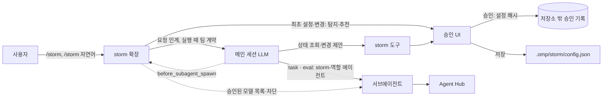

# OMP Storm 개발 계획서

> **OMP STORM** — Adaptive Multi-Agent Orchestration
> One command. Intelligent agents. Any runtime.

- 단계별 진행: [13장](#13-구현-단계). P0 결과: [p0-results.md](p0-results.md)
- 작성일: 2026-11-20
- 검증 기준: omp 19.0.1(CLI), `@oh-my-pi/pi-coding-agent` 19.0.1 소스
- 제품 형태: omp 플러그인(Extension + Skill + 역할 에이전트 정의)
- 원칙: **AI는 후보를 조사·평가·추천하지만, 설정과 중요한 변경은 사용자의 명시적 선택과 승인 이후에만 확정한다.**

## 1. 공식 네이밍

| 항목 | 이름 |
|---|---|
| 프로젝트명 | **OMP Storm** |
| GitHub 저장소 | `omp-storm` |
| npm 패키지 | `omp-storm` (omp는 플러그인을 이 패키지 이름으로 식별) |
| 실행 명령 | `/storm` |
| 확장 내부 ID | `storm` (상태 표시 키, 커스텀 엔트리·이벤트 접두사, 승인 저장 디렉터리 이름) |
| Skill | `storm` |
| 역할 에이전트 | `storm-<역할>` (예: `storm-implementer`, `storm-reviewer`) |
| 프로젝트 설정 | `.omp/storm/config.json` |
| 런타임 상태 | `.omp/storm/state/` |
| 승인 기록 | `<omp 에이전트 디렉터리>/storm/approvals/<repo-id>/` (저장소 밖) |

2026-11-20 확인: GitHub `dhkimxx/omp-storm`과 npm `omp-storm`은 비어 있었고, `/storm`은 omp 기본 슬래시 명령·CLI 명령과 겹치지 않는다.

## 2. 목표와 비목표

### 목표: `/storm` 하나로 프로젝트의 멀티에이전트 팀 전체를 관리한다

1. **최초 `/storm`:** 환경 탐지 → 역할별 후보 추천 → 인터뷰 → 승인 → `.omp/storm/config.json` 저장
2. **`/storm <자연어>`:** 작업 실행, 상태 확인, 설정 변경(우선순위, 워커 추가, 모델 재선정), 쿼터 대응을 한 인터페이스에서 처리
3. **실행:** OMP 기본 기능(`task`·eval, `workflowz`·`orchestrate`)으로 승인된 모델·effort·병렬화 정책에 따라 수행
4. **강제:** 승인 밖의 모델·Provider 사용은 스폰 단계에서 막는다
5. **모델 점검:** 사용 기록으로 역할별 선호 모델과 실측 속도를 파악하고, 더 새롭거나 더 좋거나 더 가성비 좋은 모델을 근거와 함께 찾는다(9장)

### 사용 예시

```text
/storm                                  # 최초: 탐지 → 추천 → 인터뷰 → 승인. 이후: 짧은 현황과 메뉴
/storm 로그인 기능 구현해줘                 # 작업 실행
/storm 현재 프로젝트 아키텍처 분석해줘        # 작업 실행(분석)
/storm 이번엔 비용보다 성능을 우선해줘         # 설정 변경 제안 → 승인
/storm 리뷰 워커 하나 추가해줘                # 팀 구성 변경 제안 → 승인
/storm 지금 쿼터 상황 어때?                  # 상태 확인
/storm 지금 모델보다 싸고 좋은 거 있어?        # 모델 점검(사용 기록 + 카탈로그)
```

### 비목표

- 새 DAG 실행 엔진, 스케줄러, 병렬 실행기 구현 (OMP 기본 기능 사용)
- Swarm Extension 재구현 또는 의존
- 에이전트 모니터링 UI 재구현 (Agent Hub 사용)
- 사용자의 omp 설정 파일(`.omp/config.yml`, 전역 설정) 자동 수정
- v0.1에서 외부 벤치마크 실시간 수집, 원격 호스트 실행, 외부 하네스(Claude Code, Codex) 실행
- 승인 없는 모델·런타임·설정 변경, 유료 측정 호출, 파괴적 명령
- 모든 Provider의 잔여 쿼터를 정확히 조회할 수 있다는 가정, 조회 불가를 무제한으로 해석하는 것

## 3. 설계 결정

| 결정 | 근거 |
|---|---|
| 실행 엔진을 만들지 않는다. 실행은 OMP 기본 기능(`task`, eval, `workflowz`·`orchestrate`)에 맡기고, Storm은 탐지·추천·승인·강제·관리만 맡는다. | 확장 API에는 기본 `task`를 직접 호출할 수단이 없다(`ctx.invokeTool`은 같은 이름으로 재등록한 도구에서만 그 기본 도구로 위임). 병렬, 격리, 호출별 모델은 이미 `task`에 있다. |
| `/storm <자연어>`는 메인 세션 LLM이 해석한다. 설정 변경은 `storm` 도구가 **제안만** 하고, 확정은 승인 UI에서 사용자가 한다. | LLM이 스스로 승인할 수 없어야 한다. 저장소 내용 등에 숨은 지시가 있어도 승인 창을 띄우는 데서 멈춘다. |
| 프로젝트 설정은 `.omp/storm/config.json`에 두고, 승인은 저장소 밖에 설정 해시로 기록한다. 해시가 다르면 다시 승인을 받는다. | 설정 파일은 팀이 커밋해 공유할 수 있지만, 커밋된 설정이 곧 이 사용자·이 머신의 승인은 아니다. |
| omp 설정 파일은 바꾸지 않는다. 승인된 구성은 런타임에 강제한다(역할 에이전트 + 스폰 훅). | 사용자의 omp 설정이 그대로라 롤백이 단순하다. 스폰 훅은 에이전트 이름을 받고 시도 순서대로의 모델 목록을 돌려줄 수 있다. |
| 역할은 플러그인에 포함된 에이전트 정의(`agents/storm-<역할>.md`)로 제공한다. | 확장 API로는 에이전트 정의를 동적으로 등록할 수 없다(`resources_discover`는 스킬·프롬프트·테마 경로만 받고 현재 호출되지 않음). 플러그인의 `agents/` 디렉터리는 omp가 자동 탐색한다. |
| OMP Swarm Extension을 런타임 후보에서 제외한다. | upstream에서 2026-08-05 커밋 `b0a94a8fc`로 삭제됐다. npm 최신 13.17.0은 `@oh-my-pi/pi-coding-agent ^13`을 요구한다. |
| 모델 분석과 추천은 사용자의 omp 사용 기록(선호 모델, 실측 속도·비용)과 omp 카탈로그로 결정적으로 계산한다. LLM은 설명과 인터뷰 질문에만 쓰고, 근거가 없으면 '비교 불가'로 표시하고 추측하지 않는다. | 이 사용자에게 가장 정확한 근거는 이 사용자의 실측이다. 카탈로그 지능 점수는 인증된 모델 100개 중 19개, 속도 추정치는 0개에만 있었다(9.4). 공개 벤치마크는 커버리지가 좁고 하네스가 다르다. |
| v0.1은 최초 `/storm`(탐지 → 추천 → 인터뷰 → 승인 → 저장), 스폰 강제, 팀 현황까지로 한정한다. | 자연어 관리, 작업 실행 인계, 외부 런타임은 v0.1로 가치를 확인한 뒤 붙인다. |

## 4. 재사용할 OMP 기존 기능 (재구현 금지)

| 영역 | OMP 기존 기능 | Storm의 역할 |
|---|---|---|
| 서브에이전트 실행·병렬·격리 | `task`: 배치 `tasks[]`, `isolated`, 호출별 `model`, `effort`(`task.enableEffort` 시), 비동기 잡, `task.maxConcurrency` | 사용만 |
| 결정적 다중 에이전트 워크플로 | `workflowz` 키워드 + eval `agent()`·`workpool()`·`wait()` (`eval`과 `task`가 모두 활성일 때만) | 작업 실행 계약 |
| 자동 분해·병렬 위임 | `orchestrate` 키워드 (`task` 활성 필요) | 작업 실행 계약 |
| 모니터링·조종 | Agent Hub(Alt+A): 역할·모델·비용·토큰·요청 수, 조종, 모델·thinking 변경, 종료·부활 | 재구현하지 않음. `/storm` 현황은 승인 범위 대비 요약만 |
| 에이전트 정의 | `.omp/agents/`, 사용자 `agents/`, 플러그인 `agents/` 자동 탐색, `/agents` 허브 | 역할을 `storm-<역할>` 에이전트로 제공 |
| 모델 오버라이드·역할·프리셋 | `task.agentModelOverrides`, `modelRoles`, `modelPresets` | 바꾸지 않음. 서브에이전트 모델은 스폰 훅이 최종 결정 |
| 폴백 | `retry.fallbackChains`, `retry.usageAwareFallback` | 메인 세션은 omp 설정을 그대로 사용. 서브에이전트 폴백은 스폰 훅의 모델 목록 순서로 표현 |
| 비용 상한 | 세션 비용 경고·상한(`--warn-cost`·`--max-cost`와 같은 값) | 쓰지 않음. 확실한 상한으로 사용을 권한다(11장, P0 Q5) |
| 스폰 정책 | `before_subagent_spawn` 훅 | 승인된 모델 목록 강제, 승인 밖 스폰 차단 |
| 조회 | `omp usage --json`(쿼터), `omp config list --json`(명시적 설정), `omp stats --summary`(stats DB 갱신), 모델 레지스트리 | 탐지 입력(`src/discovery/`) |
| 사용 통계 | `omp stats`(대시보드), 그 원본 `stats.db`: 모델별 요청·토큰·비용·tok/s·TTFT·오류율, main/subagent·부가 호출 구분 | 모델 분석 입력(9장). 대시보드는 재구현하지 않음 |

### Swarm Extension 판단

- **기능:** YAML로 파이프라인·병렬·순차·DAG를 정의한다(`waits_for`, `reports_to`로 의존성을 만들고 topological wave로 실행). 에이전트별 `model`, `.swarm_<name>/` 상태·로그, `pipeline` 모드의 `target_count` 반복, `/swarm run|status|help`, 독립 실행기 `omp-swarm`을 제공했다. effort 필드는 없다.
- **상태:** upstream `packages/swarm-extension`은 2026-08-05 커밋 `b0a94a8fc`(chore: cleanup)에서 파일 14개가 삭제됐다. npm 최신은 13.17.0(2026-03-30)이고, `peerDependencies`는 `@oh-my-pi/pi-coding-agent ^13`이며, 내부 모듈(`config/model-registry`, `config/settings`)을 직접 import한다.
- **실측:** omp 19.0.1에서 확장 로드 오류는 없다(로드 실패 대조군은 오류를 출력함). `/swarm run` 실행은 검증하지 않았다.
- **결정:** 런타임 후보에서 제외한다. YAML DAG 표현(`waits_for`, wave, 반복)은 작업 계획 형식 설계에 참고만 한다. 사용자가 이미 설치해 둔 경우에도 "유지보수 중단"으로 표시한다.

## 5. 아키텍처



- **`/storm` 명령:** 입력을 나눈다. 인자가 없으면 최초 설정 또는 현황과 메뉴, 정확히 일치하는 짧은 키워드는 LLM 없이 처리, 그 외 자연어는 `<storm-request>`로 메인 세션에 넘긴다. 팀 계약은 LLM이 `storm` 도구로 실행을 시작할 때 붙는다.
- **`storm` 도구:** LLM이 호출하는 관리 연산이다. 조회는 바로 답하고, 변경은 제안(diff)을 만들어 승인 UI를 띄운다.
- **정책·강제:** 스폰 훅, 예산·쿼터 감시, 텔레메트리
- **실행(OMP 기본):** 메인 세션 LLM이 `workflowz`·`orchestrate` 계약에 따라 `storm-<역할>` 에이전트를 `task`·eval로 실행

스케줄링은 메인 세션(task·eval)이 소유한다. Storm은 별도 스케줄러를 만들지 않고, 승인 범위를 넘는 스폰만 막는다.

### 확장 API 사실

omp 확장 API의 제약(P0 실측, omp 19.0.1)은 [p0-results.md](p0-results.md) Q1~Q5에 있다. 그 제약에서 나온 결정은 3장 표에 있다.

## 6. `/storm` 인터페이스

### 입력 처리

| 입력 | 처리 |
|---|---|
| `/storm` (설정 없음·오류) | 설정 인터뷰(v0.6부터 세션 LLM이 진행, [10장](#10-인터뷰-ux)) |
| `/storm` (승인할 것 있음: 직접 편집·팀원 커밋한 설정, 가림 정의) | 승인 화면 |
| `/storm` (승인됨) | 메뉴(보류 제안 승인, 팀 다시 설정, 모델 점검, 서브에이전트 재사용 권장, 되돌리기, 초기화 중 해당하는 것)를 띄우고, 그 위 패널에 현황을 보인다(v0.6). UI가 없는 모드(print, `--no-ui`)에서는 현황만 |
| `/storm <요청>` | 메인 LLM이 `storm` 도구로 처리한다. 작업이면 실행을 인계하고, 조회는 답하고, 변경은 승인 UI로 넘긴다. 되돌리기·초기화는 도구에 없어 `/storm` 메뉴로 안내한다. 팀 설정 제안(`propose`)은 `/storm`이 보낸 설정 요청에 답할 때만 쓴다(v0.6) |
| 바로가기 `status`·`models`·`setup`·`reset`(v0.4) | 정확히 일치하면 그 흐름을 LLM 없이 연다. README에 적고, `/storm ` 뒤 자동완성 후보로도 낸다(0.4.2). 공백 뒤에만 뜨므로 `/storm` + Enter는 그대로 허브를 연다. 손에 익은 예전 하위 명령이 요청으로 넘어가지 않게 남겼다. 승인과 되돌리기는 바로가기가 없다(0.4.1). `/storm`이 승인 화면을 스스로 띄우고, 되돌리기는 메뉴에 있다 |

### 자연어 관리 연산 (`storm` 도구)

| 연산 | 예 | 승인 |
|---|---|---|
| 상태 조회 | "쿼터 상황 어때?" | 불필요 |
| 서브에이전트 재사용 권장 (v0.3) | "끝난 리뷰어 다시 써도 돼?" | 불필요(조회). 재사용·새 에이전트·정리를 권할 뿐 강제하지 않음 |
| 우선순위 변경 | "비용보다 성능 우선해줘" | 필요. 영향받는 역할의 모델 재추천 diff를 보여 줌 |
| 워커 추가·제거 | "리뷰 워커 하나 추가해줘" | 필요 |
| 모델 재선정 | "구현 워커 모델 다시 골라줘" | 필요 |
| 모델 점검 | "지금 모델보다 싸고 좋은 거 있어?", "더 최신 모델 나왔어?" | 불필요(조회). 교체는 모델 재선정과 같음 |
| 시험 사용 | "리뷰 워커에 새 모델 일주일만 써 보자" (v0.2) | 필요. 비율·기간·예산 상한 포함 |
| 쿼터 대응 | "Anthropic 쿼터 다 썼어" | 승인된 폴백 범위 안이면 정책대로, 밖이면 필요 |

- 도구는 설정을 직접 쓰지 않는다. 제안(diff)을 만들고 승인 UI를 띄운다. 사용자가 승인해야 `.omp/storm/config.json`과 승인 기록이 바뀐다.
- 도구는 기본으로 꺼 두고, Storm 설정이 있는 프로젝트의 메인 세션과 `/storm <자연어>` 요청 때만 켠다. 설치만으로 모든 세션과 서브에이전트의 요청에 도구 스키마가 실리지 않게 하기 위해서다.
- 승인 창에 답이 없는 환경(print, `--no-ui`, 폼 미지원 ACP)에서는 아무것도 적용하지 않는다. 변경 제안은 보류로 남기고, 팀 설정 제안과 실행 계획의 범위 변경은 버린다.

### 작업 실행

- **인계:** `/storm <요청>`은 실행을 시작하지 않는다(v0.4). 작업이면 메인 LLM이 `storm` 도구 `run`을 부르고, Storm은 현재 턴이 끝난 뒤 `deliverAs` 없이 팀 계약을 보내 키워드 notice를 받는다(P0 Q1). 키워드를 쓸 수 없는 세션이면 계약만 보낸다. 어느 계약을 쓸지는 설정 항목이다. 구현은 `src/runtime/controller.ts`.
- **스폰 정책:** Storm 실행은 인계 시점부터 세션이 settle될 때까지다. 분기 순서는 `src/policy/spawn.ts`.
  - `storm-<역할>`: 승인된 모델 목록(시도 순서)으로 교체한다.
  - Storm 역할이 아닌 에이전트: 실행 계획·병렬도·예산 차단은 똑같이 걸린다. 요청 모델이 승인 목록 안이면 허용하고, 밖이면 omp 기본 에이전트는 맞는 역할(v0.7), 그 밖은 대체 역할의 모델로 바꾼다. 쓸 역할이 없으면 차단한다.
  - Storm 실행 밖의 일반 세션 스폰에는 관여하지 않는다.
- **역할 정의 가림:** 프로젝트·사용자 `agents/`에 `storm-*` 정의가 있으면 승인 화면에 보여 주고 그 내용 해시를 승인 범위에 넣는다. 승인되지 않은 가림 정의가 있으면 그 역할의 스폰을 차단한다.

## 7. 저장 구조

저장소 안에는 팀이 커밋할 수 있는 설정(`.omp/storm/config.json`)과 커밋하지 않는 런타임 상태(`.omp/storm/state/`)만 둔다. 승인 기록·스냅숏·추천 근거, 사용 기록 일 단위 보관본, (선택) 사용자 사전값은 저장소 밖 `<pi.pi.getAgentDir()>/storm/`에 둔다. 사용자 관점 설명은 [README](../README.md#동작)의 "omp 설정", 세부 배치는 `src/approval/store.ts`, `src/runtime/run.ts`.

- **repo-id:** `realpath(git rev-parse --path-format=absolute --git-common-dir)`의 SHA-256 앞 24자에 사람이 읽을 이름을 붙인다.
  - 같은 저장소의 worktree는 승인을 공유하고, fork·별도 클론은 따로 승인한다.
  - 저장소를 옮기면 승인이 없는 상태가 되어 다시 승인해야 한다.
  - git 저장소가 아니면 프로젝트 루트 실경로를 쓴다.
  - remote URL은 자격 증명이 섞일 수 있어 키로 쓰지 않는다.
- **설정 해시:** 엄격한 JSON 파싱(중복 키 같은 모호한 입력은 설정 오류로 거부)과 JCS(RFC 8785) 정규화 뒤의 SHA-256이다. 계산은 `src/config/canonical.ts`.
  - 서식만 바뀐 경우는 재승인하지 않는다.
  - 해시가 승인 집합에 없으면(직접 편집, 팀원의 커밋 등) 실행·적용 전에 다시 승인을 받는다.
  - 브랜치마다 config가 다른 worktree끼리 재승인을 주고받지 않도록 승인을 해시별로 보관한다.
- `config.json`에는 비밀키, 토큰, 계정 식별자를 넣지 않는다.
- 프로젝트 루트 `.gitignore`는 건드리지 않는다. `.omp/storm/.gitignore`만으로 `state/`가 git에서 빠지는 것을 실측했다.
- omp는 `.omp/storm/`을 읽지 않는다(P0 Q7). Storm은 `.omp/storm/` 밖의 `.omp/` 경로에 쓰지 않는다.
- 승인은 omp 프로필별로 따로 관리된다.
- 초기화(v0.3, `/storm` 메뉴)는 이 프로젝트의 `.omp/storm/` 전체와 `approvals/<repo-id>/`를 한 번에 지운다. 실행 요약 색인은 기본으로 남기고, 따로 고를 때만 함께 지운다(v0.9). 지울 대상(커밋된 설정 파일, 승인 기록을 함께 쓰는 다른 worktree, 진행 중으로 남은 실행 기록이 있으면 경고 포함)을 보여 주고 정확한 선택지를 고를 때만 지운다. `.omp/`의 다른 경로, `usage/` 보관본, omp 설정은 건드리지 않는다. Storm 실행 중이거나 확인 UI가 없으면 하지 않는다.
- 저장 데이터의 수명은 [v0.9 계획](#v09-계획)의 원칙을 따른다. Storm이 만든 데이터는 한도 안에서 실행이 끝날 때 정리하고, Storm 실행이 만든 omp 기록은 자동 정리를 승인한 팀에서만 정리한다.

## 8. 환경 탐지 (읽기 전용)

### 8.1 OMP

omp CLI 결과(`src/discovery/`)는 `pi.exec`로, 카탈로그는 공개 확장 API(`ctx.modelRegistry`)로 읽는다. 그 밖의 omp 내부 API(`authStorage.usage.reports()` 등)와 내부 DB는 자동 업데이트로 조용히 깨질 수 있어 쓰지 않는다. 예외는 `stats.db` 읽기 전용 조회 하나이며, 스키마 검사로 보호한다(9.1, [p0-results.md](p0-results.md) Q8). 계정 식별자(`omp usage accounts`의 `identityKey`·`orgName` 등)는 저장하거나 프롬프트에 넣지 않는다.

`pi.getActiveTools()`로 `task`·`eval` 활성 여부를 확인하고, 매직 키워드 설정이 켜져 있는지 확인해 `workflowz`·`orchestrate` 사용 가능성을 판정한다.

### 8.2 외부 런타임 (이후)

- **Herdr:** 실행 파일·세션을 확인한다. 현재 테스트 환경이 없다.
- localhost와 원격 호스트는 서로 다른 실행 환경으로 기록한다. 원격은 v0.1에서 제외한다.

### 8.3 가용량 상태

`available / limited / exhausted / unknown / unavailable`과 신뢰도, 관측 시각, 리셋 시각을 저장한다. 구독형과 종량제를 구분하고, 조회 불가를 무제한으로 해석하지 않는다.

## 9. 모델 분석과 추천

Storm은 사용자의 omp 사용 기록과 omp 카탈로그로 아래 네 가지를 파악하고 추천의 근거로 쓴다. 계산은 결정적으로 하고, LLM은 결과 설명과 인터뷰 질문에만 쓴다.

| 질문 | 방법 | 주 데이터 |
|---|---|---|
| 선호 모델은? | 명시적 설정, 모델 계열 단위(여러 Provider 합산)·가격 계층별 사용 비중(30일 전체와 최근 가중) | `omp config`, 사용 이력 |
| 얼마나 빠른가? | 경로별 실측 tok/s(omp 정의, 생성 구간)와 TTFT | 사용 이력, 카탈로그 `tps` |
| 더 최신 모델이 있는가? | 같은 계열·등급에서 `revision`이 더 높은 모델 | 카탈로그 `identity`, 모델 이름 |
| 더 좋거나 가성비 좋은 모델이 있는가? | 사용자 토큰 구성으로 다시 계산한 비용과 품질 지표의 역할별 비교 | 카탈로그 `cost`·`int`, 사용 이력, `omp usage` |

### 9.1 데이터

1. **사용 이력:** `stats.db`의 요청 단위 행을 읽기 전용으로 읽는다(`src/history/`).
   - 최근 30일 창이고, `purpose`가 있는 부가 호출은 뺀다. 오류는 omp와 같이 `stop_reason='error'`로 센다.
   - **신선도:** stats DB는 `omp stats`·`/usage`가 돌 때만 갱신된다. 그래서 분석 결과에 데이터 기준 시각을 표시하고, 많이 늦었으면 요청을 받았을 때 `omp stats --summary`를 하위 프로세스로 돌려 갱신한다.
   - **보존:** `omp gc --apply`가 30일 넘은 세션의 행을 지운다. 그래서 Storm이 일 단위 집계를 `usage/`에 쌓아 두고 창을 채울 때 함께 읽는다.
2. **카탈로그:** omp 모델 레지스트리(인증된 모델과 로그인하지 않은 Provider의 모델)의 단가, `identity`, `int`(지능 점수), `tps`(속도 추정). `omp models --json`에는 `int`·`tps`·`identity`가 없어 쓰지 않는다(`src/discovery/models.ts`).
3. **명시적 설정:** `omp config list --json`의 기본 모델, `modelRoles`, `task.agentModelOverrides`
4. **쿼터:** `omp usage --json`. 구독형 Provider는 달러가 아니라 쿼터 창 소모로 비용을 본다.
5. **측정(선택):** 승인된 시험 사용(9.3)
6. **사전값:** `priors.yml`에 다음만 둔다.
   - 이름 해석 어휘(경로·벤더·브랜드어)
   - 같은 class 안의 등급 순서
   - 가격 계층 경계와 기준 토큰 구성
   - 출처와 만료일이 있는 alias
   - (선택) 출처가 있는 외부 품질 값

   카탈로그 `int`는 보정하지 않고, tps 사전값은 두지 않는다. 플러그인에 포함하고 날짜를 붙이며 사용자가 덮어쓸 수 있다. 90일이 지나면 '사전값 오래됨'을 표시한다.
7. **외부 벤치마크(이후):** 오케스트레이터 역할은 WorkflowArena(arXiv 2611.12856)와 ClawArena-Team(arXiv 2606.31174)을 근거로 쓴다. 보도 기준 각각 25개 구성과 12개 모델만 평가해 커버리지가 좁다는 점을 함께 표시한다. 코딩·리서치 역할은 SWE-bench 계열, Terminal-Bench, BrowseComp 등을 쓰고, 하네스가 다르면 '동일 조건 비교 불가'로 표시한다.

### 9.2 분석 방법

**선호 모델**

- 설정에 적힌 선호와 실제 사용을 나눠 보여 준다.
- **모델 계열 키 `class/등급@revision`:** 같은 모델을 여러 Provider로 쓴 사용량은 이 키로 합친다. 애매하면 합치지 않는다. Provider(경로)는 속도·가격·가용성을 비교하는 별도 축으로 남긴다. 키 규칙과 경로 변형 어휘는 `src/lineage/key.ts`, `priors/priors.yml`.
- **가격 계층:** 선호를 한 줄 순위로 보지 않고, 가격 계층(고성능, 범용, 빠르고 싼 모델)별로 나눠 센다. 한 줄 순위에서는 요청 수가 많은 고성능 모델에 가벼운 계층의 선호가 묻힌다.
  - 계층은 계열의 가장 싼 사용 가능 경로(변형 경로 제외)의 기준 요청 비용으로 나눈다. 기준 토큰 구성과 경계는 `priors/priors.yml`의 `price_tier`.
- 부가 호출(`purpose`가 있는 요청)은 빼고, main과 subagent를 나눠 본다. 30일 전체 비중과 최근 가중 비중을 함께 쓴다. 최근 가중만 쓰면 오래 써 온 선호가 지워진다.

**속도**

- omp 정의 tok/s(TTFT 포함), 생성 tok/s, TTFT를 함께 본다. 두 tok/s는 2배 넘게 차이 날 수 있다. 계산식은 `src/types.ts`의 `UsageRow`.
- 표본 수와 관측 기간을 붙이고, 표본이 적으면 신뢰도를 낮춘다.
- 써 본 적 없는 경로는 카탈로그 `tps`나 같은 계열 다른 경로의 값을 신뢰도를 낮춰 쓴다. fast 계열 경로와 기본 경로끼리는 빌리지 않는다. 모두 없으면 '미측정'으로 둔다. 순서는 `src/lineage/metrics.ts`의 `fillTps`.

**더 최신 모델**

- 카탈로그에 출시일이 없다. 같은 `class/등급`에서 revision이 더 높은 키를 새 버전으로 본다.
- revision을 이름에서 만들었거나 의심스러우면(`@?`, 두 자리 압축 표기) '확인 필요'로 둔다. preview·alias 경로는 새 버전 판정에 쓰지 않는다.
- 범위는 세 단계다.
  1. 인증된 모델: 바로 후보가 된다.
  2. 카탈로그에는 있지만 로그인하지 않은 Provider의 모델: 참고로만 보여 주고, Provider 추가는 승인을 받는다.
  3. 카탈로그에 아직 없는 모델: 사용자가 요청할 때만 메인 세션 LLM이 웹에서 조사하고, 출처와 낮은 신뢰도를 함께 표시한다.

**더 좋거나 가성비 좋은 모델**

- 비용: 이 사용자의 subagent 요청 평균 토큰 구성(입력·출력·캐시)으로 후보 모델 요금을 다시 계산한다. 사용 기록에 역할 정보가 없어 역할별 구성은 쓰지 않는다. 모델마다 토큰 수가 달라지므로 '추정'으로 표시한다. 구독형 Provider는 쿼터 창 소모로 따로 본다.
- 품질: 카탈로그 `int`. `int`는 계열이 아니라 경로별 값이라, 같은 계열에도 값이 여럿일 수 있다.
  - 비어 있으면 같은 계열 다른 경로의 값이나 출처 있는 사전값으로 채우고, 없으면 '비교 불가'다. 순서는 `src/lineage/metrics.ts`의 `fillInt`.
  - 다른 revision·등급의 값은 빌리지 않는다.
  - 오류율은 작업 구성에 따라 달라지므로 점수에 섞지 않는다.
- 역할별 후보는 쓸 수 있는 모델(인증, 도구 호출, 컨텍스트, 쿼터) 가운데 품질·비용·속도와 사용자 선호를 차례로 비교해 고른다(`src/recommend/recommend.ts`).
- 비용대가 크게 다른 모델은 '더 좋은 모델'로 추천하지 않고, 비용 배수와 함께 상위 선택지로만 보여 준다.
- 지표가 없으면 '비교 불가'로 표시하고 추측하지 않는다.
- 사용자가 많이 쓰고 오류율이 낮았던 모델은 `int`가 없어도 '사용자 검증' 후보로 넣는다. 이 사용자에게는 카탈로그 점수보다 자신의 실제 결과가 더 직접적인 근거다.
- 같은 계열이라도 경로마다 가격·속도·`int`가 다를 수 있다. 경로별 값은 따로 보여 주고 평균 내지 않는다.

### 9.3 시험 사용 (v0.2)

빠진 지표는 측정으로 채운다. 사용자가 승인하면 스폰 훅이 한 역할의 스폰 일부(비율이나 횟수, 기간 상한)를 후보 모델로 보낸다. 끝나면 실측 tok/s, TTFT, 오류율, 비용을 현재 모델과 나란히 보여 주고 교체 여부를 묻는다. 승인된 비율·기간·예산을 넘지 않는다.

### 9.4 실측으로 확인한 한계 (2026-11-20, 이 Mac, omp 19.0.1)

- `omp stats --json`은 최근 24시간만 반환했다(기간 플래그 없음). stats DB에는 한 달 치 요청 약 4만 건이 있었다.
- 카탈로그 캐시의 모델 11,984개 중 `identity`는 전부, `int`는 15%, `tps`는 3.6%에만 있었다. `isNew`가 있는 행은 없었고 출시일 필드는 없다.
- 인증된 모델 100개 중 `int`는 19개, `tps`는 0개였다. 가장 많이 쓴 subagent 모델과, 새로 나온 같은 등급 모델에도 `int`가 없었다.
- 기간에 따라 선호 모델이 달랐다. 한 달 가중으로는 GPT 계열, 최근 24시간은 Claude 계열이었다.
- `int`만으로 고르면 저가 모델의 대안으로 비용이 19~29배인 모델이 나왔다. 비용대를 고려한 Pareto 비교가 필요하다.
- 정가가 같은데 `int`가 더 낮고 실측 속도가 약 4분의 1인 모델을 찾을 수 있었다. 다만 구독형이면 실제 비용은 쿼터로 따져야 한다.
- Provider·모델 단위로 세자, 30일 요청의 12.6%로 세 번째로 많이 쓴 모델 계열(DeepSeek V4.1 Flash)이 Provider 세 곳으로 쪼개져 선호 목록에서 빠졌다. 마지막 사용이 9일 전이라 7일 반감기 가중도 비중을 더 낮췄다.
- 빠르고 싼 계층(DeepSeek Flash, GPT-6 Luna, MiniMax Flash, GLM Flash, Haiku 등)이 30일 요청의 31%였지만 한 줄 순위에는 드러나지 않았다. DeepSeek V4.1 Flash의 요청당 비용(정가 기준)은 Sonnet의 약 25분의 1, Opus의 약 45분의 1이었다.
- 같은 계열을 여러 경로로 옮겨 쓰다 멈춘 경우가 있었다. 앞의 두 경로는 지금 사용 불가였고, 남은 경로는 표본이 적어 속도 기록이 없었으며 출력 단가가 이전 경로의 약 2배였다.
- 같은 모델이라도 경로에 따라 생성 속도(137 대 190 tok/s)와 출력 단가(유료 경로 사이 최대 4배)가 달랐고, 카탈로그 `int`도 32.6과 39.5 두 값이 붙어 있었다.
- 카탈로그 캐시 11,984행은 버전별 캐시가 중복된 것으로, (provider, id) 기준으로는 4,042개(Provider 40곳)였다. Storm은 `ctx.modelRegistry`가 병합한 값을 쓰므로 직접 다루지 않는다.
- `int`가 있는 계열 키 181개 중 63개가 경로마다 다른 값을 가졌다. DeepSeek V4.1 Flash의 39.5는 번들 카탈로그가 날짜 없는 id에 붙인 값이다. models.dev 현재값은 `-1017` 스냅숏에만 붙은 32.6이다.
- 계열 키로 30일 이력의 (provider, model) 19쌍이 13개 계열로 묶였다. `identity`만으로 묶으면 출력 단가가 최대 100배 다른 GPT 등급들이 한 계열이 된다.
- stats DB의 최신 행이 실측 시점보다 약 2.5시간 늦었다. 대시보드 API의 모델별 합계는 부가 호출이 섞인 39,207건으로, 부가 호출을 뺀 38,610건과 달랐다.

### 9.5 추천 규칙

- 지표마다 출처와 신뢰도를 붙이고, 결측은 0점 처리하지 않고 사유와 함께 남긴다(`src/types.ts`의 `MetricValue`).
- 점수는 결정적으로 계산한다. LLM은 설명 문장과 인터뷰 질문에만 쓰고 숫자를 만들지 않는다. LLM을 쓰면 비용을 표시한다.
- 쓸 수 없는 모델을 거른 뒤 사용자 우선순위와 선호 모델로 순위를 매겨 역할마다 몇 개를 앞에 둔다. 역할별 기본 후보는 사용자가 비슷한 자리(main·subagent)와 가격 계층에 실제로 써 온 계열을 우선한다.
- 추천마다 고른 이유와 다른 후보를 고르지 않은 이유를 남긴다(`src/types.ts`의 `Candidate`).
- 사용자가 직접 고른 조합도 제약 검사를 한다. 팀 설정 제안의 쓸 수 없는 모델은 경고로 보이고, 모델 재선정과 시험 사용은 이유와 함께 거절한다.

## 10. 인터뷰 UX

### 원칙

- 최초 호출에서 AI 판단만으로 확정하지 않는다. 추천은 기본 강조값일 뿐이다.
- 런타임이나 Provider가 하나만 감지돼도 설명하고 승인을 받는다.
- 취소, 미응답, UI 부재는 `not approved`다.
- 이전 선택은 '기존안'으로 보여 주되 새 승인으로 간주하지 않는다.

### 흐름 (v0.6: 세션 LLM이 인터뷰, Storm은 사실과 승인)

1. Storm이 `<storm-setup>` 메시지로 사실(Provider와 쓸 수 있는 모델, 역할별 후보와 고른 이유·안 고른 이유, Storm 추천안, 지금 설정과 승인 여부, 가림 정의, 경고)을 넘긴다. 내용과 LLM 지시문은 `src/setup/request.ts`.
2. LLM이 `ask` 폼으로 묻는다. 질문마다 따로 부르지 않고 단계마다 폼 하나에 모은다(v0.7.1. 질문마다 묻던 v0.7까지는 역할별로 고르면 질문 창이 스무 번 가까이 떴다). 첫 폼은 Storm 추천안을 그대로 쓸지, 역할별로 고를지, 취소할지 묻는다. 역할별로 고르면 모델 폼과 설정 폼이 나온다. effort는 고른 모델에 따라 선택지가 달라 모델 폼과 나눴다. 구현을 뺀 역할은 "사용 안 함"을 고를 수 있다(v0.7). 추천 선택지는 label 끝에 "(추천)"을 붙이고 미리 골라 둔다. ask 도구의 `recommended`는 영어 " (Recommended)"를 붙이므로 쓰지 않는다.
3. 넘긴 사실에 없는 모델을 사용자가 물을 때만 웹 검색을 하고 출처를 밝힌다.
4. LLM이 `storm` 도구 `propose`로 팀 전체 설정과 근거(2~4문장)를 낸다. Storm이 스키마를 검증해 오류는 돌려보내고, 쓸 수 없는 모델은 경고로 보인다.
5. Storm 승인 창("Storm 팀 제안": 팀 구성, 근거, 경고, 가림 정의) → `승인` / `취소`. 정확히 "승인"일 때만 저장한다. 창이 떠 있는 사이 설정이나 가림 정의가 바뀌면 저장하지 않는다.

v0.1~v0.5의 결정적 단계별 인터뷰(추천 검토 화면, 단계별 선택, ★ 추천 표시)는 v0.6에서 없앴다. 추천 계산(9장)은 그대로이고, 그 결과를 LLM에 넘기는 사실과 Storm 추천안으로 쓴다. 외부 런타임 어댑터가 생기면 런타임 후보도 사실에 넣는다.

## 11. 승인과 적용

- **승인 단위:** 정규화한 `config.json`의 해시(7장). 승인 기록에는 승인 ID, 해시, 시각, 승인 화면에 보인 범위(Provider·역할별 모델·예산·런타임), omp·Storm 버전을 남긴다.
- **승인 판정:** 승인 UI의 `select`가 정확히 "승인"을 돌려줄 때만 승인으로 기록한다. `undefined`, `false`, 취소는 모두 미승인이다.
- **적용 방식:** omp 설정 파일과 메인 세션 모델은 바꾸지 않는다. 승인된 구성은 다음으로만 적용한다.
  1. 스폰 훅: `storm-<역할>` 에이전트마다 승인된 모델 목록(시도 순서)을 돌려주고, 승인 밖 스폰은 `block`과 사유를 반환
  2. Storm 실행 계약: 팀 구성, 병렬도, 격리, 예산을 작업 실행 메시지에 포함
- **롤백:** 이전 승인 이력의 설정으로 되돌리거나 Storm 설정을 지운다. omp 설정이 바뀌지 않았으므로 omp 동작은 Storm이 없을 때와 같아진다.
- **예산:** 세 겹으로 지킨다.
  1. 스폰 훅이 Storm 실행 누계가 `perRunUsd` 이상이면 새 스폰을 막는다.
  2. Storm이 누계를 직접 계산해 `warnAtUsd`에서 알린다. 누계는 이 omp 프로세스 안 메인·서브에이전트 요청의 정가 합이다.
  3. 확실한 상한은 omp `session.maxCost`(`--max-cost`)뿐이다. 서브에이전트 요청까지 막는 것을 실측했다. Storm은 이 설정을 쓰지 않고, 현황에서 사용을 권한다.

  진행 중 요청과 병렬 워커만큼은 상한을 넘을 수 있다는 점을 함께 표시한다. 구독형 Provider는 비용이 정가 환산이거나 0이라 '비용 미측정'으로 표시한다.
- **민감 정보:** 비밀키, 원시 토큰, 계정 식별자(`identityKey`, 이메일, `orgName`)는 파일과 프롬프트에 남기지 않는다.
- **omp 설정 내보내기:** Storm 없이도 같은 모델을 쓰고 싶은 경우를 위해, 승인된 구성을 omp 설정으로 내보내는 연산은 이후 단계에서 검토한다.

## 12. 보안 및 안전

1. 탐지는 읽기 전용이다. 비용이 발생하는 측정은 별도 동의를 받는다.
2. 승인 기록은 저장소 밖에 둔다. 저장소의 `config.json`은 승인 해시와 일치할 때만 유효하다.
3. 자연어 요청으로 인한 설정 변경은 `storm` 도구가 제안만 하고, 사용자가 승인 UI에서 확정한다. LLM은 승인할 수 없다.
4. 저장소 파일이나 도구 출력에 숨은 지시가 있어도 최대 결과는 승인 창 표시다.
5. 승인 전 커밋, 병합, 배포, 원격 실행을 하지 않는다.
6. 스폰 훅으로 승인된 모델·Provider 밖의 실행을 막는다. 폴백은 승인된 목록 안에서만 한다.
7. 계정 식별자와 토큰은 파일과 프롬프트에 남기지 않는다.
8. 비용 추정이 불확실하면 범위와 근거 부족을 표시하고 사용자에게 결정을 요청한다.
9. 사용 기록은 집계값만 쓴다. 프롬프트·응답 원문은 읽지 않고 LLM에도 보내지 않는다. 웹 조사는 사용자가 요청할 때만 한다.
10. 프로젝트·사용자 `agents/`의 `storm-*` 정의는 플러그인 정의를 덮어쓴다(실측). Storm은 이를 감지해 승인 범위에 넣고, 승인되지 않은 가림 정의가 있으면 그 역할의 스폰을 막는다.
11. 승인 창에 답이 없는 환경(print, `--no-ui`, 폼 미지원 ACP)에서는 승인할 수 없고 아무것도 적용되지 않는다.

참고: omp는 프로젝트 로컬 입력(`.omp/extensions`, `.omp/config.yml`)을 신뢰 확인 없이 로드한다. 신뢰할 수 없는 저장소에서 omp를 여는 위험은 Storm이 막을 수 없다.

## 13. 구현 단계

| 단계 | 범위 | 완료 조건 |
|---|---|---|
| P0 스파이크 | 아래 질문 9개 | 완료(2026-11-20). 결과와 결정: [p0-results.md](p0-results.md) |
| v0.1 최초 설정 | `/storm`: 탐지 → 사용 기록 분석(선호 모델, 실측 속도, 새 버전·가성비 후보) → 추천 → 인터뷰 → 승인 → `config.json` 저장, 역할 에이전트, 스폰 강제, 팀 현황, `rollback` | 완료(2026-11-20). [v0.1 결과](#v01-결과). 승인 없이 저장·강제 0건, 취소 시 무변경, 승인 밖 모델 스폰 차단, 해시 불일치 시 재승인 요구, 결측 지표를 추측으로 채우지 않음, Storm 설정 삭제 후 omp 동작이 원래와 같음 |
| v0.2 자연어 인터페이스 | `/storm <자연어>`: 작업 실행 인계, 관리 연산(우선순위, 워커 추가, 모델 재선정, 모델 점검, 쿼터 대응), 시험 사용, 미인증 Provider·웹 조사 제안, 텔레메트리 | 완료(2026-11-20). [v0.2 결과](#v02-결과). 승인 전 `config.json` 불변, 작업 실행 시 승인된 모델만 사용, 시험 사용은 승인된 비율·기간·예산 이내, 예산 준수, 결과와 선정 근거 역추적 가능 |
| v0.3 운영 보강 | 실사용(2시간 20분 실행)에서 나온 보강: `/storm reset`, 현황의 Storm 버전, 실행 중 실행 기록 갱신, 스폰 기록과 서브에이전트 id 연결, 서브에이전트 수명 관리(장부, 재사용·새 에이전트·정리 권장, 캐시 유지 시간과 유휴 TTL 경고) | 완료(2026-11-20). [v0.3 결과](#v03-결과). 초기화는 정확한 "초기화" 뒤에만 지우고 다른 저장소·`.omp/` 파일은 그대로, 실행 중 다른 터미널에서 스폰·비용이 보임, 스폰 기록의 키가 장부의 에이전트 id와 일치, 권장은 조회만 하고 omp 설정을 바꾸지 않음 |
| v0.4 명령 단순화 | 외울 명령을 `/storm`(상태에 맞는 화면, 현황 뒤 메뉴)과 `/storm <요청>`(LLM이 작업·조회·변경을 판단) 둘로 줄임. `run` 하위 명령 제거, 나머지 하위 명령은 바로가기(README·`/storm ` 자동완성에 나옴) | 완료(2026-11-20). [v0.4 결과](#v04-결과). 메뉴에는 해당하는 항목만, 예전 하위 명령이 요청으로 넘어가지 않음, 승인 UI가 없으면 현황만 보이고 아무것도 바꾸지 않음 |
| v0.5 감독 모드 | Storm 실행 동안 메인은 감독만 함: 작업 트리 파일 수정(`edit`, 파일 대상 `write`, `ast_edit`)을 막고 storm-* 역할로 위임하게 함. 실행 기록에 메인 비용과 막은 수정 횟수 | 완료(2026-11-20). [v0.5 결과](#v05-결과). 실행 중 메인의 파일 수정은 막히고 위임 안내가 LLM에 전달됨, `agent://` 후속 지시·`local://` 메모·읽기·검증은 그대로, 실행 밖과 서브에이전트에는 영향 없음 |
| v0.6 화면 정리와 omp 기능 활용 | 한 번 보는 화면은 오버레이, 고르는 창은 위 패널, 대화 기록에는 실행 결과만. 설정 인터뷰를 세션 LLM이 진행(`<storm-setup>` → `ask` → `propose` → 승인 창). omp 폴백 이벤트로 쿼터 자동 표시, 새 버전 알림, omp 설정 점검(격리, 동시 실행 수, 모델 배지, 폴백 체인. 명령만 보여 줌) | 완료(2026-11-21). [v0.6 결과](#v06-결과). 저장은 승인 창의 정확한 "승인" 뒤에만, 오버레이·패널은 닫으면 남지 않음, omp 설정은 바꾸지 않음 |
| v0.7 역할 확장 | 단순 작업(`storm-quick`)·설계·자문(`storm-architect`) 역할, 역할별 "사용 안 함", 설정에 없는 역할은 가까운 역할 모델로, 실행 중 omp 기본 에이전트(scout·reviewer·security-reviewer·task)를 맞는 역할 모델로, 리뷰 판정 구조화와 실행 기록 증거, 레인 쓰기 범위 분리 규칙 | 완료(2026-11-21). [v0.7 결과](#v07-결과). 사용 안 함 역할은 스폰이 막히고 계약에서 빠짐, 설정에 없는 역할은 시험 사용 없이 가까운 역할 모델로, 승인된 모델 요청은 그대로 허용 |
| v0.8 실행 정책 강제 | 실행 계획 필수(레인 → 역할·워커, 범위 안은 바로 적용·범위 밖은 승인), 역할별 워커 최소·최대와 병렬도를 스폰 때 강제, 컨텍스트 상한을 넘은 에이전트로 가는 후속 지시 차단, 실행 전 메인 컨텍스트 점검(압축), 리뷰를 판정 횟수로 집계, 셋업이 기존 계획을 읽고 추천 | 완료(2026-11-21). [v0.8 결과](#v08-결과). 계획 없이는 스폰되지 않음, 계획·설정의 상한을 넘는 스폰은 막힘, 상한 넘은 에이전트로는 후속 지시가 가지 않음, 범위 밖 계획은 정확한 "승인" 뒤에만 설정에 반영 |
| v0.9 감독 맥락, 데이터 수명 주기, 문서 정합 | 감독의 중복 읽기 차단과 근거 위치, 결정을 남기는 압축, 인계 요약, 실행 요약 색인과 실행이 끝날 때 도는 정리, Storm으로 돌리는 프로젝트의 문서·코드 정합(계약 규칙, 리뷰의 문서 검사), Storm 저장소의 문서·코드 정합 | 완료(2026-11-21). [v0.9 결과](#v09-결과). 하위가 읽은 파일의 통째 읽기는 막히고 범위 읽기는 통과, 상한 넘은 감독은 하위를 기다리는 동안 압축, 이 머신이 연 실행의 내린 에이전트 기록만 지우고 결과는 남김, 문서 정합을 끈 팀에는 문서 규칙과 집계가 없음 |
| 이후 | Herdr, 원격 호스트, 외부 하네스, 벤치마크 수집(`omp bench` 포함), omp 설정 내보내기, 메인 세션 모델 전환, 7·90일 사용 기록 창과 폴더별 분석, 불만 신호, 품질·비용·속도 Pareto 추천, 지표가 없을 때 시험 사용 제안, 최근 구간 느림 경고, 쓰다 멈춘 모델과 이유 표시, 저장소 이동 시 승인 이어받기 | 필요가 확인되면 단계로 올린다 |

### v0.1 결과

완료 조건은 아래 검증으로 확인했다.

- 단위 테스트 141개(`npm run verify`): 설정 해시·엄격 JSON·스키마, 승인 저장소·repo-id·가림 감지, 스폰 결정의 모든 분기, 사용 이력 집계·보관, 계열 키·가격 계층·지표 대체, 분석·추천, 인터뷰 분기.
- E2E 19개(`npm run e2e`, omp 19.0.1, 가짜 LLM): 설정 없음 차단, 설정·승인 저장, 승인 모델·effort 적용, 직접 편집 후 재승인, 가림 정의 차단·승인, 롤백, print 모드 무변경·무호출, 현황, 설정 삭제 후 원래 동작.
- 실제 프로필 미리 보기(저장 직전 취소, 모델 호출 없음): 30일 사용 기록 3만 8천여 건으로 탐지부터 추천까지 3초 안에 끝났고, 탐색 DeepSeek V4.1 Flash, 구현 Claude Sonnet 5.5, 리뷰 GPT-6.1 Sol을 추천했다.

알려진 한계(v0.2 이후):

- 스폰 강제는 `storm-*` 역할에만 적용한다. 다른 에이전트의 실행 단위 정책과 예산 강제는 없다. 예산은 저장만 하고 `omp --max-cost`를 권고한다.
- 가림 감지는 가장 가까운 프로젝트 `.omp/agents`와 사용자 `agents/`만 본다. 다른 확장 패키지나 Claude 플러그인 루트의 같은 이름 정의는 보지 않는다.
- 지능 점수 차이가 1점 이내인 후보는 최근 subagent 사용 비중으로 고른다. 설정에 적힌 기본 모델은 보여 주기만 하고 순위에는 쓰지 않는다.
- 사유를 확인하지 못한 '쓰다 멈춘 계열'은 표시만 하고 인터뷰에서 묻지 않는다.
- `/storm`은 취소해도 사용 기록 일 단위 보관본(`<omp 에이전트 디렉터리>/storm/usage/`)을 남긴다. 설정과 승인은 바뀌지 않는다.
- Orca 채팅 폼 지원과 `/agents` 화면 표시는 확인하지 않았다.

### v0.2 결과

완료 조건은 아래 검증으로 확인했다.

- 단위 테스트 259개(`npm run verify`): v0.1 분량에 더해 비용 장부 임계값, 실행 기록, 인계 메시지(실제 키워드 매처로 검사), 시험 카운터 동시 갱신, 스폰 결정 v2(예산·시험·쿼터 순서·실행 중 다른 에이전트), 새 설정 필드 검증, 근거 저장, `storm` 도구의 모든 동작(정확히 "승인"일 때만 저장, UI 없으면 보류), 제안 저장소, 모델 점검·시험 비교 보고.
- E2E 39개(`npm run e2e`, omp 19.0.1, 가짜 LLM). v0.1 19개는 그대로 통과했다. v0.2 20개는 다음을 확인했다.
  - 인계에 workflowz 안내가 붙는다.
  - 실행 중 승인 밖 모델 요청은 대체 역할 모델로 바뀌고, 실행 밖 일반 에이전트는 그대로다.
  - 실행 기록이 남는다.
  - 자연어 변경은 취소하면 그대로이고 승인하면 적용된다.
  - UI가 없으면 제안만 보류되고, `/storm review`에서 승인하면 적용된다.
  - 쿼터 대응은 승인 없이 다른 Provider 폴백으로 넘어간다.
  - 시험 사용은 비율 0.5·최대 1회대로 현재 → 후보 → 현재로 라우팅되고, 끝나면 교체 여부를 묻는다.
  - 예산을 넘으면 스폰이 막히고 실행 기록이 `budget-exceeded`로 남는다.
- 실제 프로필(모델 호출 없음, 임시 프로젝트): `/storm models` 1.6초, `/storm status` 1.0초. 리뷰 역할에 새 버전 GPT-6.2-Sol, 탐색 역할에 Claude Haiku 5.5(비용 ×1.21)를 대안으로 보여 줬다.

알려진 한계:

- 비용은 메시지의 정가 환산 비용이라 구독형 Provider는 실제 청구와 다르거나 0으로 잡힌다.
- 진행 중 요청과 병렬 워커만큼 예산을 넘을 수 있다.
- 누계는 omp 프로세스 단위라 같은 프로젝트의 다른 omp 프로세스와는 합쳐지지 않는다.
- 시험 예산은 시험 기간 중 후보 모델의 모든 요청을 센다(시험 스폰만 따로 셀 방법이 없다). 넘치게 세는 쪽이라 일찍 끝날 수는 있어도 넘지는 않는다.
- 시험 비교의 TTFT p50은 행별 중앙값의 요청 가중 평균이다.
- 쿼터 대응 표시는 사용자 요청으로만 생긴다. `omp usage`로 자동 감지하지 않는다.
- `onExceed: "stop"`은 메인 턴을 중단한다. 이미 돌고 있는 자식이 함께 멈추는지는 확인하지 않았다.
- 웹 조사는 사용자가 요청할 때 메인 LLM이 한다. Storm이 직접 하지 않는다.

### v0.3 결과

v0.2를 실제 프로젝트에서 2시간 20분 돌린 실행(스폰 6건 전부 승인 모델, 메인이 `agent://`로 후속 지시 5건·재리뷰 1건)에서 보인 빈틈을 메웠다.

- 버전 표기가 코드 변경을 따라가지 않아 설치본을 파일 해시로 대조해야 했다 → 0.3.0으로 올리고 현황 첫 줄에 Storm 버전을 보인다.
- 실행 기록이 시작·종료 때만 쓰여 실행 내내 비용 0·스폰 0으로 보였다 → 스폰·비용·예산 경고·초과 때마다(최대 2초 간격으로 묶어) 다시 쓴다. 최종 기록은 늦게 끝난 중간 쓰기에 덮이지 않는다.
- 스폰 기록이 서브에이전트 이름·기록과 이어지지 않았다 → omp가 주는 `spawnKey`(서브에이전트 id, `agent://<id>`)를 기록한다.
- 재사용 판단 근거가 없었다 → 서브에이전트 세션의 공식 이벤트(`before_agent_start`의 `revive` 포함, `message_end`, `agent_end`, `session_shutdown`)로 장부를 만들고, `storm` 도구 `agents` 동작과 현황에서 재사용·새 에이전트·정리를 권한다. 실행 기록에 서브에이전트와 후속 지시 횟수를 남기고 결과 보고에 재사용 수를 보인다. 재사용을 강제하지 않고(스폰을 막아 돌려보내지 않음), 비공식 내부 모듈로 에이전트를 정리하지도 않는다.
- 초기화 수단이 없었다 → `/storm reset`(7장).

완료 조건은 아래 검증으로 확인했다.

- 단위 테스트 306개(`npm run verify`): v0.2 분량에 더해 장부(후속 지시, 조상 필터, 24시간 정리), 권장의 모든 분기와 임계값(캐시 창·가격 미상 포함), 캐시 유지 시간과 유휴 TTL 경고, 설정 읽기, `agents` 동작, 초기화(한 번에 삭제, 정확한 라벨 없이는 무변경, 손으로 `.omp/storm/`을 지운 뒤 남은 승인 기록 정리, 실행 중 거부, 커밋된 설정·다른 worktree 경고, 다른 저장소 승인 보존), 실행 기록 실시간 갱신과 최종 기록 보존, `spawnKey`.
- E2E 48개(`npm run e2e`, omp 19.0.1, 가짜 LLM): v0.2 분량에 더해 현황의 버전·수명 관리 경고, 실행 기록의 서브에이전트 장부(역할·모델·컨텍스트), 스폰 기록 키 = 장부의 에이전트 id, 같은 세션에서 끝난 에이전트에 재사용 권장과 `agent://` 안내, print 모드 `/storm reset` 무변경, 초기화 취소·확인 한 번으로 설정과 승인 기록 삭제, 초기화 뒤 storm 역할 차단·일반 에이전트 정상·도구 꺼짐.

알려진 한계:

- 캐시 유지 시간은 Provider와 `providers.cacheRetention`으로 추정한다. Anthropic 기본은 API 키 기준 5분으로 보며 OAuth의 1시간 여부는 구분하지 못한다. OpenAI 밖(openai-codex 포함)은 5분 추정이다.
- 장부는 omp 프로세스 단위다. 다른 터미널의 서브에이전트나 프로세스를 다시 띄우기 전의 에이전트는 보이지 않는다(되살아난 에이전트는 다시 잡힌다).
- 실행 중 갱신은 그 실행을 연 프로세스만 쓴다. 프로세스가 죽으면 기록은 '진행 중'으로 남고, 초기화 화면은 이를 경고만 한다.

### v0.4 결과

명령이 9가지(`/storm`, `status`, `setup`, `review`, `models`, `rollback`, `reset`, `run`, 자연어)였고, 넷은 다른 형태와 같은 일을 했다. `/storm`이 이미 상태에 따라 설정·리뷰·현황을 대신했고, 자연어 작업 요청은 결국 `run`과 같았다. 사용자 인터뷰로 정한 대로 바꿨다.

- `/storm <요청>`은 LLM이 판단한다. 작업이면 실행을 인계하므로 `run`은 없앴다. 실행은 보통 길어서 판단 턴 하나의 비용·시간은 작고, "관리 요청은 `/storm` 없이"라는 규칙이 생기지 않는다.
- `/storm`(승인됨)은 현황 뒤 메뉴를 띄운다. 메뉴에는 보류 제안 승인, 팀 다시 설정, 모델 점검, 서브에이전트 재사용 권장, 되돌리기, 초기화 중 해당하는 것만 나온다. 승인 UI가 없으면 현황만 보인다.
- 예전 하위 명령 중 `status`·`models`·`setup`·`reset`은 정확히 일치할 때 그 흐름을 바로 여는 바로가기로 남겼다(README와 `/storm ` 자동완성에 나옴. 자동완성은 0.4.0에서 뺐다가 0.4.2에서 되살림). 그냥 지우면 손에 익은 `/storm setup`이 "setup"이라는 요청으로 LLM에 넘어간다. `review`·`rollback`은 0.4.1에서 뺐다. `/storm`이 승인할 것이 있으면 승인 화면을 스스로 띄우고, 보류 제안과 되돌리기는 메뉴에 있어 따로 둘 이유가 없다. 이 두 단어는 이제 요청으로 넘어가며, LLM은 작업으로 실행하지 않고 `/storm`을 안내한다.
- 안내 문구(스폰 차단 사유, 현황, 보류 안내)는 하위 명령 대신 `/storm`을 가리킨다. 팀 다시 설정·되돌리기·초기화는 도구로 할 수 없어, LLM은 `/storm` 메뉴로 안내한다.
- Storm 보고 상자의 머리글을 omp 기본값 "📦 storm-report"에서 "🌀 Storm"으로 바꿨다(0.4.1, `registerMessageRenderer`로 omp의 상자 부품을 그대로 쓰고 아이콘과 이름만 바꿈). 🌪는 기본 표시가 문자형이라, VS16을 무시하는 터미널(tmux 등)에서는 1칸으로 그려져 테두리가 어긋날 수 있다. 그래서 항상 2칸인 🌀를 골랐다. slash 메뉴에 나오는 명령 아이콘은 확장 API(`registerCommand`)에 필드가 없어, omp가 모든 확장 명령에 붙이는 기본 아이콘 그대로다.

검증: 단위 테스트 306개. E2E 52개(`npm run e2e`, omp 19.0.1, 가짜 LLM)는 다음을 확인했다. 실제 TUI에서 `/storm status` 보고 상자 머리글이 "🌀 Storm"으로 나오는 것도 확인했다.
- `/storm`이 설정 없음에서 설정 인터뷰, 직접 편집 뒤 승인 화면, 승인 뒤 현황과 메뉴로 이어진다.
- 메뉴 항목이 상황에 맞게 나온다. 되돌리기는 이전 승인이 있을 때만, 서브에이전트 권장은 이번 세션에 서브에이전트가 있을 때만 나온다.
- 메뉴에서 되돌리기, 보류 제안 승인, 초기화 확인·취소가 동작한다.
- `/storm <요청>`으로 실행하는 경로(storm 도구 `run`)가 동작한다.
- 바로가기 `reset`이 동작하고, 가림 정의 승인도 `/storm`이 스스로 띄운다.
- print 모드에서는 `/storm`, `setup`, `reset` 모두 아무것도 바꾸지 않고 모델도 호출하지 않는다.

### v0.5 결과

실사용 실행(2시간 20분, $54.09)에서 메인(Opus)이 비용의 89%($48.10)를 썼다. 승인된 팀이 있어도 메인이 직접 읽고 고치는 일이 많았다는 뜻이다. omp vibe 모드의 "감독" 구조를 가져오되 그대로 쓰지는 않았다. vibe 일꾼은 스폰 훅(`before_subagent_spawn`)을 거치지 않아 Storm의 승인 모델이 적용되지 않는다. 또 vibe는 메인의 도구 목록을 바꿔 큰 맥락의 프롬프트 캐시를 다시 쓰게 한다. 사용자 인터뷰로 정한 대로 만들었다.

- 감독 모드는 Storm 실행에서 항상 켠다. 켜고 끄는 설정은 없다.
- 메인에서는 파일 수정 도구(`edit`, `ast_edit`, 파일·원격 파일 대상 `write`)만 omp `tool_call` 이벤트로 막는다. omp plan 모드처럼 `local://`, `agent://`, `proc://` 같은 내부 주소 쓰기는 열어 둔다. `write xd://<장치>` 같은 중첩 호출도 omp가 안쪽 도구 이름으로 같은 이벤트를 보내므로 함께 막힌다.
- 읽기·검색(read, grep, glob, lsp), `bash`, `eval`은 연다. `eval`은 workflowz 실행에, `bash`는 검증에 필요하다. `bash`로 파일을 고치지 말라는 규칙은 계약 문구로만 둔다.
- 리뷰 관문(`session_stop`으로 리뷰를 강제하는 것)은 넣지 않았다. 리뷰는 메인 판단에 맡긴다.
- 실행 기록에 메인 비용(`mainCostUsd`)과 막은 수정 횟수(`blockedEdits`)를 남기고, 결과 보고에 메인 비용 비중을 보인다. 실제로 비용이 줄었는지는 다음 실사용 실행에서 이 값으로 확인한다.

검증: 단위 테스트 309개. 막을 호출과 열어 둘 호출의 구분, 실행 중에만 감독하고 메인 비용·막은 수정이 기록과 보고에 남는 것을 확인했다. E2E 55개(`npm run e2e`, omp 19.0.1, 가짜 LLM)는 v0.4 분량에 더해 실제 omp로 다음을 확인했다.
- Storm 실행 중 메인의 `write`가 막혀 파일이 생기지 않고, LLM에 "Storm 감독 모드" 안내가 가고, 실행 기록 `blockedEdits`가 1이다.
- 메인 비용이 기록되고 결과 보고에 나온다.
- 실행 밖에서는 같은 `write`가 그대로 파일을 만든다.

### v0.6 결과

사용자 인터뷰 두 번(UX 4문항, 가져올 omp 기능 5문항)으로 정한 대로 만들었다.

- **화면:** 현황·모델 점검·서브에이전트 권장은 TUI 오버레이(`ctx.ui.custom`, `overlay: true`)로 띄우고, 스크롤(`ScrollView`)과 Esc·Enter·q 닫기를 넣었다. 메뉴·승인·되돌리기·초기화·시험 사용 결정은 판단할 내용을 선택 창 위 위젯(`setWidget`, omp 메시지 프레임)으로 띄우고, 창이 닫히면 `finally`에서 지운다. 메뉴 위에는 전체 현황 대신 짧은 현황(버전, 설정·승인, 역할별 모델, 실행, 확인할 것의 개수)을 띄운다. 전체 현황을 그대로 넣었더니 40행 화면에서도 앞쪽(저장소 id, 경로)만 남고 역할과 경고가 잘렸다. 시험 사용 결정에는 그 시험의 비교표만 띄운다. 패널은 선택지 수만큼 선택 창 자리를 남기고, 그래도 잘리면 선택지에 "전체 내용 보기"를 더한다. 승인할 내용을 못 본 채 고르는 일이 없게 하려는 것이다. omp는 위젯 팩토리를 `setWidget` 안에서 바로 부르므로, 선택 창을 열기 전에 잘림 여부를 안다. 대화 기록에는 실행 결과만 4줄 이하로 남긴다. TUI가 아닌 모드는 컴포넌트를 그릴 수 없어(RPC `custom()`은 `undefined`) 같은 내용을 대화 기록 메시지(`excludeFromContext`)로 보낸다. 이미 대화 기록에 있는 예전 보고는 건드리지 않는다.
- **설정 인터뷰:** [10장](#10-인터뷰-ux) 흐름대로 세션 LLM에 넘겼다. 결정적 인터뷰 코드는 지웠고, 추천안 계산(`recommendedConfig`)은 예전 인터뷰의 기본 선택(역할별 1순위 + 다른 Provider 폴백, 역할 기본 effort)을 그대로 쓴다.
- **쿼터 자동 표시:** omp가 오류로 모델을 바꾸면(`retry_fallback_applied`) 원래 모델의 Provider를 5시간 동안 쿼터 소진으로 표시하고(source `fallback`) 알린다. 인증 정보 비활성화(`credential_disabled`)는 알리기만 한다. Storm 설정이 없는 프로젝트에는 아무것도 쓰지 않는다.
- **새 버전 알림:** 플러그인의 `package.json`을 디스크에서 읽어 불러온 버전보다 새것이면 상태줄과 현황에 "새 버전 x → /restart"를 띄운다. 세션 시작, `/storm` 뒤, 메인 턴이 끝날 때 확인한다.
- **omp 설정 점검:** 격리 설정인데 `task.isolation.enabled`가 꺼짐, `task.maxConcurrency` < 병렬도, `task.showResolvedModelBadge` 꺼짐, 역할 주 모델 → 승인된 폴백의 `retry.fallbackChains` 없음(`retry.modelFallback` 꺼짐 포함)을 짚고 복사할 `omp config set` 명령을 보여 준다. 실행 계약은 task 항목마다 `isolated: true`를 붙이라고 적는다. Storm은 omp 설정을 바꾸지 않는다.

검증: 단위 테스트 329개. E2E 58개(`npm run e2e`, omp 19.0.1, 가짜 LLM)는 v0.5 분량에 더해 실제 omp로 다음을 확인했다.
- `/storm`이 설정 요청을 보내면 가짜 LLM이 `propose`를 부르고, "Storm 팀 제안" 승인 창에서 "승인"을 고른 뒤에만 설정과 승인 기록이 생긴다.
- `/storm` 메뉴와 함께 짧은 현황이 나오고, `/storm status`에는 수명 관리 경고와 "omp 설정 점검"(`omp config set` 명령 포함)이 나온다.
- 429를 돌려주는 모델에서 omp가 `retry.fallbackChains`로 넘어가면 그 Provider가 `fallback` 표시로 기록되고 알림이 뜨며, 설정 파일은 그대로다.

TUI(pty 110열, pyte로 화면 복원)에서는 다음을 눈으로 확인했다.
- 40행: `/storm status` 오버레이가 뜨고 `q`로 닫으면 대화 기록에 아무것도 남지 않는다.
- 40행: 승인 화면과 초기화 확인에서 패널이 선택 창 위에 보이고, Esc로 닫으면 패널도 사라진다.
- 40행: 승인 뒤 `/storm` 메뉴 위의 짧은 현황이 잘리지 않고 다 보인다.
- 24행: 승인 패널이 잘리면 "전체 내용 보기"가 생기고, 그 오버레이를 닫으면 같은 승인 선택으로 돌아온다.

### v0.7 결과

oh-my-pi(omp 기본 에이전트·모델 역할), oh-my-hermes(rlaope: 작업 카테고리가 모델 체인과 effort를 고름, 완료 전에 증거), 그 원조 OmO(Oracle·Prometheus 같은 자문·계획 역할)를 검토했다. 사용자 인터뷰로 다음을 정했다.

- **역할 추가:** `storm-quick`(단순 작업: 저가, effort low, 판단이 필요하면 멈추고 돌려보냄)과 `storm-architect`(설계·자문: 고성능, effort xhigh, 읽기 전용으로 레인 분해·막힌 디버깅·설계 판단). OMH의 `quick`·`simple-work`, `ultrabrain`·`architect` 카테고리에 해당한다.
- **넣지 않은 것:** 검증 실행·UI·문서 역할은 넣지 않았다. 외부 문서 조사(OmO Librarian)는 탐색에 `web_search`가 있어 넣지 않았다. 계획 검토(Metis·Momus)는 설계·자문에 합쳤다. 보안은 omp `security-reviewer`를 리뷰 모델로 보낸다. 제품·운영 역할(Salomondiei08 oh-my-hermes의 CTO·Product·Ops)은 Storm 범위 밖이다.
- **사용 안 함:** 역할별로 고를 때 구현을 뺀 각 역할의 마지막 선택지가 "사용 안 함"이다. 설정의 `disabledRoles`에 들어가고, 스폰은 막히며, 실행 계약에서도 빠진다. 사용자가 일부러 뺀 역할(예: 리뷰 비용을 안 쓰려고 뺀 리뷰)을 다른 모델로 몰래 돌리지 않으려는 것이다. 설정에 아예 없는 역할(v0.6 이전 설정)은 가까운 역할의 모델을 빌린다(`ROLE_STAND_INS`). 이때 그 역할의 시험 사용은 적용하지 않는다.
- **omp 기본 에이전트:** 실행 중 승인 밖 모델을 요청하면, 전에는 모두 대체 역할(구현) 모델로 갔다. 이제 `scout`는 탐색, `reviewer`·`security-reviewer`는 리뷰, `task`는 구현 모델로 간다. 승인된 모델 요청은 그대로 허용한다.
- **리뷰 판정:** `storm-reviewer`에 omp reviewer의 output 스키마(correct/incorrect, 확신도, P0~P3 지적)와 `structured: true`를 붙였다. omp 19는 `task.structured`가 꺼져 있으면(기본값) 하위 세션에 스키마도 `yield`도 주지 않는다. 다만 에이전트가 `structured: true`를 선언하면 결과 계약을 유지한다. 이 줄이 없으면 E2E에서 리뷰어가 텍스트로만 답해 판정이 남지 않았다. Storm은 하위 세션의 `yield` 결과(`tool_result`)에서 판정과 지적 수를 서브에이전트 장부에 모은다. 실행 기록과 결과 보고, 현황의 마지막 실행에 "리뷰: 통과 N · 수정 필요 M (P0 …)" 또는 "리뷰: 없음"으로 남긴다.
- **실행 계약:** 쓸 수 있는 역할과 각 역할을 언제 쓰는지 적는다. 설정에 없는 역할이 어느 역할 모델로 도는지, 쓰지 않는 역할이 무엇인지도 적는다. 레인 쓰기 범위 분리("동시에 도는 작업 항목은 서로 다른 파일을 맡게 나눈다")와, incorrect 판정이나 처리하지 않은 P0를 남긴 채 끝내지 말라는 규칙이 들어간다.

검증: 단위 테스트 348개. E2E 65개(`npm run e2e`, omp 19.0.1, 가짜 LLM)는 v0.6 분량에 더해 실제 omp로 다음을 확인했다.
- 추천안에 단순 작업·설계·자문이 들어가고, 두 역할 스폰이 각자 승인 모델로 간다.
- 승인 밖 모델을 요청한 `scout`는 탐색 역할 모델로 바뀐다.
- 리뷰어가 낸 판정(incorrect, P1 1건)이 실행 기록에 남고, 결과 보고에 "수정 필요 1 (P1 1)"이 나온다.
- 리뷰를 사용 안 함으로 승인하면 `storm-reviewer` 스폰이 막힌다. 설정에서 뺀 단순 작업은 구현 모델로 돈다.

E2E의 승인 밖 모델은 컨텍스트 6만 토큰짜리 `fake/outsider-z`로 바꿨다. 역할이 다섯이 되자 추천안이 가짜 카탈로그 모델 다섯 개를 모두 승인할 수 있어서다. 모든 역할의 최소 컨텍스트(6만 4천)보다 작아 어느 팀에도 들어가지 않는다.

### v0.8 결과

ENNP 실행(11-21, 5시간 58분, $83.60)을 점검한 뒤 문제를 근본 원인부터 다시 봤다. 증상은 여러 가지였지만 원인은 하나였다. Storm은 승인된 모델만 강제하고, 실행 중 결정(누구에게 맡길지, 몇 개 띄울지, 언제 새로 띄울지)은 감독 LLM의 판단에 맡겼다. 권장은 물어볼 때만 보이는 텍스트였고, 계약의 재사용 규칙과 부딪히면 계약이 이겼다. 사용자 인터뷰로 다음을 정했다.

| ENNP에서 본 것 | 원인 | v0.8 |
|---|---|---|
| "새 에이전트" 권장 6번 무시: 구현 1,126요청·평균 컨텍스트 약 23만($36.96), 리뷰 최대 849k($16.83) | Storm이 후속 지시에 관여하지 않음 | 컨텍스트 상한(역할·팀 `contextCap`, 기본 20만 토큰, 창의 70% 중 먼저 닿는 쪽)을 넘은 에이전트로 가는 `write agent://`를 감독 모드처럼 막음 |
| "동시에 최대 N개"가 실제로 안 지켜짐 | 계약 문구로만 존재 | 역할별 워커 최대와 병렬도를 스폰 때 셈. 스폰 판단은 저장소별로 차례로 하므로, 한꺼번에 띄워도 앞서 허용한 스폰이 다음 판단에 잡힘 |
| 설계·자문 0회, 단순 작업 1회, 구현이 긴 기기 실행·대기까지(bash $12.03, wait $8.28) | 역할 분배를 감독 판단에만 맡김 | 실행 계획 필수. 레인 종류별 기본 역할(실행·대기·로그 수집 → 단순 작업) |
| 리뷰 4번 이상 → "통과 1" | 에이전트당 마지막 판정만 저장 | 판정 1개 = 리뷰 1회로 집계 |
| 메인 요청마다 약 24만 토큰 | 실행 시작 때 메인 상태를 안 봄 | 메인 컨텍스트가 15만 토큰 이상이거나 창의 50% 이상이면 압축할지 물음(`ctx.getContextUsage`, `ctx.compact`) |

- **설정은 범위, 계획은 값:** 승인된 팀 설정은 역할별 모델 목록, 워커 최소~최대, 사용 여부, 병렬도, 예산, 컨텍스트 상한 같은 범위다. 실행 계획이 그 범위 안에서 이번 실행의 값(레인과 역할별 워커 수)을 고른다. 범위 안이면 승인 없이 바로 적용한다. 사용자가 이미 범위를 승인했기 때문이다. 범위 밖(워커 최대 초과, 사용 안 함이거나 없는 역할)이면 설정 변경 승인 창을 거친다. 셋업 뒤에 세운 계획은 이 경로로 반영한다. 셋업 전에 세운 계획은 셋업 인터뷰가 읽고 역할과 워커 범위를 추천한다.
- **워커 최소·최대:** 최대는 한 실행에서 그 역할이 동시에 살아 있을 수 있는 에이전트 수다. 넘는 스폰은 Storm이 막는다. 최소는 계획이 그 역할의 워커 수를 정하지 않았을 때의 기본값이다. 예전 설정의 숫자(`workers: n`)는 최소=최대=n으로 읽는다. 승인된 파일을 바꾸면 다시 승인해야 하므로, 파일을 고쳐 쓰지 않고 읽을 때 해석한다.
- **살아 있는 에이전트 세기:** 이번 실행에서 허용한 스폰 가운데, 장부에서 실행 중인 에이전트와 아직 장부에 오르지 않은 최근 2분 이내 스폰을 센다. 하위 세션의 스폰도 같은 계획과 수를 보도록, 계획은 세션별 컨트롤러가 아니라 프로세스 공유 장부에 둔다.
- **스폰 판단 시점:** omp의 `task`는 비동기라, 도구 호출이 먼저 돌아오고 스폰 판단(`before_subagent_spawn`)은 백그라운드에서 조금 뒤에 일어난다. "계획 없으면 막음"은 판단하는 그 순간의 계획을 본다. 감독이 스폰 직후 바로 계획을 내면, 판단이 계획보다 늦어 허용될 수 있다. 그때도 스폰 시점에는 계획이 있으므로 규칙에 맞는다. E2E는 처음에 이 순서를 가정해 실패했고, 차단 사유가 돌아온 뒤에 계획을 내도록 고쳤다.

검증: 단위 테스트 386개. E2E 71개(`npm run e2e`, omp 19.0.1, 가짜 LLM)는 v0.7 분량에 더해 실제 omp로 다음을 확인했다. 가짜 LLM에는 한 실행 안에서 계획 제출, 스폰, 후속 지시를 차례로 하는 스크립트(`SPIKE-STEPS`)를 넣었다.
- 계획 없이 띄운 스폰은 막히고, 계획을 낸 뒤 계획의 워커 수(탐색 1)를 넘는 두 번째 스폰도 막힌다. 실행 기록에 계획이 남는다.
- 역할 최대(탐색 4)를 넘는 계획(9)은 승인 창을 띄우고, 취소하면 설정과 기존 계획이 그대로다.
- 컨텍스트 상한을 50토큰으로 승인하면 하위 에이전트(100토큰)로 가는 `write agent://`가 막히고, 실행 기록 `blockedFollowUps`가 1이다.
- 메인 컨텍스트가 창의 58%인 세션에서 실행을 시작하면 점검 대화상자가 뜨고, 취소하면 실행 기록이 생기지 않는다.
- 리뷰 집계가 "리뷰 1회: 통과 0 · 수정 필요 1 (P1 1)"로 나온다. 워커 변경은 `min`/`max`로 보류·승인된다.

0.8.1에서 사용자 요청으로 역할 기본 effort를 올렸다. 구현은 medium에서 high로, 탐색과 단순 작업은 low에서 medium으로 바꿨고, 리뷰 high와 설계·자문 xhigh는 그대로다. 어느 역할도 기본 effort를 medium 아래로 두지 않는다. 이 역할들이 쓰는 저가 모델에서는 low로 아끼는 몫이 작고, 품질은 떨어진다. effort는 출력(생각) 토큰을 늘리지만, 긴 실행의 비용은 대부분 입력 컨텍스트이고 v0.8부터 컨텍스트 상한이 걸린다. 모델이 그 단계를 지원하지 않으면 가장 가까운 단계를 고르고, 거리가 같으면 위로 고른다(`pickEffort`). 그래서 low까지만 지원하는 모델이면 low가 된다. 이미 승인된 설정의 effort는 바뀌지 않는다. 새 기본값은 팀 다시 설정과 우선순위 변경·모델 재선정 제안부터 적용된다.

### v0.9 계획

0.8 실행(11-21, ai-benchmark)과 galaxybook의 로컬 데이터를 점검해 정했다. 연구 정리("You Don't Need Long Context", arXiv 2611.05306, K-Layer 비교)에서는 코딩 에이전트에 맞는 두 가지만 가져온다. 필요할 때만 결정을 남기며 압축하기, 주장에 근거 위치를 붙이기(K-Layer의 근거 연결 주장)다. 행동마다 맥락을 끊는 SAC와 모델 학습이 필요한 SSSM은 쓰지 않는다.

| 본 것 | 원인 |
|---|---|
| 실행 첫 8분에 감독 맥락이 40k에서 201k로 늘었고, 메인 비용 비중이 72%였다 | 감독이 처음 16분 동안 읽은 42만 자 중 65%(27.5만 자)는 하위 에이전트도 읽은 파일이다. 0.8은 감독의 수정만 막고 읽기는 그대로 둔다 |
| galaxybook에 Storm 실행이 만든 omp 기록이 1.3GB다(하위 세션 기록 974개, 출력 로그 3,270개) | `omp gc`는 쉬는 세션 단위로만 정리하고, 실행 중인 프로세스가 쥔 세션은 통째로 건너뛴다. 이 세션은 11-19부터 열려 있다. Storm도 정리하지 않는다 |
| Storm 자체 데이터는 360KB지만 승인 스냅숏·근거·로그와 끝난 시험 카운터는 늘기만 한다 | 한도가 실행 기록(개수)과 사용량 보관(기간)에만 있다 |
| 초기화가 분석에 쓸 실행 기록까지 지웠다(11-21) | 초기화가 실행 기록을 설정과 한 묶음으로 지운다 |
| 감독이 실행 첫 8분에 프로젝트 문서(.md)만 8.7만 자를 읽었다 | Storm 계약의 문서 규칙은 메모를 `local://`에 두라는 것뿐이다. 문서와 코드가 어긋날 때 사실로 푸는 규칙도, 코드 현황을 옮겨 적지 말라는 규칙도 없다. 문서가 코드를 옮겨 적으면 커지고 낡는데, 감독은 실행마다 그 문서를 다시 읽는다 |

원칙:

- **감독은 나누고 합친다.** 원본 증거는 하위 에이전트가 읽고, 결과에 근거 위치(파일과 줄 범위, 명령과 종료 코드, 로그 경로)를 붙인다. 감독은 그 위치만 확인한다.
- **필요할 때만, 결정을 남기며 압축한다.** 맥락을 행동마다 끊지 않는다. 상한을 넘었을 때 턴 사이에서 압축하고, 요약은 감독의 기억이 아니라 Storm 장부(계획, 에이전트별 결과, 리뷰 판정, 막힌 일)로 만든다.
- **소유와 동의로 지운다.** Storm이 만든 데이터는 한도를 넘으면 Storm이 정리한다. Storm 실행이 만든 omp 기록은 팀 설정에서 자동 정리를 승인했을 때만 지운다. 메인 세션, `local://` 문서, omp 설정과 통계는 건드리지 않는다.
- **정리는 실행 단위로 한다.** 실행이 끝나는 때가 그 실행의 데이터가 더는 쓰이지 않는 첫 시점이고, Storm은 그 실행에 속한 에이전트를 정확히 안다. 직전 실행 몇 개는 결과 확인과 분석에 쓰이므로 남긴다.
- **`omp gc`를 다시 만들지 않는다.** 쉬는 세션 전체의 보관·압축·재생 데이터 정리는 `omp gc`가 한다. Storm은 필요하면 명령만 안내한다. 며칠씩 열어 두는 세션 안에 쌓이는 Storm 실행의 하위 기록은 `omp gc`가 닿지 않으므로 이것만 Storm이 지운다.
- **한도 없는 저장소를 만들지 않는다.** 모든 저장소는 개수나 기간 한도를 가진다. 새 기능의 데이터는 새 파일 대신 장부와 실행 기록에 붙이고, 원문 대신 위치와 수치만 남긴다. 원문은 omp 세션에 이미 있다.
- **원본은 짧게, 요약은 오래.** 실행이 끝나면 비교에 쓸 요약을 따로 남기고, 원본 실행 기록은 한도에 따라 지운다.
- **문서는 결정과 사용법만.** 코드가 정하는 값과 구조를 문서로 옮기지 않고 위치만 가리킨다. 문서와 코드가 어긋나면 실제 동작을 확인해 틀린 쪽을 고친다. Storm 저장소에도, Storm이 돌리는 프로젝트에도 적용한다. 프로젝트에서는 계약과 리뷰로 지키게 한다.

| # | 작업 | 완료 조건 |
|---|---|---|
| A1 | 하위 결과에 근거 위치를 받는다. 하위 에이전트가 읽은 파일은 하위 세션의 Storm 훅이 실행별로 기록한다. 실행 중 감독이 그 파일을 범위 없이 읽으면 막고, 범위를 정해 읽거나 그 에이전트에 묻게 한다. 결과(`agent://`), 기록(`history://`), 스킬, `local://`은 막지 않는다 | 하위가 읽은 파일을 통째로 읽으면 막히고 범위 읽기는 통과한다. 실행 기록에 막은 횟수와 중복 읽기 비율이 남는다 |
| A2 | 감독 맥락이 상한을 넘으면, 감독이 하위 결과를 기다리며 쉬는 때에 압축한다. 남길 것은 결정과 이유, 바뀐 파일, 검증·실패와 근거 위치, 남은 문제, 다음 행동이다. 레인·에이전트 상태(에이전트마다 `agent://` 위치)는 Storm 장부로 만들어 omp 자동 압축을 포함한 모든 압축에 얹는다. omp 압축을 통째로 대체하는 훅은 쓰지 않는다. 등록만 해도 omp의 백그라운드 압축이 꺼진다 | 상한을 넘긴 감독이 쉬는 동안 압축되고, 압축 요청에 레인 이름과 에이전트의 `agent://` 위치가 들어간다. 실행 기록에 압축 시각과 전후 토큰이 남는다. 실행 전 점검과 달리 UI 없이 돌므로 가짜 LLM E2E로 확인한다 |
| A3 | 상한 때문에 후속 지시를 막을 때, 사유에 "새 에이전트를 띄워 `agent://<이전 id>`를 읽고 이어 가게 하라"를 넣는다. omp는 `agent://`를 프로세스 전체에서 찾으므로 하위 에이전트도 읽을 수 있다. 요약을 따로 만들거나 저장하지 않는다 | 막힘 사유에 이전 에이전트의 `agent://` 위치가 있고, 새 에이전트가 그 결과를 읽는다(가짜 LLM E2E) |
| B0 | 사전 실험(스파이크): 열린 부모 세션에서 끝난 하위 에이전트 기록을 지워도 omp가 견디는지 본다 | 완료(11-21). 조건부 안전이다. 내린(parked) 에이전트만 지우고, 결과(`.md`)는 남기고, 정리한 에이전트로는 후속 지시를 보내지 않는다. [B0 결과](p0-results.md#b0-하위-기록-삭제) |
| B1 | 실행이 끝나면 요약(비용, 메인 비중, 메인·에이전트별 최대 컨텍스트, 리뷰, 막힌 스폰·후속 지시·읽기, 압축 횟수)을 실행 색인에 한 줄 남긴다. 원본 실행 기록과 색인은 개수 한도를 둔다 | 한도를 넘은 원본은 지워지고 색인에 요약이 남는다 |
| B2 | 실행이 끝나면 Storm이 정리 단계(청소부)를 돈다. LLM 워커가 아니라 Storm 코드다. 지울 대상이 Storm 기록으로 정해지므로 판단이 필요 없다. ① 이번 실행 요약을 색인에 남긴다(B1). ② Storm 데이터를 한도로 줄인다: 실행 원본, 승인 스냅숏·근거(지금 쓰는 해시와 최근 몇 벌은 보존), 승인 로그 크기, 끝난 시험 카운터, 오래된 보류 제안. ③ 실행을 시작할 때와 끝날 때 모두 자동 정리가 승인된 팀이면, 최근 실행 3개를 뺀 Storm 실행의 하위 에이전트 가운데 omp가 디스크로 내린 것의 기록, 부속 파일, 하위 폴더의 기록을 지운다. 대상 실행은 이 머신이 실행을 끝낼 때 저장소 밖 승인 기록 옆에 남긴 목록에서만 고른다. 결과(`.md`)는 남긴다. 그래야 `agent://`가 계속 되고 omp가 같은 id를 새 에이전트에 다시 주지 않는다(B0). 정리한 에이전트로 가는 후속 지시는 막고, 새 에이전트가 `agent://<id>`를 읽고 이어 가게 안내한다(A3). 정리 결과는 실행 결과 보고에 한 줄로 남긴다 | 실행이 끝나면 한도 밖 데이터가 지워지고 결과가 보고에 나온다. 지우는 omp 기록은 이 머신이 남긴 실행 목록의 에이전트 id로 찾은 것뿐이고, omp 세션 폴더 밖은 건드리지 않는다. 저장소 안 실행 기록에만 있는 실행은 지우지 않는다. 메인 세션, `local://` 문서, 결과(`.md`), Storm 실행 밖 에이전트, 메모리에 살아 있는 에이전트는 남는다. 정리한 에이전트로 가는 후속 지시는 막힌다. 자동 정리를 끈 팀은 omp 기록을 지우지 않는다 |
| B3 | 셋업 설정 폼에서 "실행이 끝나면 정리"(켬·끔)를 묻고 팀 설정에 넣는다. 승인이 곧 omp 기록 자동 정리 동의다. `/storm` 현황에 저장 데이터 한 줄(Storm 데이터, 남은 omp 기록, 마지막 정리)을 보인다 | 켬을 승인한 팀만 omp 기록이 지워지고, 현황에 용량과 마지막 정리가 보인다 |
| B4 | 초기화가 실행 요약 색인을 남길지 묻는다. 기본은 남김이다 | 기본 선택으로 초기화해도 색인이 남는다 |
| C | Storm 저장소의 문서와 코드를 대조해 어긋난 곳을 사실대로 고치고, 코드를 옮겨 적은 문장을 지운다. 구현되지 않은 설계는 구현된 것처럼 쓰지 않는다 | 대조 결과에서 문서 쪽 상충이 0건이다 |
| C2 | 설계와 다르게 동작하는 코드를 고친다. 승인 창을 띄울 수 있는지를 폼 지원으로 판단(폼 미지원 ACP에서 셋업 인터뷰를 보내지 않음), 단순 작업 역할 정의에 실행 레인 업무(긴 빌드·기기 실행·대기·로그 수집), 운영에서 쓰이지 않는 표시 함수(멈춘 모델·계층별 선호)는 셋업 요청에 넣거나 지움, 낡은 코드 주석 | 폼 미지원 ACP에서 셋업 인터뷰가 가지 않는다. 테스트에서만 불리는 운영 함수가 0개다 |
| D1 | Storm이 돌리는 프로젝트의 문서 규칙을 계약과 역할 정의(감독, 구현, 단순 작업, 리뷰)에 넣는다. 사실의 기준은 코드와 실제 동작(테스트, 실행 결과)이다. 문서에는 결정·이유·사용법·결과를 쓰고, 코드 현황(상수, 파일·함수 목록, 필드, 단계 순서, 진행 상태)은 옮겨 적지 않고 위치만 가리킨다. 코드를 바꾼 레인은 그 코드를 언급하는 문서도 같이 맞춘다. 문서와 코드가 어긋나면 사실을 확인해 틀린 쪽을 고친다. 문서가 틀리면 문서를 고치고, 코드가 지금 유효한 결정과 다르면 코드를 고치거나 감독에게 돌려준다. 진행 상황은 실행 기록과 `local://`에 두고 저장소 문서에 쓰지 않는다 | 감독 계약과 네 역할 정의에 규칙이 있다 |
| D2 | 리뷰가 문서도 본다. 리뷰한 변경과 어긋나는 문서, 코드를 옮겨 적은 문서 대목을 지적에 넣고, 지적마다 종류(코드, 문서 상충, 문서 사본)를 붙인다. 종류는 리뷰 판정 형식에 선언한다. omp는 선언하지 않은 필드를 거부한다. 근거 위치는 A1과 같은 형식이다. Storm은 문서 지적을 따로 세어 실행 기록, 결과 보고, 실행 색인(B1)에 남긴다 | 문서 지적이 있는 리뷰를 받으면 실행 결과에 "문서 상충 n건"이 나온다(가짜 LLM E2E) |
| D3 | 팀 설정 "문서 정합"(기본 켬)을 둔다. 셋업에서 따로 묻지 않고 `/storm` 요청과 승인으로 바꾼다. 끄면 D1의 문서 규칙과 D2의 문서 검사가 빠진다 | 끈 팀의 리뷰 결과에는 문서 집계가 없다 |

C와 B0는 끝났다(11-21). 나머지는 0.9.0 하나로 낸다(A1~A3, B1~B4, C2, D1~D3). 구현은 세 묶음으로 나눠 병렬로 한다. 감독 맥락(A1~A3), 데이터 수명 주기(B1~B4), 문서·코드 정합(C2, D1~D3)이다. 묶음들이 함께 쓰는 팀 설정 형식, 실행 기록 형식, 확장 연결, E2E는 통합 담당 한 명이 맞춘다. 효과는 B1이 남기는 지표로 0.8 실행(11-21)과 비교한다.

정한 것(11-21): 정리는 실행이 끝날 때마다 자동으로 돈다(사용자 제안). 청소부는 LLM이 아니라 Storm 코드로 한다. omp 하위 기록은 최근 실행 3개분, 실행 원본 기록은 50개, 요약 색인은 1,000줄을 남긴다. B0 결과에 따라 청소부는 내린 에이전트만 정리하고 결과(`.md`)는 남긴다. 이미 쌓인 11-19 실행분(1.26GB)은 초기화로 실행 기록이 지워져 Storm 실행 소유를 증명할 수 없으므로 자동 정리 대상이 아니다. 문서 정합은 Storm이 돌리는 프로젝트에도 적용한다(사용자 요청). 무엇이 사본이고 어느 쪽이 틀렸는지는 판단이 필요해 LLM이 맡되, 새 레인을 만들지 않고 계약과 리뷰에 얹는다. 기본은 켬이다.

### v0.9 결과

계획의 작업 표를 세 묶음(감독 맥락, 데이터 수명 주기, 문서·코드 정합)으로 나눠 병렬로 구현하고, 통합 뒤 독립 리뷰를 거쳤다.

리뷰가 청소부에서 실제 결함을 찾아 고쳤다.

| 찾은 것 | 고친 방향 |
|---|---|
| 저장소 안 실행 기록에 적힌 경로를 믿고 지웠다. 커밋된 가짜 기록 하나로 사용자 폴더의 `.json`·`.jsonl`이 지워지는 것을 재현했다 | 저장소 기록은 지울 위치를 정하는 데 쓰지 않는다. 이 머신이 실행을 끝낼 때 저장소 밖 승인 기록 옆에 남긴 목록만 믿고, 그 경로도 omp 세션 폴더 아래이면서 세션 기록(`.jsonl`)이 옆에 있을 때만 받는다 |
| 다른 프로세스가 연 실행이면 장부를 보지 않아, 재개 뒤 되살린 에이전트의 기록을 지웠다(B0의 데이터 유실 상황) | 어느 프로세스의 실행이든 지금 장부에 살아 있는 에이전트와 그 하위 에이전트는 건너뛴다. 아직 살아 있는 다른 omp 프로세스의 실행도 건너뛴다 |
| 실행 도중 정리 동의를 거둬도 시작할 때의 설정으로 지웠다 | 시작할 때와 끝날 때 승인된 설정이 모두 정리를 켰을 때만 지운다 |
| 다른 세션의 같은 id까지 "정리됨"으로 표시했고, 오래 열린 세션의 같은 프로세스 실행은 장부에서 빠져 영영 정리되지 않았다 | 이 프로세스의 실행만 장부에 표시하고, 장부에 없는 같은 프로세스 에이전트는 내린 것으로 본다 |
| 색인을 남긴 초기화 뒤 `.gitignore`가 사라져 색인이 git에 보였다. 디렉터리 목록 읽기와 범위 읽기도 중복 읽기로 막았다 | 색인을 남기면 `.gitignore`를 다시 쓴다. 디렉터리와 하위의 범위 읽기는 기록하지 않는다 |

- **셋업:** 추천안 그대로 가는 경로는 폼 하나를 유지한다. 정리 설정은 첫 폼의 표와 승인 창의 설정 차이에 보이고, 역할별로 고르면 설정 폼에서 묻는다.
- **팀 스위치:** 정리와 문서 정합은 `storm` 도구 `settings` 제안과 승인으로 바꾼다. 기본값(정리 끔, 문서 켬)으로 돌리면 설정에서 그 필드가 빠진다.
- **표시 함수 정리:** 운영 코드에서 쓰지 않던 표시 함수 네 개와, 그중 하나만 쓰던 멈춘 모델 분석을 지웠다. 멈춘 모델 표시는 13장 "이후"로 옮겼다.
- **격리 팀의 한계:** 하위 에이전트가 다른 작업 트리를 읽으므로 A1의 중복 읽기 검사가 걸리지 않는다.

검증: 단위 테스트 425개. E2E 90개(`npm run e2e`, omp 19.0.1, 가짜 LLM)는 v0.8 분량에 더해 다음을 실제 omp로 확인했다.
- RPC 셋업 시작 확인에서 취소하면 설정 요청이 가지 않는다.
- 하위가 통째로 읽은 파일을 감독이 통째로 읽으면 읽은 에이전트를 알려 주며 막히고, 범위 읽기는 통과한다. 실행 기록과 색인에 읽기 2·중복 2·막음 1이 남는다.
- 상한(50토큰)을 넘은 감독이 하위를 기다리는 동안 압축되고, 압축 요청에 레인 이름과 `agent://` 장부가 들어간다.
- 상한 넘은 하위로 가는 후속 지시는 새 에이전트가 `agent://<id>`를 읽고 이어 가라는 안내와 함께 막힌다.
- 신뢰 목록의 가장 오래된 실행에서 `.jsonl`·`.json`·하위 `.jsonl`만 지워지고 `.md`는 남는다. 저장소에만 심은 실행 기록으로는 아무것도 지워지지 않고, 정리를 끈 팀은 지우지 않는다.
- 리뷰의 `doc_conflict` 지적은 omp 스키마를 통과해 결과 보고에 "문서 상충 1건"으로 나온다. 문서 규칙은 문서 정합을 켠 팀의 역할 프롬프트에만 들어간다.
- 허브에 저장 데이터 한 줄이 나오고, 기본 초기화 뒤에도 실행 요약 색인이 남는다.

확인하지 못한 것: 실제 모델이 근거 위치를 붙이는지와 막힌 읽기에 어떻게 대응하는지, 실제 비동기 하위 에이전트가 있는 TUI에서의 실행 중 압축, 기본 내림 시간(420초)에서의 정리, omp가 실제로 만든 부속 파일·중첩 기록의 삭제(E2E는 같은 모양의 파일을 심어 확인했다). 효과는 다음 실제 실행의 색인 지표로 0.8 실행과 비교한다.

### P0 질문

모두 답했다. 결과와 남은 확인은 [p0-results.md](p0-results.md)에 있다.

1. `pi.sendUserMessage`로 보낸 `workflowz`·`orchestrate` 메시지가 유휴 상태와 후속(followUp) 전달에서 각각 키워드 계약을 주입하고 실행되는가?
2. 스폰 훅이 `storm-<역할>` 에이전트별로 승인된 모델 목록을 강제하고 승인 밖 스폰을 차단하는가? `task.agentModelOverrides`가 있어도 훅이 최종 결정하는가? Storm 역할이 아닌 에이전트는 어떻게 다룰 것인가?
3. 플러그인 `agents/`의 역할 에이전트가 `/agents`에 보이고, task·eval에서 이름으로 스폰되는가?
4. `storm` 도구 안의 승인 UI(`ctx.ui.select`·`confirm`)가 TUI와 ACP(Orca 채팅 포함)에서 동작하는가?
5. 예산 상한을 어떻게 강제할 것인가? 새 스폰 차단만으로 충분한가, omp 세션 비용 상한과 연동해야 하는가?
6. 승인 기록의 형식, 저장소 식별자(경로 vs git remote), 설정 해시 계산 방식은 무엇인가?
7. omp가 `.omp/storm/`을 다른 용도로 읽지 않는가?
8. 30~90일 사용 이력을 어떤 경로로 읽을 것인가? stats 대시보드 HTTP API(`?range=`, 서버 프로세스 필요), `stats.db` 읽기 전용 조회(스키마 확인 필수), upstream에 `omp stats --json` 기간 옵션 기여 중 omp 자동 업데이트에 가장 덜 깨지는 쪽은?
9. 카탈로그 공백과 모델 계열 키를 어떻게 다룰 것인가? `int` 결측(인증된 모델의 81%), `tps` 결측(전부), `identity`로 구분되지 않는 등급(GPT terra·sol·luna), 경로 변형(`-fast`·날짜 접미사)을 같은 계열로 묶는 규칙, 가격 계층 경계, `priors.yml`의 범위는?

### 필수 E2E 시나리오 (v0.1~v0.3)

- 승인 전에는 설정 저장, 유료 호출, 워커 생성이 없다.
- `/storm` 설정 인터뷰를 취소하거나 답하지 않으면 아무것도 바뀌지 않고, 승인하면 저장된 설정이 사용자 선택과 일치한다.
- 목록에는 있지만 인증·쿼터가 없는 모델은 제외되거나 경고된다. 지원하지 않는 effort는 적용되지 않는다.
- 승인 밖 모델로의 스폰이 차단되고 사유가 남는다.
- 팀원이 커밋한 `config.json`만 있는 새 머신에서는 다시 승인을 요구한다.
- `/storm 이번엔 비용보다 성능을 우선해줘`는 diff를 제안하고, 승인 전에는 `config.json`이 바뀌지 않는다.
- LLM이 `storm` 도구로 변경을 시도해도 사용자 승인 없이는 적용되지 않는다.
- Storm 설정을 지운 뒤 omp 동작이 Storm 설치 전과 같다.
- 사용 기록이 없거나 지표가 빠진 모델은 '미측정'·'비교 불가'로 표시되고, 추측한 값으로 추천되지 않는다.
- 비용대가 크게 다른 모델이 '더 좋은 모델'로 추천되지 않는다(비용 배수와 함께 상위 선택지로만 표시).
- 시험 사용이 승인된 비율·기간·예산을 넘지 않고, 끝나면 현재 모델과의 실측 비교를 보여 준다.
- 같은 모델을 여러 Provider로 쓴 사용량이 한 계열로 합쳐지고, 경로별 속도·가격은 따로 표시된다.
- 빠르고 싼 계층의 선호가 고성능 계층 사용량에 묻히지 않는다(가격 계층별로 따로 센다).
- 작업 인계 메시지는 `deliverAs`를 지정하지 않는 경로만 써서, 키워드를 쓸 수 있는 세션이면 키워드 notice가 붙는다.
- 프로젝트에 `storm-*` 에이전트 정의를 넣은 저장소에서는, 승인하지 않으면 그 역할이 스폰되지 않는다.
- print, `--no-ui`, 폼 미지원 ACP에서는 어떤 변경도 적용되지 않는다.
- 브랜치마다 `config.json`이 다른 worktree 둘을 오가도 이미 승인한 해시는 다시 묻지 않는다.
- 초기화는 "초기화"를 고를 때만 지우고, 다른 저장소의 승인과 `.omp/`의 다른 파일은 그대로다.
- `/storm`은 상태에 맞는 화면(설정·승인·현황과 메뉴)만 띄우고, 메뉴에는 해당하는 항목만 나온다. 예전 하위 명령은 요청으로 넘어가지 않는다.
- 실행 기록의 스폰 키가 서브에이전트 id와 같고, 실행 중에도 스폰·비용이 기록에 보인다.
- 끝난 서브에이전트에 대한 권장은 조회일 뿐이고, omp 설정과 스폰 결정을 바꾸지 않는다.

## 14. 플러그인 구성

패키지 구성은 `package.json`의 `files`와 `src/`를 본다. `scripts/e2e/`(가짜 LLM으로 실제 omp에서 도는 E2E), `tests/`, `spikes/`(P0·B0 스파이크 하네스)는 패키지에 넣지 않는다.

## 15. 선행 사례와 차별점

- **omp용:** `@yuechou/omp-agent`(다중 에이전트 관리), `@nledford/omp-coord`(세션 간 서브에이전트 한도·큐), `gsd-for-omp`(오케스트레이션 시스템 호스트), `@sencha930511/pi-model-sync`(서브에이전트 모델 라우팅)
- **Pi용:** `pi-subagents`, `pi-herdr-agents`(Herdr + worktree), `pi-orchestrator-config`
- **OMP 자체:** Swarm Extension(삭제됨), `workflowz`·`orchestrate` 키워드, Agent Hub
- **Storm의 차별점:** (1) `/storm` 하나로 팀 구성·실행·변경·쿼터 대응을 관리하는 자연어 인터페이스, (2) 사용 기록과 카탈로그로 선호 모델·실측 속도·새 버전·가성비 대안을 찾는 모델 점검, (3) 근거 기반 역할별 모델·effort 추천과 승인 기록, (4) 승인 범위의 강제(스폰 훅)와 승인된 시험 사용. 실행 엔진 자체로는 경쟁하지 않는다.

## 16. 참고

- OMP: https://github.com/can1357/oh-my-pi
- Extensions(`before_subagent_spawn`, `ctx.invokeTool`, UI 컨텍스트): https://github.com/can1357/oh-my-pi/blob/main/docs/extensions.md
- Magic keywords(`orchestrate`, `workflowz`): https://github.com/can1357/oh-my-pi/blob/main/docs/magic-keywords.md
- Task: https://github.com/can1357/oh-my-pi/blob/main/docs/tools/task.md
- Task agent discovery(플러그인 `agents/` 탐색): https://github.com/can1357/oh-my-pi/blob/main/docs/task-agent-discovery.md
- Eval(`agent()`, `workpool()`): https://github.com/can1357/oh-my-pi/blob/main/docs/tools/eval.md
- Agent Hub: https://github.com/can1357/oh-my-pi/blob/main/docs/agent-hub.md
- Settings: https://github.com/can1357/oh-my-pi/blob/main/docs/settings.md
- Swarm Extension 삭제 커밋: https://github.com/can1357/oh-my-pi/commit/b0a94a8fc
- Herdr: https://github.com/herdrdev/herdr, https://herdr.dev/tui/docs/cli-reference/
- WorkflowArena: https://arxiv.org/abs/2611.12856
- ClawArena-Team: https://arxiv.org/abs/2606.31174

명령과 API는 버전마다 바뀔 수 있다. omp를 올린 뒤에는 `spikes/p0`와 `spikes/b0`의 시나리오를 다시 돌려 확인한다.
